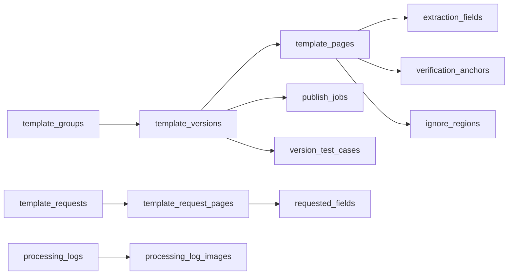

# เอกสารอ้างอิงเชิงลึก COOP_Project4_New

รายละเอียดประกอบ [คู่มือสำหรับนักพัฒนา](DEVELOPER_GUIDE_TH.md) เปิดอ่านเฉพาะหัวข้อที่ต้องแก้ไขหรือวิเคราะห์ปัญหา

Snapshot ฉบับ 2.0 — ตรวจซอร์สใน workspace วันที่ 10 พฤศจิกายน 2569 (2026-11-10)

## Part 00 — ขอบเขตหลักฐานและวิธีอ่านคู่มือ

คู่มือนี้อธิบาย implementation ที่ตรวจพบใน repository โดยแยก **พฤติกรรมจากโค้ด**, **ตัวอย่างสำหรับนักพัฒนา**, และ **สิ่งที่ซอร์สยืนยันไม่ได้** ออกจากกัน ไม่ใช้ README รุ่นเก่าหรือชื่อฟังก์ชันเพียงอย่างเดียวเป็นหลักฐานว่าฟีเจอร์ทำงานจริง

สำหรับหัวข้อที่ลงรายละเอียด ได้เปิดอ่าน body ของฟังก์ชันที่อ้างถึง รวมเงื่อนไข return/exception และผู้เรียกที่เกี่ยวข้อง ไฟล์ใหญ่ เช่น services.py และ page.tsx อ่านแยกตามช่วงของงาน ขอบเขตนี้ไม่ใช่คำกล่าวว่าได้อ่านทุกบรรทัดของทุกไฟล์ใน repository หรือทดสอบทุกเส้นทางแล้ว ภาคผนวกแยกรายการที่ดึงด้วย AST ออกจากคำอธิบายเชิงพฤติกรรม ไม่ถือว่าการ parse ไฟล์เท่ากับทดสอบระบบ

สิ่งที่เอกสารนี้ไม่ใช้เป็นข้อเท็จจริงที่ยืนยันแล้ว:

- เวอร์ชัน Python/Node/PostgreSQL ขั้นต่ำที่ทีมรับรอง: ไม่พบการ pin ครบทั้งสามส่วนในไฟล์ dependency ที่อ้างในคู่มือนี้
- พอร์ตจริง สเปกเครื่อง GPU checkpoint หรือ implementation ของ Gateway/Leaf ภายนอก: ไม่มีซอร์สบริการดังกล่าวให้ตรวจใน checkout นี้
- จำนวนผู้ใช้ที่รองรับ เวลา inference ความแม่นยำ OCR และผล production: ต้องมีผลวัดจากระบบจริง ไม่อนุมานจาก unit tests
- ผลทดสอบที่เคยเขียนในเอกสารประกอบ: เป็นผลรายงานในอดีต ไม่ใช่ผลรันทดสอบของการแก้คู่มือครั้งนี้
- ค่าจริงในไฟล์ .env.local หรือข้อมูลใน DB: ไม่คัดลอก secrets และไม่ได้เชื่อม DB เพื่อยืนยันสถานะข้อมูล

ทุกครั้งที่แก้คู่มือต่อ ให้เปิด implementation ปัจจุบันของฟังก์ชันนั้นจนจบ ตรวจ helper/ผู้เรียกเมื่อมีผลต่อคำอธิบาย และปรับหลักฐานตามซอร์สใหม่ หากพบเพียง schema หรือ stub ให้เขียนว่า schema/stub ไม่ยกระดับเป็นความสามารถที่ทำงานครบแล้ว

### สารบัญตามส่วนงาน

| Part | เนื้อหา |
| --- | --- |
| 01 | แผนที่ระบบและขอบเขตความรับผิดชอบ |
| 02 | ติดตั้ง คำสั่ง และ dependency ที่มีจริง |
| 03 | Environment และลำดับโหลด config |
| 04 | Backend startup, CORS และ Database pool |
| 05 | Login, session และ authentication ที่ใช้งานจริง |
| 06 | Upload, PDF และการยืนยันภาพ |
| 07 | Detection transport และ job polling |
| 08 | การคัด Template และ staged verification |
| 09 | Template, Page, Field และ Version |
| 10 | Prepublish, readiness และ Publish job |
| 11 | ROI coordinate และการเตรียม Workspace |
| 12 | OCR job และ extraction pipeline |
| 13 | Gateway, DET/REC contracts และโมเดล |
| 14 | Table adapter และผลลัพธ์ตาราง |
| 15 | SigLIP V2.4 |
| 16 | Maintenance และ pending operations |
| 17 | Processing Logs, ภาพ และ cleanup |
| 18 | Frontend modules, caches และผลตรวจทาน/export |
| 19 | Timing และ Benchmark |
| 20 | การตรวจสอบ แก้ปัญหา และขอบเขต deploy |
| A–D | Endpoint inventory, schema fields, env references และดัชนีหลักฐาน |

## Part 01 — แผนที่ระบบ

### 1.1 เส้นทางที่พบใน implementation

```text
Browser
  ├─ Next.js App Router / client components
  ├─ local mock login + localStorage/cookie
  ├─ เตรียมภาพ/PDF/crop/ROI
  └─ HTTP ไป ADMIN_API_BASE_URL
       └─ FastAPI main.py + api/routes.py
            ├─ services.py -> PostgreSQL ผ่าน core/db.py
            ├─ detection_service.py -> staged_verification.py
            ├─ main.py -> OCR jobs + process_document_payload
            └─ model_runtime_client.py -> GATEWAY_URL + /paddle/api/v1/...
```

Backend ไม่ได้เปิด Leaf servers จาก main.py โค้ด client ชี้ไป Gateway จึงไม่ควรเติมแผนภาพว่ามี Leaf พอร์ตใดรันอยู่จริงโดยไม่มี config/ซอร์สของการติดตั้งนั้น

### 1.2 จุดเข้าและเจ้าของงาน

| งาน | ไฟล์ / symbol |
| --- | --- |
| ประกอบ Backend app และ startup | main.py: app, startup_warmup, shutdown_db_pool |
| HTTP APIs ด้าน Admin/Detection | api/routes.py: router |
| Request schema | api/schemas.py และ DTO ใน main.py |
| DB connection และ runtime DDL | core/db.py: connect, _POSTGRES_SCHEMA |
| จับคู่ Template | processing/detection_service.py: detect_template_dev |
| ลำดับตรวจ Anchor | processing/staged_verification.py: run |
| การให้คะแนน Anchor | business/services.py: VerificationService |
| เก็บ metadata และสถานะ | business/services.py: GlobalSettingsService/AdminTemplateService |
| สกัด ROI | main.py: process_document_payload |
| ติดต่อโมเดล | core/model_runtime_client.py: _post_predict |
| ตรวจทานและ export ฝั่ง User | project_frontend/src/app/page.tsx และ GroundTruthEditorZone.tsx |

### 1.3 แยกสิ่งที่มีชื่ออยู่กับเส้นทางที่ถูกเรียก

- มี layout_signature_service, alignment_service และ layout_template_matcher อยู่ในโค้ด แต่เส้นทาง detect_template_dev ปัจจุบันคืนจาก _detect_template_anchor_strategy โดยตรง
- _candidate_from_anchor_strategy กำหนด alignment_status=skipped, alignment_evaluated=False, projected_fields=[] และ matching weights เป็นศูนย์ ไม่ได้ทำ alignment/project ROI ในฟังก์ชันนี้
- ชื่อ recognize_table_v2_local ไม่ได้แปลว่าโหลดโมเดลใน Backend; body เรียก _predict_table_model ไป HTTP runtime
- POST /admin/templates/{id}/test เรียก test_template ซึ่งคืน test_mode_stubbed ไม่ได้ทำ detection จริง
- helper verify_template มี weighted summary/required flags แต่ staged matching ตรวจ checked Anchor แต่ละตัวซ้ำอีกชั้น และใช้กฎผู้ชนะของ staged_verification ไม่ใช้ weighted summary ตัดสินแทน

แหล่งโค้ด: [main.py](project_backend/main.py), [routes.py](project_backend/app/api/routes.py), [detection_service.py](project_backend/app/processing/detection_service.py), [services.py](project_backend/app/business/services.py)

## Part 02 — ติดตั้งและคำสั่งที่ใช้

### 2.1 Dependency ที่ระบุจริง

Frontend package.json กำหนด Next.js=16.2.9, React/React DOM=19.2.4, OpenCV.js=4.12.0-release.1 ส่วน TypeScript ใช้ ^5 และ Tailwind ใช้ ^4 จึงต้องแยก declared range ออกจากรุ่น resolved ใน package-lock.json

Backend requirements.txt pin FastAPI=0.110.0, Uvicorn=0.28.0, Pydantic=2.6.4, opencv-python-headless=4.9.0.80, NumPy=1.26.4 ส่วน Pillow, PyMuPDF, requests, python-multipart, pythainlp, beautifulsoup4 และ lxml ไม่ระบุรุ่นตายตัว psycopg2-binary กำหนด >=2.9.9

ไม่พบ Python/Node/PostgreSQL runtime-version pin ในไฟล์เหล่านี้ จึงไม่ระบุว่าเวอร์ชันใดรับรองแล้ว เพียงติดตั้งสำเร็จยังไม่ยืนยัน model contracts หรือความถูกต้องของเอกสาร

### 2.2 ตัวอย่างเตรียม environment

คำสั่งต่อไปนี้เป็นวิธีประกอบ environment สำหรับนักพัฒนา ไม่ใช่ setup script ที่ repository เรียกให้อัตโนมัติ และไม่ต้องรันซ้ำหากมี environment ถูกต้องแล้ว:

```powershell
cd D:\coop\COOP_Project4_New
python -m venv .venv
.\.venv\Scripts\python.exe -m pip install -r project_backend\requirements.txt
```

สร้าง project_backend/.env.local จาก env.local.example เฉพาะเมื่อยังไม่มี กำหนด DB และ Gateway ที่เตรียมไว้จริง ไม่คัดลอกทับไฟล์เดิม ไม่ใส่ API key ใน Frontend

```powershell
cd D:\coop\COOP_Project4_New\project_backend
..\.venv\Scripts\python.exe -m uvicorn main:app --host 127.0.0.1 --port 8000 --reload
```

Frontend อีก terminal:

```powershell
cd D:\coop\COOP_Project4_New\project_frontend
npm ci
npm run dev
```

package.json มี scripts: dev=next dev, build=next build --webpack, start=next start, lint=eslint และ postinstall=node scripts_copy_opencv.cjs ไม่มี npm test script

scripts_copy_opencv.cjs resolve @techstark/opencv-js/dist/opencv.js แล้ว copy ไป public/opencv.js หากติดตั้ง dependency หรือ postinstall ล้มเหลว asset นี้อาจไม่พร้อม

### 2.3 ตรวจบริการแยกเป็นสามระดับ

```powershell
Invoke-RestMethod http://localhost:8000/health
Invoke-RestMethod http://localhost:8000/health/db
Invoke-RestMethod http://localhost:8000/health/models
```

| Endpoint | สิ่งที่ body ทำ |
| --- | --- |
| /health | คืน status=ok ไม่ทำ query |
| /health/db | เปิด connection และ SELECT 1; exception คืน 503 |
| /health/models | อ่าน configured_runtimes และ bool ของ URL; ไม่เรียกโมเดล |

FastAPI ถูกสร้างด้วย title=OCR AI Engine โดยไม่ได้ override docs/openapi URL ใน main.py ให้ตรวจ app ที่รันจริงที่ /docs และ /openapi.json

แหล่งโค้ด: [requirements.txt](project_backend/requirements.txt), [package.json](project_frontend/package.json), [OpenCV postinstall](project_frontend/scripts_copy_opencv.cjs), [health routes](project_backend/app/api/routes.py)

## Part 03 — Configuration

### 3.1 ลำดับโหลด env ที่โค้ดทำจริง

main.py เรียก load_local_env ก่อน import router และ Gateway client ภายใน local_env.py:

1. parents[1] ของไฟล์ app/core/local_env.py คือ project_backend/app
2. ตัวแปรชื่อ repo_root ใน loader จึงชี้ project_backend
3. วนอ่าน project_backend/.env.local แล้ว project_backend/app/.env.local
4. ข้ามบรรทัดว่าง/ขึ้นต้น #/ไม่มีเครื่องหมาย =
5. split เพียงเครื่องหมาย = ตัวแรก strip ช่องว่างและ quote รอบค่า
6. เพิ่มค่าเฉพาะ key ที่ยังไม่มีใน os.environ

ดังนั้น process env มีลำดับสำคัญสูงสุด ไฟล์แรกมีผลก่อน และ root repository/.env.local ไม่ถูก loader นี้อ่าน ไม่ควรเดาตำแหน่งจากชื่อตัวแปร backend_root/repo_root ในไฟล์อย่างเดียว

### 3.2 ตัวแปรหลักและข้อจำกัดการ parse

| ตัวแปร | Default ในโค้ด | พฤติกรรม |
| --- | --- | --- |
| DATABASE_URL | ว่าง | connect ยอมรับ postgres:// หรือ postgresql:// เท่านั้น |
| GATEWAY_URL | http://localhost:8080 | ประกอบ URL ตอน import config; strip / ท้ายเมื่อใช้งาน |
| MODEL_GATEWAY_API_KEY | ว่าง | เติม Authorization เฉพาะเมื่อค่าไม่ว่าง |
| MODEL_RUNTIME_ROLE | ว่าง | ค่า service ทำให้ runtime_url คืน None |
| FRONTEND_URL | ว่าง | เพิ่ม origin ใน CORS หลังตัด / ท้าย |
| NEXT_PUBLIC_API_URL | http://localhost:8000 | ใช้ ?? จึง fallback เมื่อ undefined/null ไม่ใช่สตริงว่าง |
| DB_POOL_MIN_CONNECTIONS | 1 | parse int, ขั้นต่ำ 1, invalid ใช้ default |
| DB_POOL_MAX_CONNECTIONS | 10 | parse int และยกให้ไม่น้อยกว่า min |
| DB_POOL_RECYCLE_SECONDS | 300 | parse float ขั้นต่ำ 0; >0 จึงตรวจ max age |
| DB_POOL_MAX_IDLE_SECONDS | 60 | parse float ขั้นต่ำ 0; >0 จึงตรวจ idle |
| ADMIN_CACHE_TTL_SECONDS | 1800 | max(1,float(...)); invalid อาจทำให้ import error |
| ADMIN_CACHE_MAX_ENTRIES | 512 | max(1,int(...)); invalid อาจทำให้ import error |
| MAINTENANCE_SINGLE_PROCESS_CACHE | false | opt-in cache เฉพาะ process |
| SAVE_DEBUG_ARTIFACTS | false | ตรวจ 1/true/yes/on; การเปิดมีผลกับ debug artifacts |
| SAVE_CROPPED_ROIS | false | ควบคุมการเขียน crop ใน main.py |
| OCR_MEMORY_DIAGNOSTICS | true | ปิด diagnostics ได้ แต่ไม่ปิด serialized worker |
| OCR_JOB_PROCESSING_TIMEOUT_SECONDS | 900 | int และ max 60; invalid ไม่ได้ fallback ในบรรทัดกำหนดค่า |
| TEMPLATE_ASPECT_RATIO_TOLERANCE | 0.08 | ยอมรับ finite [0,1] ไม่เช่นนั้นใช้ 0.08 |
| TEXT_RECOGNITION_SCORE_THRESHOLD | 0.0 | text-line recognition threshold; parse float ตอน import |
| IMAGE_CLASSIFICATION_BATCH_LIMIT | 64 | max(1,int(...)) ใน image batch |
| BACKEND_OCR_INCLUDE_RAW_OUTPUT | false | เพิ่ม raw_output ใน REC adapter เมื่อเปิด |
| AUTH_SECRET | ocr-studio-dev-secret | ใช้เฉพาะ token helper ไม่ทำให้ route enforce auth เอง |

TABLE_PROCESSING_EXPAND_TOP/BOTTOM/LEFT/RIGHT_PX ใน ocr_adapter.py default ด้านละ 8 มีผลใน crop_table_processing_roi_from_image ไม่ได้หมายความว่าทุก Table route เรียก helper นี้

SigLIP optional gates คือ SIGLIP_V24_CONFIDENCE_MIN_RELATIVE_SCORE และ SIGLIP_V24_MARGIN_MIN_RELATIVE_SCORE ว่าง=ปิด, finite [0,1]=เปิด ดู Part 15 และภาคผนวก C สำหรับรายการ env call ใน Backend ที่ดึงจากซอร์ส

### 3.3 URL สองเส้นทางใน Frontend

adminApi.ts ใช้ NEXT_PUBLIC_API_URL แต่ next.config.ts ยังมี rewrite /backend/:path* ไป destination ที่เขียนตายตัว การแก้ env ไม่ได้แก้ destination นี้ ตรวจการใช้งานจริงของ path ก่อน deploy ไม่ถือว่า rewrite เป็น proxy ที่ dynamic ตาม env

แหล่งโค้ด: [local_env.py](project_backend/app/core/local_env.py), [config.py](project_backend/app/core/config.py), [db.py](project_backend/app/core/db.py), [admin cache](project_backend/app/core/admin_cache.py), [next.config.ts](project_frontend/next.config.ts)

## Part 04 — Backend Startup และ PostgreSQL

### 4.1 สิ่งที่ประกอบตอน import main.py

- สร้าง FastAPI และ GlobalSettingsService
- ตั้ง CORS ให้ http://localhost:3000 และ FRONTEND_URL หากมี allow_credentials=True, methods/headers เป็น * และ expose Server-Timing
- เพิ่ม SearchBenchmarkMiddleware
- mount /debug/detection-queries ไป project_backend/storage/detection_queries ด้วย StaticFiles(check_dir=False)
- include router จาก app/api/routes.py โดยไม่เติม prefix กลาง

การ mount debug ในที่นี้ไม่ผูก authentication dependency ไม่ควรเรียกว่า authenticated image route

### 4.2 ลำดับ startup_warmup

1. memory checkpoint startup_before_warmup
2. ensure_database_ready: สร้าง schema ตามความจำเป็นและ seed users ที่ยังไม่มี email
3. เปิด connection, ensure_image_verification_categories_table และ backfill_page_geometry
4. processing_maintenance ภายใน try/except; หากล้ม log แล้วให้ retry ตอนอ่านครั้งถัดไป
5. load_verification_strategy_cache ภายใน try/except
6. published_template_cache.load_all ภายใน try/except; ล้มแล้ว detect ใช้ DB fallback
7. checkpoint startup_after_warmup และพิมพ์ runtime URLs

ขั้น 2–3 ไม่ได้ถูกครอบด้วย try แบบขั้น 4–6 จึงห้ามอธิบายว่า startup ปล่อยผ่านความผิดพลาดทุกชนิด Backend ไม่ warm up โมเดลในฟังก์ชันนี้ Shutdown รอ memory worker จบก่อนปิด PostgreSQL pool

### 4.3 Connection wrapper และ transaction

connect ตรวจ scheme และเรียก _connect_postgres ไม่มี SQLite fallback ใช้ psycopg2.pool.ThreadedConnectionPool กับ RealDictCursor

PostgresConnection.__exit__ commit เมื่อ body สำเร็จ rollback เมื่อมี exception แล้วคืน connection เข้า pool close จะ rollback connection ปกติก่อนคืนด้วย หาก connection เสียหรือ rollback ล้มจะทิ้ง connection

execute แปลง ? เป็น %s, DATETIME เป็น TIMESTAMPTZ และ rowid บางรูปแบบ ส่วน PRAGMA foreign_keys เป็น no-op และ PRAGMA table_info query information_schema ไม่ใช่หลักฐานว่า runtime ใช้ SQLite

Pool ตรวจ closed/max_age/max_idle ระหว่างขอยืม connection และ recycle ได้สูงสุดสามรอบ ไม่ใช่ background timer ที่ kill connection ทุก 300 วินาที และไม่พบ retry/backoff สำหรับ query ทุกชนิดใน wrapper นี้

### 4.4 Schema bootstrap มีทั้ง DDL และ data update

_POSTGRES_SCHEMA มี CREATE TABLE, ALTER, UPDATE, INDEX และ VIEW ดังนั้น startup ไม่ได้มีแต่ CREATE IF NOT EXISTS ตัวอย่างที่มีผลกับข้อมูลเดิม:

- เพิ่ม geometry columns ให้ template_pages
- เพิ่ม source/metadata บางคอลัมน์ของ template_request_pages
- ตั้ง similarity_threshold default=0.50 และ UPDATE ค่าเก่า 0.75/0.72 เป็น 0.50
- เพิ่ม roi_points_json และ DROP unique-name constraints รุ่นเก่าของ Field/Anchor

_POSTGRES_READY เป็น process flag ตั้งหลัง execute statements และ commit ไม่ใช่ migration history table ห้ามใช้ schema.prisma เก่ามา reset/push ทับ runtime schema

### 4.5 Seed users

_seed_default_users ตรวจ email ก่อน insert ไม่เปลี่ยนรหัสของ email ที่มีอยู่แล้ว seed ตัวอย่างคือ user@ocr.com/user123 และ admin@ocr.com/admin123 การเปลี่ยนข้อมูลใน DB จึงไม่เหมือนการเปลี่ยน mockAccounts ที่ Browser ใช้ ดู Part 05

แหล่งโค้ด: [main.py](project_backend/main.py), [db.py](project_backend/app/core/db.py), [runtime schema](project_backend/docs/database_schema_v2.md)

### 4.6 ตารางและความสัมพันธ์จาก runtime DDL

| ตาราง | หน้าที่และ key/ความสัมพันธ์ที่ประกาศ |
| --- | --- |
| users | email unique, password_hash, role |
| app_settings | key เป็น primary key; value เป็น TEXT แม้หลายค่าจะ encode JSON |
| image_verification_categories | value unique; prompt/threshold/enabled |
| template_groups | template_code unique; created_by ลบ User แล้ว SET NULL |
| template_versions | Group -> Version แบบ CASCADE; unique (group, version_number); created_from_version_id เป็น self reference แบบ SET NULL |
| template_pages | Version -> Page แบบ CASCADE; unique (version, page_number) |
| extraction_fields | Page -> extraction ROI แบบ CASCADE; data_type CHECK text/table/image |
| verification_anchors | Page -> Anchor แบบ CASCADE; image_category_id ลบ category แล้ว SET NULL |
| ignore_regions | Page -> ignore ROI แบบ CASCADE |
| template_requests | requested_by และ converted group/version เป็น SET NULL เมื่อแถวอ้างอิงถูกลบ |
| template_request_pages | Request -> Page แบบ CASCADE; unique (request, page_number) |
| requested_fields | Request Page -> requested ROI แบบ CASCADE |
| version_test_cases | Version -> test image แบบ CASCADE; มี expected_match/test_type |
| publish_jobs | Version -> job แบบ CASCADE; status/step/error/metadata/timestamps |
| ocr_jobs | request_json/result_json; User/Version references แบบ SET NULL |
| processing_logs | processing_run_id unique; snapshots หลายชนิดเป็น JSONB |
| processing_log_images | primary key (log_id,page_number,kind); Log -> image แบบ CASCADE; kind CHECK source/processing |
| notifications | audience/event/title/message/related entity/metadata; related_entity_id ไม่ได้ประกาศเป็น FK ใน DDL นี้ |



ลูกศรแสดง parent -> child ของความสัมพันธ์หลัก ไม่ใช่ลำดับ HTTP workflow DDL ยังสร้าง 17 indexes และ 3 views: template_versions_view, template_fields_view, verification_anchors_view การที่ตารางหรือ view มีอยู่ไม่ได้แปลว่าทุกเส้นทาง UI เรียกใช้งานมัน

### 4.7 ค่า default ของ schema กับ service อาจต่างกัน

ตัวอย่างสำคัญคือ image_verification_categories: CREATE TABLE ใน db.py กำหนด match_threshold=0.70 แต่ registry seed service ใช้ค่าของตนในการ INSERT รายการใหม่ จึงต้องดู INSERT จริงเมื่ออธิบายค่าที่ผู้ใช้จะพบ เช่นเดียวกับ publish_jobs.step ที่ DDL default=validation แต่ create_publish_job ปัจจุบันระบุ anchor_readiness เอง ค่า default ของคอลัมน์ไม่มีผลแทนค่าที่ SQL ส่งชัดเจน

ข้อจำกัด ROI ใน DDL ตรวจแต่ละค่า ไม่ตรวจผลรวม x+width/y+height; readiness เป็นอีกชั้นตาม Part 10 ส่วนสถานะของ Version/Job เป็น TEXT ใน DDL นี้ ไม่ใช่ PostgreSQL enum ที่รับรอง transition ทุกคู่

## Part 05 — Login และ Authentication ที่ใช้งานจริง

### 5.1 หน้า Login ไม่เรียก Backend login

LoginForm.handleLogin ป้องกัน form submit ตั้ง loading แล้วรอ setTimeout 250 ms ค้น mockAccounts โดย email แบบ trim/lowercase และ password ตรงตัว เมื่อพบจะเขียน session แล้ว router.replace ไป safeNext หรือ /admin หรือ /

safeNext ต้องขึ้นต้น / ไม่ขึ้นต้น // และ User ไม่ไป /admin การเปลี่ยนรหัสในตาราง users ไม่เปลี่ยนเงื่อนไข LoginForm นี้ เพราะไม่มี HTTP request ไป /auth/login ใน handler

### 5.2 Browser session และ route redirect

| ส่วน | สิ่งที่ทำ |
| --- | --- |
| writeAuthSession | localStorage key ocr-studio:auth-session; cookie ocr_role อายุ 604800 วินาที, path=/, SameSite=Lax |
| readAuthSession | parse JSON ตรวจ role=user/admin และมี email; ไม่ verify token |
| clearAuthSession | ลบ localStorage และ expire cookie |
| AuthGate | ตรวจ local session ใน useEffect แล้ว redirect ตาม requiredRole |
| proxy.ts | ใช้ cookie ocr_role redirect; ข้าม /login, /_next, /api และ pathname ที่มีจุด |
| authHeaders | คืน headers ที่ส่งเข้ามา ไม่เติม Authorization |
| adminApi.fetchWithAuth | สร้าง Headers แล้ว fetch ไม่เติม token |

cookie ที่ client เขียนเองและ localStorage จึงเป็น UI state ตาม implementation ไม่ใช่การยืนยัน role จาก Backend

### 5.3 Backend auth API เป็นอีกเส้นทาง

POST /auth/register ใช้ AuthRegisterRequest(email,password,role) password min_length=6 แต่ email เป็น str ไม่ใช่ EmailStr create_user เปลี่ยน email เป็น lowercase, คืน 409 เมื่อซ้ำ, ใช้ role=admin เฉพาะค่าตรง admin นอกนั้น user

POST /auth/login เรียก authenticate_user เทียบ PBKDF2 hash ผิดคืน 401 ทั้งสอง route พยายามคืน access_token ผ่าน create_access_token แต่ auth_service.py อ้าง hashlib/base64 โดยไม่ได้ import ทั้งสองในไฟล์ ข้อสังเกตนี้ยืนยันจาก namespace ในซอร์ส ไม่ใช่ผลทดสอบ HTTP จริงครั้งนี้

รูปแบบ token helper คือ Base64 ของ user_id:expires_at:HMAC-SHA256 อายุ 7 วัน ไม่ใช่ JWT ตาม implementation ที่เห็น decode จับ error การ parse เป็น 401 และตรวจ signature/expiry แต่โค้ดยังมี import issue ดังกล่าว

current_user รองรับ Bearer หรือ x_user_id เมื่อไม่มี/ไม่พบ user คืน mock ส่วน current_admin คืน user โดยไม่ตรวจ role และ router ไม่กำหนด Depends(current_admin) ระดับรวม อย่าถือว่า path ที่ขึ้น /admin ป้องกันสิทธิ์แล้ว

GET /auth/me คืน ok/data ที่มี user=null, auth_mode=mock ตรงจาก route

### 5.4 Password helper

hash_password ใช้ uuid4().hex เป็น salt แล้ว hashlib.pbkdf2_hmac sha256 จำนวน 120000 iterations เก็บเป็น pbkdf2_sha256$salt$encoded_digest verify_password ตรวจ algorithm และใช้ hmac.compare_digest ไม่เก็บ plain password ใน users.password_hash

แหล่งโค้ด: [LoginForm](project_frontend/src/app/login/page.tsx), [session](project_frontend/src/auth/session.ts), [AuthGate](project_frontend/src/auth/AuthGate.tsx), [proxy](project_frontend/src/proxy.ts), [auth service](project_backend/app/auth/auth_service.py), [password](project_backend/app/auth/auth_password.py)

## Part 06 — Upload, PDF และภาพที่ยืนยันแล้ว

### 6.1 UploadZone

handleFileChange รับครั้งละหนึ่งไฟล์ หากมากกว่าหนึ่งแจ้งเตือนและล้าง input ตรวจ PDF จาก MIME หรือชื่อท้าย .pdf สำหรับ PDF เรียก convertPdfToImages ส่วนภาพอ่าน FileReader.readAsDataURL แล้วส่ง preparedImages พร้อมชื่อ ชนิด และ File ผ่าน callback

UploadZone ไม่ได้ส่งไฟล์เข้า Backend ใน handler นี้ Input accept=image/*,application/pdf เป็นข้อกำหนด UI ไม่ใช่ server file validation และไม่พบขนาดไฟล์สูงสุดใน handler นี้

### 6.2 PDF ถูก rasterize ใน Browser

pdfImages.ts โหลด PDF.js 3.11.174 จาก cdnjs และ worker จาก CDN เดียวกัน หาก window.pdfjsLib มีแล้วใช้ตัวเดิม convertPdfToImages อ่าน ArrayBuffer, getDocument, วนหน้า 1..numPages, viewport scale=2.0, await render.promise แล้ว canvas.toDataURL image/jpeg quality=0.95

ถ้า getContext(2d) ไม่ได้จะ continue หน้านั้น ไม่มี error ใหม่จากบรรทัดนี้ เอกสารจึงไม่รับรองว่าทุกหน้าแปลงสำเร็จใน Browser ทุกสภาพแวดล้อม การทำงาน PDF ครั้งแรกพึ่งการโหลด CDN ตามซอร์ส ไม่ใช่ npm pdfjs dependency ใน package.json

### 6.3 State หลัง upload

HomeWorkspace.handleUploadSuccess ยกเลิก detection เดิม ล้าง processing run/results/Template state เก็บ imagesList และ originalImagesList ตั้ง currentIndex=0 สร้าง PageConfig ต่อหน้า แล้ว currentStep=adjust

PageConfig เริ่ม rotation=0, brightness/contrast=100, sharpness/perspective=0, flip=false และ cropBox/cropCorners/croppedLocalUrl เป็น null

### 6.4 AdjustZone.handleConfirmAll

handler ไม่ทำงานถ้า isProcessing, autoDetecting หรือ hasPendingCrop

เมื่อมี sourceFileType ซึ่งเป็น User upload flow จะเลือก croppedLocalUrl หาก isCropped หรือภาพ original แต่ละหน้า ถ้าไม่มี transform/cropBox คืน src เดิม ไม่ encode ซ้ำ หากมีการเปลี่ยนโหลด Image แล้ว processSingleImageCanvas ก่อน onBatchConfirm(results,startedAt)

processSingleImageCanvas แปลง crop coordinates จาก rendered box โดยคำนึงถึง object-fit offsets ตัดภาพ สร้าง affine transform จาก rotation/flip/perspective คำนวณขอบภาพใหม่ เติมพื้นขาว ตั้ง brightness/contrast filter แล้วคืน JPEG 0.95 ค่าชื่อ sharpness ในฟังก์ชันนี้ถูกรวมกับ contrast ใน ctx.filter ไม่ได้มี sharpening convolution แยกใน body นี้

กรณีไม่มี sourceFileType มี branch สำหรับการใช้งาน editor เดิม: render หน้าปัจจุบันแล้ว reuse croppedLocalUrl/ต้นฉบับของหน้าอื่น ห้ามอธิบายสอง branch ว่าประมวลผลทุกหน้าแบบเดียวกัน

ถ้าเตรียมภาพล้ม แสดง cropError และไม่เรียก callback ด้วยภาพที่เดาขึ้นมา ส่วน auto card crop ใช้ getCardCropWorker สร้าง shared Worker('/card-crop-worker.js') ส่ง preload และ dispose เมื่อ error/unmount ต้องอ่าน worker/geometry เพิ่มก่อนเปลี่ยนอัลกอริทึมตรวจขอบ ไม่อนุมานสูตรจากชื่อ worker

แหล่งโค้ด: [UploadZone](project_frontend/src/user/components/UploadZone.tsx), [pdfImages](project_frontend/src/shared/pdfImages.ts), [AdjustZone](project_frontend/src/user/components/AdjustZone.tsx), [worker owner](project_frontend/src/user/cardCropWorker.ts), [User orchestration](project_frontend/src/app/page.tsx)

## Part 07 — Detection Transport และ Job

### 7.1 ก่อนส่ง request

handleBatchConfirm สร้าง AbortController และ run token ใช้ cache ภาพต่อ detection run ล้าง ROI/results/matchedTemplate เปลี่ยน currentStep=studio และเปิด loading จากนั้นแปลง finalProcessedImages แต่ละหน้าเป็น File แล้วเรียก detectTemplateDev(...,{confirmedImages:true,signal,timing}) ไม่ใช้ original PDF เป็น detection input ในเส้นทางนี้

adminApi.detectTemplateDev ใส่ไฟล์ทุกหน้าลง FormData ด้วย key file ตามลำดับ ตั้ง confirmedImages=1 และ candidateFormat=pool-v1 เมื่อไม่ใช่ Admin มี benchmark_trace_id เฉพาะเมื่อได้รับ trace token

### 7.2 POST /api/templates/detect-dev

ลำดับใน route:

1. ตรวจ Maintenance ก่อนอ่าน body ผ่าน asyncio.to_thread
2. อ่าน context=admin จาก query; User ต้องมี confirmedImages=1
3. _read_dev_detection_image อ่าน body และตรวจ Content-Type
4. confirmedImages ต้องเป็น multipart ที่คืน list; ปฏิเสธ PDF ใน list
5. trace ID ถ้ามีต้องเป็น lowercase hex 32 ตัว
6. สร้าง detectdev_<uuid hex> และใส่ dictionary detect_dev_jobs พร้อม Lock
7. BackgroundTasks เรียก _run_detect_dev_job
8. ตอบ HTTP 202 ด้วย status=success และ data.job_id/status=processing รวม confirmed_images=true เมื่อใช้ภาพยืนยัน

Multipart parser ปัจจุบัน parse boundary/body เอง เลือก parts ที่มี Content-Disposition และ filename ไม่ได้ผูกชื่อ field ตายตัวกับ key file หากไม่ใช่ confirmed mode: หนึ่งไฟล์คืน bytes, หลายภาพแปลงเป็น PDF แต่ไม่รับ PDF ผสมหลายไฟล์

### 7.3 ภาพยืนยันกับ normalization

_prepare_query_pages เมื่อ input เป็น list จะ _save_query_image(confirmed=True): EXIF transpose, composite transparency บนพื้นขาว, convert RGB แล้วบันทึก page_N.png ภายใน query directory

detect_template_dev ส่ง skip_normalization เมื่อ confirmedImages หรือ admin_context เป็นจริง _normalize_query_pages จึงใช้ original/normalized/matching path เดียวกันใน branch นี้ ไม่ตรวจขอบและ warp ซ้ำจาก Backend

ฟังก์ชันยังรองรับ bytes/PDF สำหรับ callers อื่น PDF bytes ใช้ PyMuPDF scale=2.0 เส้นทาง normalize ที่ไม่ได้ skip มี logic image normalization/PDF physical crop แต่ไม่ควรนำมาอธิบายว่า User confirmed flow ผ่านทุกขั้นตอนเหล่านั้น

### 7.4 Polling และ lifecycle

GET /api/templates/detect-dev/jobs/{job_id}:

| เงื่อนไข | HTTP / data |
| --- | --- |
| ไม่พบ ID | 404 detail=Detection job not found |
| กำลังทำ | 200 status=processing |
| จบสำเร็จ | 200 status=completed, result |
| Worker exception | 200 status=failed, error เป็น string |

Worker จับ exception เป็น job error และ clear_layout_analysis_cache ใน finally งานไม่สำเร็จไม่ได้เปลี่ยน poll HTTP เป็น 500 เอง

Frontend รอ abortableDelay 1000 ms ก่อนแต่ละ poll ใช้ cache=no-store ตรวจ completed/failed และ signal ไม่มีจำนวนครั้งหรือ timeout สูงสุดใน while(true) ของ detectTemplateDev นี้ การยกเลิก Browser request ไม่ได้มี endpoint ยกเลิก BackgroundTask บน server

Job state อยู่ RAM ไม่ใช่ตาราง publish_jobs/ocr_jobs ไม่พบ persistence/TTL cleanup ใน route dictionaries นี้ Restart ทำให้ poll ID เก่าหาย และ multi-worker อาจ poll ไป process ที่ไม่มี ID

ส่วน query artifacts มี lifecycle ต่างจาก job dictionary: detect_template_dev ลบ query directory ใน finally เมื่อ cleanup_generated=true และไม่ได้เปิด SAVE_DEBUG_ARTIFACTS ตาม Part 17 ผลใน job อาจยังมีอยู่แม้ไฟล์ชั่วคราวถูกลบแล้ว

### 7.5 Candidate pool และ User response

_finish_detection_result เรียก user_detection_response ตาม work scope ตัวแปลงตัด diagnostics/path/image payload ที่ไม่จำเป็น แล้วคง debug สรุปบางค่าไว้ compact_user_candidates เก็บ candidate variants ใน candidate_pool และแทนจุดอ้างด้วย candidate_ref โดยไม่ merge หน้าและ aggregate ที่มีเนื้อหาต่างกัน Frontend ต้อง resolve references ก่อน map candidate

ข้อต่าง envelope: Detection ใช้ status=success/data ไม่ใช่ ApiResponse.ok และ OCR jobs ใช้ success=true อีกแบบ ห้ามอ่านทุก endpoint ด้วย parser envelope เดียวโดยไม่ตรวจ route

แหล่งโค้ด: [routes.py](project_backend/app/api/routes.py), [detection_service.py](project_backend/app/processing/detection_service.py), [response trimming](project_backend/app/api/detection_response.py), [API client](project_frontend/src/admin/adminApi.ts), [candidate resolver](project_frontend/src/shared/detectionCandidateResolver.ts)

## Part 08 — กฎจับคู่ Template ที่เรียกจริง

### 8.1 โหลด pool

_load_anchor_strategy_templates ขอ active/published Template จาก published cache ก่อน ถ้า cache ไม่พร้อม/degraded หรือ force_refresh จึง query DB พร้อม metadata/จำนวนหน้า/Field/Anchor/geometry อ่าน Anchor เรียงหน้า, sort_order, created_at

ใน prepublish ที่ส่ง selected_template_id จะรวม selected Template กับ active pool จาก DB โดยบังคับ force_refresh และกรอง active เท่านั้น ไม่รวม draft อื่นและไม่เอา selected ซ้ำ

Both strategies รับ Anchor types={text,image} จาก verification_anchor_types ไม่ได้มีโหมด text_only/layout_only ใช้งานจริงในตัวเลือก strategy ปัจจุบัน

### 8.2 Gate ก่อนเรียกโมเดล

| Gate | เงื่อนไข |
| --- | --- |
| all_pages | จำนวนหน้า Template ต้องเท่าจำนวน query pages เมื่อมี page_count |
| main_page | main_page_number ต้องมีใน query; ไม่บังคับจำนวนหน้ารวมเท่ากัน |
| Aspect/orientation | เปรียบเทียบเฉพาะหน้าที่มีทั้ง query/reference ratio |

สูตร aspect ใน document_aspect.check_template คือ max(query,reference)/min(query,reference)-1 และ orientation ต้องมี (query-1)*(reference-1)>=0 เทียบ difference<=tolerance+1e-9 ภาพจัตุรัสจึงไม่ถูกปฏิเสธ orientation ด้วยสูตรนี้เพียงอย่างเดียว

ถ้าไม่มี ratio ให้เปรียบเทียบ จะได้ comparisons=[] และ passed=True ด้วย all([]), status=unknown_dimensions ไม่ได้แปลว่าระบบวัด dimension แล้วผ่าน

persist_page_geometry อ่าน image header จาก data URL/local file ไม่ download http/https เก็บ checked=True แม้อ่านไม่ได้ Startup backfill ครั้งละ 100 สำหรับ checked=False; ภาพที่ unknown จะลองใหม่เมื่อมีการเปลี่ยนภาพ

### 8.3 Scheduling

_ordered_anchor_templates เรียงจำนวน Anchor มากก่อน ตามด้วย template_id แต่ไม่ได้หยุดค้นหาทั้ง pool เมื่อ Template แรกผ่าน

staged_verification.run เก็บ state ต่อ Template และแต่ละ stage หยิบ Anchor ถัดไปของแต่ละ Template ที่ยังรอด Composite batch key เป็น JSON array ของ template ID, anchor ID, page และ index เพื่อกัน ID ชนกัน

- หน้าที่ขาด: reject ใน local ไม่ส่งโมเดล
- judge error/missing result: passed=False
- Anchor ไม่ผ่าน: Template นั้นหยุด stage ต่อไป
- ตรวจครบและผ่าน: complete และหยุดส่ง Anchor ของตัวนั้น
- ไม่มี Anchor: state=no_verification_fields และ passed=False ใน staged layer

standard ใช้ ThreadPoolExecutor(max_workers=2) รัน Text/Image batches คู่กันต่อ stage strict ทำ Text batch แล้ว Image batchของ stage ก่อนเข้าสู่การ judge ไม่ได้หมายความว่า Text ของ Template ทุกตัวจะต้องผ่านก่อนเริ่ม Image ในทุกกรณี

### 8.4 Text Anchor exact rule

VerificationService._score_match:

1. NFKC
2. ลบ U+200B, U+200C, U+200D, U+FEFF
3. lowercase และลบ whitespace ด้วย split/join
4. ต้องมี normalized expected และ actual ทั้งคู่
5. Levenshtein insert/delete/substitute cost=1
6. ผ่านเมื่อ distance <= len(normalized_expected)//4

length ใช้ Python len ของ Unicode string ไม่ใช่จำนวนคำหรือ grapheme ภาษาไทย OCR confidence เป็น diagnostic ไม่เข้ากฎ accept นี้ ไม่มี regex interpretation หรือ text threshold ที่ตั้งได้ใน _score_match

ตัวอย่างคำนวณเพื่ออธิบายสูตร ไม่ใช่ผล OCR จริง: expected ยาว 3 code points ยอม error 0; ยาว 4 ยอม 1; ยาว 8 ยอม 2

### 8.5 Winner และ compatibility fields

_candidate_from_anchor_strategy บังคับ fields ไม่ว่าง, checked เท่าจำนวน fields, ทุกตัว passed และไม่มี error จากนั้น candidate_order เรียง complete pass ก่อน, Anchor count มากก่อน, template_id น้อยก่อน เลือก best_candidate จากตัวที่ final_passed เท่านั้น

score/final_score/verification_score เป็น 1.0 หรือ 0.0 ของ complete pass, layout_score/retrieval_score=0, final_confidence_threshold=None, matching weights=0 และ alignment skipped จึงห้ามอธิบาย score=1 ว่า OCR แม่นยำ 100% หรือ similarity 100%

ข้อแตกต่างสำคัญ: verify_template ที่เรียกเดี่ยวคำนวณ required_passed/weighted summary และกรณีไม่มี fields คืน passed=True แต่ staged layer มีเงื่อนไขเข้มกว่า การเห็น passed ในหน้า test-verification จึงไม่เท่ากับผล final matching โดยอัตโนมัติ

แหล่งโค้ด: [matching orchestration](project_backend/app/processing/detection_service.py), [scheduler](project_backend/app/processing/staged_verification.py), [geometry gate](project_backend/app/processing/document_aspect.py), [VerificationService](project_backend/app/business/services.py)

## Part 09 — Template Data และ CRUD

### 9.1 ความหมายของ template_id

ใน API ปัจจุบัน template_id ส่วนใหญ่คือ template_versions.id ไม่ใช่ template_groups.id Group เก็บชื่อกลุ่ม/document_type/category/description ส่วน Version เก็บ version_name/version_number/status/detection_mode และหน้าของตัวเอง

create_template สร้าง Group ใหม่และ Version 1 สถานะ draft เท่านั้น ไม่สร้างหน้าให้ตาม payload.page_count โดยอัตโนมัติ Group.name ใช้ document_type ถ้ามี ไม่เช่นนั้นใช้ name ส่วน Version.version_name ใช้ payload.name

get_template query จำนวนหน้าจาก template_pages จริง ไม่ใช้ page_count ใน request มาอธิบายว่ามีภาพแล้ว เมื่อไม่พบ ID จะคืน object status=not_found พร้อม arrays ว่าง ไม่ได้ raise 404 ใน method นี้ทุกกรณี ผู้เรียกบางตัวแปลงเป็น 404 อีกชั้น

### 9.2 Page

create_template_page ตรวจ Version มีอยู่ INSERT ภาพ/signature metadata แล้ว persist_page_geometry จากนั้น refresh cache update_template_page update ตาม allowlist และวัด geometry ใหม่เฉพาะเมื่อเปลี่ยน sample/normalized URL หาก active+enforcement จะบันทึก pending update_page

ข้อจำกัดที่เห็น: create_template_page และ delete_template_page ไม่มี defer branch แบบ update_template_page ใน body ของตัวเอง อย่าเขียนว่าทุก Page operation ถูกพักไว้เสมอ

TemplatePageCreate รับ page_number>=1, page_name, sample_image_url, normalized_image_url และ layout_signature_json schema ที่รับ signature ไม่ได้แปลว่า publish จะ generate signature ให้

### 9.3 Field API ใช้ endpoint เดียวแต่เก็บสองตาราง

| use_for_verification | ตาราง | ข้อมูลหลัก |
| --- | --- | --- |
| false | extraction_fields | field_name, display_label, data_type, extraction_method, ROI, roi_mode, expected_content |
| true | verification_anchors | anchor_name, anchor_type, ROI, expected_text, required, weight, image_category_id |

create_template_field ตรวจ page_id อยู่ใต้ Version ที่ขอ แล้วแยก INSERT ข้างต้น get_template รวมสองตารางเป็น fields array โดยเติม user_selectable/default_selected/use_for_verification แบบคงที่จาก SQL ไม่ใช่ทุก flag ใน payload ถูกเก็บตรงลงคอลัมน์

สำหรับ extraction query คืน user_selectable=1/default_selected=1; verification คืนทั้งคู่=0 และ use_for_verification=1 ส่วน anchor_text/roi_padding ถูกคืน NULL จาก SQL ในเส้นทางนี้ จึงไม่ควรอ้างว่าแก้ roi_padding ใน DTO แล้วจะ persist ลงตาราง Anchor เสมอ

update_template_field โหลด current รวม patch และ validate ผ่าน TemplateFieldCreate อีกครั้ง หากอยู่ตารางเดิม UPDATE ID เดิม แต่เมื่อสลับ use_for_verification จะ delete แล้ว create ทำให้ได้ ID ใหม่ในเส้นทาง immediate ปัจจุบัน ต่างจาก pending update_field ที่ใช้ field_id เดิมตอน apply

Field name/Anchor name ไม่ใช่ unique identity ใน DDL ปัจจุบัน ใช้ ID ระบุรายการ อย่าใช้ชื่ออย่างเดียวเป็น key สำหรับ delete/update

### 9.4 Validation หลายชั้นไม่เท่ากัน

RoiRatio ตรวจ x/y อยู่ [0,1] และ width/height อยู่ (0,1] แยกรายค่า แต่ไม่ได้ตรวจ x+width<=1 หรือ y+height<=1 ใน class นี้ readiness ตรวจขอบรวมเพิ่มภายหลัง

_normalize_data_type รองรับ number/date/address/currency ใน helper แต่ extraction_fields CHECK ใน DDL อนุญาต text/table/image เท่านั้น verification_anchors อนุญาต text/image เท่านั้น ดังนั้นการที่ DTO เป็น str หรือ TypeScript union มี number ไม่ได้รับรองว่า DB insert ทุกชนิดผ่าน

### 9.5 Template Requests

TemplateRequestService.create สร้าง draft และ pages จาก payload.pages หรือ fallback sample_file_url หนึ่งหน้า ถ้า requested field อ้างหน้าใหม่จะสร้าง request page ที่ภาพ null ก่อนบันทึก ROI

- submit เปลี่ยน status=submitted
- start_review เปลี่ยนเป็น in_review
- reject เปลี่ยนเป็น rejected พร้อม admin_note และ Notification
- DELETE /template-requests/{id} ปัจจุบันเรียก service.delete ที่ **เปลี่ยนเป็น rejected** ไม่ใช่ลบ row ออกจาก DB
- delete_image ลบ requested_fields ของภาพนั้น ลบภาพ record แล้วเรียง page_number ใหม่
- ตั้ง is_canonical=true จะ clear canonical ของภาพอื่นใน request เดียวกัน

List/get ของ requests มี backend cache; บาง status helper ไม่ invalidate cache แบบเดียวกับ mutation อื่น จึงต้องตรวจการ refresh เมื่อแก้ flow ไม่สมมติว่า DB update แปลว่า list cache ใหม่ทันที

### 9.6 แปลง Request เป็น Template/Version

convert_request_to_template เลือก request pages ที่ review_status=approved หรือ pending และมี sample_image_url ไม่ใช่เฉพาะ approved สร้าง Group+Version draft ใหม่ copy pages/ROI ไป extraction_fields โดยกำหนด fixed_roi/fix เรียงหน้าใหม่และ mark request=converted ไม่มีการสร้าง verification_anchors จาก requested_fields ใน method นี้

create_version_from_request ใช้ Group ของ base version, next_version=MAX+1 และเลือก request pages ตามเงื่อนไขเดียวกัน copy requested fields ก่อน หากไม่ได้ copy Field เลยและ reuse_roi=true จึง copy extraction_fields จาก base ตามเลขหน้า ไม่ได้ copy verification_anchors ของ base ใน body นี้

suggest_base_version_for_request คืน suggested_base_version=None และ reuse_roi=False ไม่ได้ทำ similarity search จริงใน method นี้

แหล่งโค้ด: [AdminTemplateService / TemplateRequestService](project_backend/app/business/services.py), [DTO](project_backend/app/api/schemas.py), [runtime DDL](project_backend/app/core/db.py)

## Part 10 — Prepublish และ Publish

### 10.1 สามการตรวจที่ต้องแยก

| การเรียก | พฤติกรรม |
| --- | --- |
| prepublish-simulation | อ่าน stored configuration/images ตรวจ readiness ไม่มี model inference |
| prepublish-detection-test | ใช้เอกสารทดสอบกับ selected draft+active pool มี inference ตาม Anchor |
| confirm-publish | ตรวจ readiness, ตั้ง validated, สร้างและรัน Publish job ทันที |

### 10.2 Readiness ตรวจอะไร

_template_anchor_readiness อ่าน Version, ทุก Page และ Anchors:

- ทุก stored page ต้องโหลดภาพได้จาก normalized URL หรือ sample URL
- ต้องมีหน้าอย่างน้อยหนึ่ง; main_page ต้องมีเลข main page จริง
- ตรวจ Anchor เฉพาะ main page เมื่อ detection_mode=main_page
- ชนิดเป็น text/image
- ROI ต้อง finite, 0<=x/y<1, width/height>0, x+width/y+height<=1.000001
- Text expected_text ต้องไม่ว่างหลัง strip
- Image ต้องมี category ที่ enabled
- ต้องมี Anchor ใน scope อย่างน้อยหนึ่ง

ผลประกอบด้วย passed, page_count, readiness_pages, anchor_readiness_results, text_anchor_count, image_anchor_count และ issues _require_template_anchor_readiness raise HTTP 409 พร้อมรายละเอียดเมื่อไม่พร้อม

### 10.3 Prepublish document test

route รับไฟล์ สร้าง prepubdet_<uuid> ใน RAM ตอบ 202 ด้วย ApiResponse แล้วให้ BackgroundTasks ทำงาน progress_events เก็บท้ายสุด 20 รายการ Poll ต้องตรงทั้ง job_id และ template_id

run_prepublish_detection_test ส่ง admin_context=True, skip_query_normalization=True, compare_active_templates=True, disable_pdf_subdocument_crop=True รวม draft ที่เลือกกับ active templates จาก DB แล้วจัดอันดับทั้งหมด

ผล passed=true ต้องมี selected final_passed, selected ID=draft ID และ draft rank=1 result มี candidates ทั้งชุด ไม่ได้ตัดให้เหลือ Top 5 ใน method นี้ ส่วน UI อาจเลือกแสดงบางอันดับ _enrich... ไม่ rerun staged candidate ที่มี selection_rule ปัจจุบัน หลังจบลบ query directory ใน finally

### 10.4 Publish state transition

```text
confirm_publish_template
  -> readiness
  -> Template status=validated
  -> create_publish_job
       job=queued, step=anchor_readiness
       Template=embedding_pending (ชื่อสถานะ legacy)
  -> run_job_dev
       job=running -> readiness ซ้ำ
       -> completed หรือ failed
```

ถ้า enforcement ปิด: job completed และ Template active/published_at พร้อม refresh cache
ถ้า enforcement เปิด: save pending_status=active และ Template อยู่ validated จน apply pending; confirm response status=pending_publish และ deferred=true

run_job_dev รับ queued เท่านั้น complete_job_dev รับ queued/running ส่วน fail_job_dev รับ queued/running แล้วตั้ง job failed และ Template validated

### 10.5 ขอบเขตที่ publish ยังไม่ได้ enforce

confirm_publish_template ตรวจ readiness แต่ไม่ได้อ่านผล prepublish document test ที่เคยผ่านจากฐานข้อมูลหรือบังคับ test token ใน body ที่ตรวจ ดังนั้นไม่สามารถอ้างว่า Backend ป้องกัน publish ทุกกรณีจน draft rank=1 แล้ว หน้า UI กับ server readiness เป็นคนละชั้น

approve_template เป็นอีก endpoint ที่ UPDATE active ตรง ไม่เรียก readiness/pending gate/cache refresh แบบ confirm_publish_template และ test_template คืน test_mode_stubbed อย่าใช้ endpoint เหล่านี้แทน production publish flow โดยคิดว่ามี validation เท่ากัน

แหล่งโค้ด: [readiness / publisher / prepublish](project_backend/app/business/services.py), [prepublish job routes](project_backend/app/api/routes.py)

## Part 11 — ROI และ Workspace

### 11.1 Coordinate spaces

| ชั้นข้อมูล | หน่วย/ลำดับหน้า |
| --- | --- |
| Backend RoiRatio / DB | ratio 0..1, page_number เริ่ม 1 |
| Frontend TemplateField.roi | xRatio/yRatio/widthRatio/heightRatio และ pageNumber |
| Workspace ROI | พิกเซลบนพื้นที่แสดงผลอ้างอิง width=750, pageIndex เริ่ม 0 |
| POST /api/ai/process | พิกเซลบนภาพที่ส่งจริง รวม polygon points |
| Processing Log snapshot | อาจเป็น natural-image pixels พร้อม reference dimensions ตาม compactRoiSnapshot |

ratioToImageBox ใน shared/workspace/roiGeometry รวม imageOffsetX/Y ของ workspace metrics ด้วย อย่าเอา offset บน Canvas ไป persist เป็น image ratio

### 11.2 โหลด Template หลัง match

handleBatchConfirm ทำตามลำดับ:

1. fetchTemplateBundle(templateId,{context:user}) ผ่าน /admin/templates/{id}?context=user
2. buildTemplateCanvasImages เลือก processing preview ของ Template หาก server ส่งมา ไม่เช่นนั้นคงภาพยืนยันเดิม
3. templateFieldsToWorkspaceRois กรอง !useForVerification เรียง page/sort/name แล้ว ratio*displayWidth/Height
4. buildFlexibleResolvedDisplayRois สำหรับ flexible fields
5. ถ้า main_page และหลายหน้า ใช้ auto ROI pages ที่ detection ส่งมา หรือ fallback buildWholePageAutoRois เมื่อไม่มี extra-page ROI
6. ตั้ง rois/matchedTemplate แล้ว commit workspace images ใน finally เฉพาะ run ที่ยัง current

templateFieldsToWorkspaceRois ไม่อ่าน projected_fields จาก candidate ใน body นี้ แต่ใช้ TemplateField.roi โดยตรง id ของ Workspace มาจาก stableNumericId ของ template-field:<field.id>

main_page mapping ฝั่ง User ใส่ templatePageToImageIndex ที่ key 1 ซึ่งสะท้อน UI หน้าแรก ไม่ควรรับรองว่า Frontend จัด main_page_number อื่นได้ครบเพียงเพราะ Backend รองรับเลข >=1

### 11.3 กลุ่ม ROI และ polygon

roiSelection.canvasPoint แปลง client coordinates ด้วย DOM rect ratio และ clamp เข้าขอบ selectionRect รองรับลากย้อน groupTranslation clamp ทั้งกลุ่มให้ relative position คงเดิม translateRoi ย้าย polygon points ไปด้วย

เมื่อส่ง OCR handleRunOCR ใช้ naturalWidth/750 และ naturalHeight/renderedHeight แปลง x/y/width/height/points เป็น natural pixels ก่อนส่ง จึงต้องรักษาความสัมพันธ์ระหว่างภาพที่ preview กับภาพที่ส่ง

### 11.4 Flexible ไม่ใช่การอ่านทั้งกรอบแบบเดียวเสมอ

ใน Backend selected extraction จะเข้า flexible_text ต่อเมื่อ roiMode=flexible และ expectedContent=text โดยลำดับเลือก image/table มาก่อน flexible_text

process_flexible_text_roi เรียก Layout, สร้าง paragraph/non-text regions แล้ว _ocr_flexible_regions แยก Text/Table/Image ภายใน boundary และรวม text/segments/resolved_blocks ในผลของ helper แต่ process_document_payload ไม่ส่งทุก key ของ helper ออกตามเดิม เช่น response mapping ไม่ได้คัด resolved_blocks ไปโดยตรง จึงต้องตรวจ contract จริงก่อนพึ่ง field นั้นใน UI

แหล่งโค้ด: [User mapping/confirmation](project_frontend/src/app/page.tsx), [geometry](project_frontend/src/shared/workspace/roiGeometry.ts), [selection](project_frontend/src/shared/workspace/roiSelection.ts), [Backend flexible/extraction](project_backend/main.py)

## Part 12 — OCR Jobs และ Extraction

### 12.1 Request/response ต่างจาก Detection

DocumentPayload ใน main.py ต้องมี image:str และ rois:list ค่าเริ่ม async_mode=false, context=None ROIModel รับ fieldName,x,y,width,height และ optional roiId/type/extractionMethod/roiMode/expectedContent/points ไม่มี Field bounds constraints แบบ RoiRatio

ตัวอย่างรูปแบบ payload เพื่ออธิบาย schema โดยไม่ใช้ภาพจริง:

```json
{
  "image": "data:image/png;base64,<BASE64_OF_INPUT_IMAGE>",
  "rois": [{"fieldName":"document_number","roiId":1,"x":10,"y":20,"width":200,"height":40,"type":"text","extractionMethod":"paddle_thai_ocr","roiMode":"fix"}],
  "async_mode": true
}
```

POST /api/ai/process แบบ async สร้างแถว ocr_jobs พร้อม request_json และ async_mode ถูกเปลี่ยนเป็น false ใน JSON ที่เก็บ จากนั้น queue เฉพาะ job ID ตอบ success=true,job_id,status=queued,job_create_ms route นี้ไม่ได้ตั้ง HTTP 202 เหมือน Detection ใน body ที่ตรวจ

### 12.2 Worker

memory_usage มี ThreadPoolExecutor(max_workers=1) ต่อ process enqueue copy ContextVars, serialized ทำให้ nested call ใน worker ไม่ queue ซ้ำ จึงไม่ deadlock ตัวเอง ปิด OCR_MEMORY_DIAGNOSTICS ไม่ปิด worker limit

run_ocr_job โหลด row, ตั้ง processing/started_at, อ่าน request_json, parse DocumentPayload แล้ว process_document_payload ผลสำเร็จเก็บ result_json ตั้ง completed/completed_at หาก exception พยายามตั้ง failed; ถ้า update failed ล้มจะ log แยก

ข้อมูล job อยู่ DB แต่ executor queue อยู่ใน process ไม่พบ startup recovery ที่นำ queued jobs เก่าทั้งหมดกลับเข้าคิว จึงไม่อ้างว่า restart แล้วงานค้างจะทำต่ออัตโนมัติ

### 12.3 Timeout ที่ตรวจตอน poll

GET /api/ai/jobs/{job_id} อ่าน DB และ _mark_stale_ocr_job_failed ตรวจเฉพาะ status=processing หาก elapsed ถึง OCR_JOB_PROCESSING_TIMEOUT_SECONDS จะ mark failed queued job ไม่เข้า stale check นี้

นี่เป็นการ update status เมื่ออ่าน ไม่ใช่การ cancel thread/HTTP inference และ run_ocr_job ไม่มี cancellation flag จาก stale timeout ดังนั้นไม่ควรรับรองว่า worker ถูกหยุดทันทีที่ครบเวลา

Frontend runAiProcessJob ส่ง async_mode=true ทุกครั้ง รอ 500 ms ก่อน poll รอบต่อไป ไม่มี AbortSignal หรือ deadline สูงสุดใน loop นี้; runId ใน User handler ใช้กันการ commit ผลเก่าบางจุด ไม่ใช่การ cancel server job

### 12.4 process_document_payload

ฟังก์ชันถูกหุ้ม serialized และ extraction_timing.measure_processing Decode Base64 ด้วย Pillow แปลง RGB เป็น OpenCV BGR แล้ว close PIL

หาก rois=[] จะทำ full_page_detection แล้ว crop ตามกล่องและ recognize_text_roi ต่อกล่อง นี่คือกรณีว่างที่สั่ง full-page OCR ไม่ใช่ error ว่าไม่มี ROI

หากมี ROI:

1. ลอง polygon crop ก่อน; polygon ต้องอย่างน้อย 3 จุดและอ่าน float ได้ ไม่เช่นนั้น fallback rectangle
2. crop ว่างข้าม ROI นั้น ไม่สร้างผล placeholder ทุกตัว
3. ตั้ง pipeline ตามลำดับ image -> table -> flexible_text -> text
4. รวม fixed-text crops ไป recognize_text_crops_with_detection หนึ่งชุด
5. ประมวลผลส่วนอื่นตาม pipeline และสร้าง extracted_data ตามลำดับที่เตรียม

| เงื่อนไข | ผล/engine |
| --- | --- |
| type=image หรือ method=extract_image | crop-only, text ว่าง, confidence=1.0; ไม่ใช่ model accuracy |
| type=table หรือ method=table_recognition_v2 | recognize_table_v2 |
| method=ocr_table และไม่ได้ถูก branch type=table จับก่อน | process_table_roi_with_engine รุ่นอีกเส้นทาง |
| flexible+expected text | process_flexible_text_roi |
| ที่เหลือ | fixed Text DET/REC |

typhoon_ocr ถูก normalize เป็น paddle_thai_ocr ถ้าไม่พบข้อความและ roi.type ไม่ใช่ image ใส่ข้อความ '(ไม่พบข้อความในพื้นที่ที่กำหนด)' พร้อม confidence=0 ผล text/table เก็บ table_rows/table_structured/table_sections/table_html/table_debug ตาม mapping ที่มี

### 12.5 HTTP errors ที่ต้องระวัง

process_document จับ PaddleThaiOcrUnavailableError/LayoutAnalysisUnavailableError เป็น HTTP 503 แต่จับ Exception อื่นเป็น HTTP 500 ภายใน try เดียวกับ Maintenance gate และไม่มี except HTTPException: raise ก่อน generic catch ดังนั้น HTTPException จาก Maintenance สามารถถูกแปลงเป็น 500 ใน route นี้ตาม control flow ที่ตรวจ ต่างจาก detection/layout ที่ gate อยู่นอก generic catch

TableRecognitionV2UnavailableError ไม่ได้มี except เฉพาะใน process_document จึงเข้า generic 500 ของ synchronous route หากเป็น async จะกลายเป็น job failed แล้ว poll 200 พร้อม error

แหล่งโค้ด: [OCR DTO/jobs/extraction](project_backend/main.py), [memory worker](project_backend/app/processing/memory_usage.py), [OCR client](project_frontend/src/app/page.tsx), [OCR adapter](project_backend/app/processing/ocr_adapter.py)

## Part 13 — Gateway และสัญญา DET/REC

### 13.1 ขอบเขต HTTP client

Backend ติดต่อโมเดลผ่าน core/model_runtime_client.py ไม่ได้โหลด checkpoint ใน client นี้ `_post_predict` encode JSON, ส่ง urllib request, อ่าน response, parse JSON และแปลงความผิดพลาดเป็น ModelRuntimeUnavailableError ไม่มี retry loop ในฟังก์ชันนี้

- GATEWAY_URL เป็นฐาน URL; path ของ API อยู่ภายใต้ /paddle/api/v1/
- MODEL_RUNTIME_ROLE=service ทำให้ตัวเลือก runtime URL ของ client คืน None เพื่อกันเรียกต่อในบทบาทนั้น
- ถ้า API key ว่าง ไม่ใส่ auth header; การไม่มี header ไม่ได้พิสูจน์ว่า Gateway ภายนอกอนุญาตคำขอ
- timeout ปกติ 120 วินาที; batch DET/REC, Table และ SigLIP ใช้ 240 วินาทีตาม wrapper
- success=false, JSON ใช้ไม่ได้ และ HTTP/transport errors ไม่ถือเป็นผล OCR ว่างที่สำเร็จ
- client ตรวจ model identity ของผลกับ model_id ที่เลือกตามเงื่อนไขใน wrapper การตอบ HTTP 200 อย่างเดียวจึงไม่พอ

เวลาที่ client วัดครอบคลุมช่วง HTTP และงานประกอบ request/response ตาม field ไม่ควรเรียกทั้งหมดว่าเวลา inference ของ GPU

### 13.2 Text response contract

text_response_contract.py ใช้ตรวจและคลี่ wrapper เช่น data, result, results, raw_output, predictions, raw_predictions และ res โดยจำกัดความลึก 32 ชั้น ตรวจจำนวนรายการ batch ให้ตรง และตรวจโครงสร้าง/ตัวเลข finite ไม่ยอมรับ bool แทนตัวเลข การมี wrapper ที่แข่งขันกันหลายตัวอาจทำให้ contract error จึงไม่ควรแก้ด้วยการหยิบ key แรกโดยไม่ดู validator

ผลว่างที่มีรูปแบบถูกต้องกับ response ขาดโครงสร้างเป็นคนละกรณี Timing/meta ไม่ใช่ตัวแทนผล OCR ที่ผ่าน contract

### 13.3 OCR adapter ใช้ DET แล้ว REC อย่างไร

ocr_adapter.py แบ่งงาน DET batch สูงสุด 60 รายการต่อ chunk และใช้ผลกล่องเพื่อเตรียม REC; เมื่อเส้นทาง DET ที่ adapter จับข้อผิดพลาดไม่สำเร็จ สามารถ fallback ไป REC ทั้ง crop ได้ การมีข้อความออกมาจึงไม่ได้รับรองว่า DET สำเร็จ ต้องดู diagnostics ด้วย

ตัวช่วย REC แบบรายการเดียวเรียก batch ด้วยรายการหนึ่งภาพ การนับชื่อ helper ว่าเป็น single endpoint จึงทำให้ตีความจำนวน HTTP calls ผิดได้ REC batch แบ่ง chunk 60 เช่นกัน ส่วน REC score threshold อ่าน environment ไม่ใช่ค่าความแม่นยำที่วัดจากชุดข้อมูล

### 13.4 ตั้งค่าโมเดลและ probe

probe ใช้ภาพทดสอบที่สร้างขึ้นพร้อมข้อความ OCRTEST123 ตรวจทั้ง single/batch และ identity ตามเงื่อนไขของ service ไม่ใช่ benchmark ภาษาไทยหรือการทดสอบ accuracy ของงานจริง การบันทึกรายการโมเดลกับการเลือก active model เป็นคนละ operation: การเลือกอาจถูก defer โดย Maintenance แต่การเพิ่ม/แก้ metadata ของโมเดลไม่ได้รอหน้าต่างดังกล่าวทุกกรณี

แหล่งโค้ด: [runtime client](project_backend/app/core/model_runtime_client.py), [text contract](project_backend/app/model_runtime/text_response_contract.py), [OCR adapter](project_backend/app/processing/ocr_adapter.py), [REC adapter](project_backend/app/model_runtime/paddle_thai_ocr_adapter.py), [model config](project_backend/app/core/ocr_model_config.py), [settings service](project_backend/app/business/services.py)

## Part 14 — Table adapter และผลตาราง

### 14.1 เส้นทางที่ตรวจจาก entry point

recognize_table_v2_local เรียก _predict_table_model ผ่าน HTTP แล้วประกอบโครงสร้างตารางใน Backend ชื่อ local หมายถึงตำแหน่งของ adapter ไม่ใช่การมี Table weights อยู่ใน process นี้ งานถูกหุ้มตัวจัดคิวแบบ serialized

ตัวจัดผลพยายามใช้ cell_box_list และ recognized text items เพื่อ reconstruct ตาราง จากนั้น fallback ไปอ่านรูปแบบผลที่รองรับหากเส้นทางก่อนหน้าไม่ให้โครงสร้างที่ใช้ได้ จุดเรียก reconstruct_table_from_ocr ที่ตรวจส่ง image_path=None จึงไม่ควรกล่าวว่าจุดเรียกนี้ทำ OCR ภาพซ้ำเสมอ

### 14.2 ผลที่ส่งต่อ

ผลมี rows, HTML และ structured cells ตามข้อมูลที่ประกอบได้ Cell เก็บตำแหน่ง row/column, spans, bbox, text/ocrText/groundTruth รวม recognizedItems/warnings ตาม mapping ของ adapter การแสดงผล Frontend เลือก structured cells ก่อน rows แล้วจึง HTML ใน handler OCR ที่ตรวจ

Mapping audit ใช้ข้อความและกล่องของ items ที่ได้รับมา ไม่ใช่การรันโมเดลตรวจความถูกต้องอีกชุด การมี rows หรือ HTML ไม่ได้แปลว่ามี confidence ที่เชื่อถือได้: adapter เฉลี่ย raw scores เมื่อมี และ fallback เป็น 0 เมื่อไม่มีคะแนนตามเส้นทางนั้น

รายละเอียด mapping ที่เห็นใน helper เต็ม body:

- _backend_cells อ่าน row_index/column_index ก่อน fallback row/col และใช้ 0 เมื่อไม่มีค่า; rowSpan/colSpan มีค่าขั้นต่ำ 1
- bbox อ่าน bbox_grid ก่อน bbox รูปแบบ [x0,y0,x1,y1] แล้วแปลงเป็น x/y/width/height โดย width/height ขั้นต่ำ 1.0
- text, ocrText และ groundTruth เริ่มจากข้อความ OCR เดียวกันใน mapping นี้ ไม่ได้มีผู้ตรวจทานสามชุด
- _normalize_table_rows เรียก normalize_ocr_text(cleanup_noise=False) และเติมช่องว่างให้ทุกแถวยาวเท่าแถวที่ยาวที่สุด
- HTML parser เก็บข้อความจาก tr และ td/th แล้ว normalize whitespace; ไม่ได้ใช้ rowspan/colspan ของ HTML สร้าง grid ใน helper นี้
- _collect_dicts เดิน nested dict/list/tuple และคืนรายการ dict ไม่ใช่จำนวน cell detections; มี finally ตัด recursive closure reference เพื่อปล่อย raw output ได้

### 14.3 ขอบเขตที่ต้องแยกเมื่อแก้ algorithm

รายละเอียดข้างต้นอธิบาย entry point, remote call และ output mapping ที่อ่าน body แล้ว ไม่ใช้เป็นคำรับรอง threshold ทุกตัวของ reconstruction algorithm ในไฟล์ขนาดใหญ่ หากจะเปลี่ยนการ merge cell, split row หรือ token assignment ต้องอ่าน helper ที่ถูกเรียกจนจบและทดสอบกรณีตารางนั้นโดยตรง ห้ามอนุมานจากชื่อ table_recognition_v2 ว่ารองรับทุก layout

แหล่งโค้ด: [Table adapter](project_backend/app/model_runtime/table_recognition_v2_adapter.py), [OCR response mapping](project_backend/main.py), [Frontend OCR/table mapping](project_frontend/src/app/page.tsx)

## Part 15 — Image verification: SigLIP V2.4

### 15.1 Policy ที่ใช้งาน

policy ปัจจุบันอยู่ใน repository นี้ ไม่จำเป็นต้องมีโฟลเดอร์ API_Service ข้างเคียงเพื่ออ่าน policy มี canonical positive categories 8 รายการและ negative categories 7 รายการ ไม่ควรสร้าง category เพิ่มแล้วสมมติว่าโมเดลรองรับเอง

| กลุ่ม | ลำดับที่ policy กำหนด |
| --- | --- |
| Positive | emblem, thai_garuda, company_logo, document_stamp, portrait, signature, barcode, qr_code |
| Negative | printed_text, table, blank, background, illustration, pattern, bar_chart |

การตัดสิน V2.4 ใช้ raw logits และ canonical order ของ policy ตำแหน่งเสมอกันอิงลำดับนั้น ใช้ negative tolerance 0.8 ตาม policy; ค่า optional relative confidence/margin ถ้าไม่ตั้งหรือว่างจะไม่เปิดเกณฑ์นั้น และ validator รับเฉพาะ finite number ในช่วงที่กำหนด ไม่รับ bool

ค่าที่แสดงผ่าน softmax/sigmoid ไม่ใช่หลักฐานว่าเป็น calibrated probability หรือ accuracy ของเอกสารจริง ผลผ่านของ Anchor ยังต้องตรง target category ด้วย คะแนนที่ส่งเข้าการตัดสิน Anchor เป็นแบบผ่าน/ไม่ผ่าน

สูตร negative gate คือ negative_top1_logit <= positive_top1_logit + 0.8 จึงยอมให้ negative สูงกว่า positive ได้ถึงขอบ 0.8 ถ้าผ่านจึงพิจารณา optional confidence gate แล้ว margin gate ตามลำดับ relative score คำนวณ softmax เฉพาะ 8 positive logits และ relative margin คือ score อันดับ 1 ลบอันดับ 2 เมื่อ gate ไม่ผ่าน final_predicted_category เป็น other; เมื่อผ่านเป็น positive อันดับ 1

### 15.2 สัญญาตัดสินและ category registry

adapter คำนวณ decision จาก raw outputs ตาม V2.4 และตรวจ trace/decision contract ที่เกี่ยวข้อง ผลไม่สอดคล้องกันเป็น decision_contract_error ไม่ควรทำให้ผ่านด้วยการใช้ label ที่ Gateway ส่งมาอย่างเดียว Fingerprint ของ policy ใช้ SHA-256 สำหรับตรวจความตรงของค่ากำหนด ไม่ใช่ลายเซ็นยืนยันตัวตน

ImageVerificationCategoryService มี ensure ภายใต้ process lock/flag สร้างตารางและทำให้ registry สอดคล้องค่าที่รองรับ การ update prompt ของรายการเดิมไม่ได้หมายถึง reset label, enabled และทุก threshold ของผู้ดูแลทุกครั้ง Category ที่ disabled ไม่ผ่านเป็น target แต่การแข่งขันของ policy ยังอิง canonical categories ของโมเดล

โค้ด V2.3 ที่ยังอยู่ไม่ใช่หลักฐานว่ากฎ V2.3 ทุกข้อยังทำงานในเส้นทาง V2.4 ปัจจุบัน

แหล่งโค้ด: [V2.4](project_backend/app/model_runtime/siglip_v24.py), [policy](project_backend/app/model_runtime/siglip_policy.py), [adapter](project_backend/app/model_runtime/siglip_image_verification_adapter.py), [registry](project_backend/app/business/image_verification_category_service.py)

## Part 16 — Maintenance และ pending operations

### 16.1 สถานะกับเวลาที่ apply

GlobalSettingsService เก็บ enforcement และช่วง start/end เมื่อทั้งคู่ parse ได้และ start < end จึงเป็น schedule ที่ใช้ได้ สถานะ active ต้อง enforcement=true และ start <= now < end นอกช่วงยังอาจเป็น scheduled/inactive ส่วน enforcement=false เป็น disabled

การตัดสินว่าจะ defer การแก้หลายชนิดใช้ enforcement boolean ไม่ใช่ active อย่างเดียว จึงมีการแก้ที่เข้า pending แม้ยังไม่ถึงเวลาเริ่ม Maintenance

pending due ใช้ enforcement + start + now >= start ไม่ได้บังคับว่าต้องอยู่ก่อน end ด้วย การ apply เกิดจากจุดอ่าน/เขียนที่เรียก service และ startup ไม่มี background scheduler ใน service ที่รับรองว่าครบเวลาแล้วจะ apply ทันทีโดยไม่มี request

### 16.2 Operation ใดรอและใดไม่รอ

| Operation ที่ตรวจ | พฤติกรรมเมื่อ enforcement เปิด |
| --- | --- |
| เปลี่ยน strategy / active OCR selection | เก็บ pending ตาม service |
| update Page ของ Template ที่ active | defer ตามเงื่อนไข active |
| create/update/delete Field ของ Template ที่ active | pending field operation ตาม branch |
| เปลี่ยน Template status ผ่าน service | มี pending status path |
| create/delete Page | ไม่ใช้ defer แบบ update Page |
| เพิ่ม/แก้ model metadata | ไม่ defer ทุก operation; อย่าสับสนกับ active selection |
| ลบ Template | มีเส้นทางลบทันที |
| approve/reject route ที่เขียน SQL โดยตรง | ต้องอ่าน route นั้น ไม่อนุมานว่ามี readiness/cache hooks เหมือน publish |

นี่เป็นตารางของเส้นทางที่ตรวจ ไม่ใช่คำรับรองว่า API เขียนทุกตัวผ่าน Maintenance gate เดียวกัน

### 16.3 Transaction, cache และ event

_apply_pending_settings_if_due อ่านชุด pending แล้วเขียน settings/template/page/field ภายใน transaction; เมื่อเกิด exception ก่อน commit จะ rollback จึงไม่ควรลบ pending ด้วยมือเพื่อแก้ error โดยยังไม่ทราบสาเหตุ หลัง commit จึง refresh caches ซึ่งเป็นอีกช่วงหนึ่ง ไม่ใช่ transaction เดียวกับหน่วยความจำ

maintenance_events ใช้ Condition และ version ใน process เก็บ payload ล่าสุด SSE ส่งสถานะแรกและรอ event/keepalive ไม่ใช่ event bus ข้าม worker และไม่มี automatic time-boundary publisher ในตัว hub Frontend มี timer สำหรับ refresh ตามเวลา

บางเส้นทางอ่าน Maintenance จับ storage error แล้วคืน disabled fallback จึงไม่ควรอ้างว่า fail closed เสมอ User UI ที่ reset/abort เมื่อ Maintenance เปลี่ยนไม่ได้ยืนยันว่า worker ที่ Backend เริ่มแล้วถูก cancel

แหล่งโค้ด: [settings/pending](project_backend/app/business/services.py), [event hub](project_backend/app/business/maintenance_events.py), [routes](project_backend/app/api/routes.py), [User UI](project_frontend/src/app/page.tsx)

## Part 17 — Processing Logs และไฟล์ภาพ

### 17.1 Snapshot ไม่ใช่ audit ทุก HTTP request

Frontend สร้าง snapshot จาก processing run และ OCR results ถ้าไม่มี active processing run หรือ results ว่าง จะข้ามใน helper ที่ตรวจ ดังนั้นตรวจจับสำเร็จอย่างเดียวไม่ได้หมายถึงมี Processing Log เสมอ การเปลี่ยนเอกสาร ออกจากระบบ และกลับไป ROI มีจุดเรียกบันทึก แต่การส่งแบบ fire-and-forget ไม่ใช่ durable queue

snapshot เก็บข้อมูลก่อนรอเตรียมภาพ เพื่อลดการหยิบ state ของเอกสารใหม่มาใส่ run เก่า ผล OCR ต้นฉบับถูก clone แยกจากผลแก้ไข และรายการ candidates ที่บันทึกมีการ slice 5 รายการใน Frontend ไม่ใช่หลักฐานว่า Backend ตรวจเพียง 5 Template

### 17.2 Upsert และภาพใน PostgreSQL

ProcessingLogService ต้องได้ processing_run_id ที่ trim แล้วไม่ว่าง ใช้เป็น conflict key ให้การส่ง snapshot ซ้ำปรับ log เดิม ไม่สร้างแถวใหม่ทุกครั้ง ID log ใหม่มี prefix proc_log_

การรักษา original snapshot มีเงื่อนไข snapshotReason=ocr_completed; snapshot อื่นไม่ได้เขียนทับต้นฉบับแบบไม่มีเงื่อนไข ภาพจาก detection query ที่ยังมีอยู่จะถูกอ่านก่อน แล้ว fallback pageFiles ของหน้าที่ไม่มีภาพใน DB การมี queryId ใน metadata จึงไม่ใช่หลักฐานว่าบันทึก bytes สำเร็จแล้ว

ภาพอยู่ใน processing_log_images เป็น Base64 พร้อม MIME และ key ของ log/page/kind ฟังก์ชันชื่อ _copy_processing_log_image ในเส้นทางนี้อ่าน bytes และบันทึก DB ไม่ได้ทำสำเนาเป็นไฟล์ถาวรอย่างที่ชื่ออาจทำให้เข้าใจ

preview route อ่านภาพ DB ก่อน มี legacy file fallback และตรวจ path ตาม helper ของ service การอ่านภาพ DB ไม่ใช้ authenticated bearer dependency ใน route ที่ตรวจ อย่าอ้างว่า private จากชื่อหน้า Admin เพียงอย่างเดียว

### 17.3 อายุภาพชั่วคราวและข้อจำกัด cleanup

detect_template_dev มี finally ลบ query artifacts เมื่อ cleanup_generated=true และ SAVE_DEBUG_ARTIFACTS=false ซึ่งเป็นค่า default ของเส้นทางปกติ การส่งผล detection กลับจึงไม่ได้รับรองว่า debug URL หรือ query directory ยังอ่านได้ภายหลัง Frontend ต้องส่ง pageFiles ตามเส้นทาง log เมื่อจะเก็บภาพ ไม่ควรพึ่ง query directory เพียงอย่างเดียว

StorageMaintenanceService สแกนไฟล์ตาม mtime ค่าอายุ default 24 ชั่วโมงและ clamp อย่างน้อย 1 ชั่วโมง dry_run=true โดย default รายงาน candidates สูงสุด 200 รายการ แต่ candidate_count นับทั้งหมด การลบไม่ได้ query ตรวจ reference ใน DB ก่อนทุกไฟล์

ตำแหน่งที่ service กำหนดจริงคือ project_backend/app/cropped_rois และ project_backend/storage/detection_queries ส่วน main.py ใช้ OUTPUT_DIR แบบ relative cropped_rois จึงขึ้นกับ working directory และอาจไม่ใช่โฟลเดอร์แรกของ cleanup ต้องดู path จริงก่อนใช้ cleanup แก้พื้นที่เต็ม

การลบ Log ทำงานกับ local directory และ DB คนละช่วง ไม่ใช่ transaction ร่วมของ filesystem กับ PostgreSQL

### 17.4 ย้ายภาพ legacy

ตัวอย่างจาก project_backend:

```powershell
python scripts/migrate_processing_log_images.py --log-id <LOG_ID>
python scripts/migrate_processing_log_images.py --log-id <LOG_ID> --apply
```

คำสั่งแรกเป็น dry-run ของการย้ายภาพ คำสั่งที่มี --apply บันทึกภาพที่พบลง PostgreSQL และคงต้นฉบับไว้ อย่างไรก็ตาม script เรียก ensure_database_ready ก่อนทำงาน จึงไม่ควรเรียกว่า read-only ต่อ DB ทั้งหมด การไม่ระบุ --log-id จะอ่านรายชื่อทุก Log

แหล่งโค้ด: [log/storage services](project_backend/app/business/services.py), [migration](project_backend/scripts/migrate_processing_log_images.py), [snapshot client](project_frontend/src/app/page.tsx), [query cleanup](project_backend/app/processing/detection_service.py)

## Part 18 — Frontend, Cache และ Export

### 18.1 จุดอ่านโค้ดตามงาน

| งานที่จะแก้ | เริ่มอ่านที่ |
| --- | --- |
| ลำดับ User upload/detect/ROI/OCR/review | src/app/page.tsx และ component ที่ handler เรียก |
| HTTP client, DTO mapping, bundle cache | src/admin/adminApi.ts |
| Login/session/route redirect | src/app/login/page.tsx, src/auth/session.ts และ src/proxy.ts; ตรวจ path จาก import ก่อนแก้ |
| ข้อความและตารางที่แก้ไขแล้ว | GroundTruthEditorZone และ shared table helpers ที่ import |
| สถานะผลพร้อมเห็นบนหน้าจอ | shared/resultVisibility.ts |
| เวลา Browser | shared/browserTiming.ts |

page.tsx มีทั้ง state, async handler และ export ในไฟล์เดียว การแก้หนึ่ง handler ต้องอ่านตัวแปร state ที่ capture, run guard, callback และ cleanup ที่เกี่ยวข้อง ไม่พอที่จะอ่าน JSX เฉพาะปุ่ม

### 18.2 Cache แต่ละตัวมี lifecycle ต่างกัน

| Cache | สิ่งที่ตรวจพบ |
| --- | --- |
| Backend admin_cache | TTL 1,800 วินาที, max 512, LRU/deep copy, per-key lock และ generation สำหรับ invalidation |
| Backend published_template_cache | process memory, ready/degraded state และ refresh/remove; ไม่ใช่ distributed cache |
| Frontend template bundle | key แยก user context กับ id, แชร์ in-flight Promise และ clone ผลให้ caller |
| Frontend admin lists/detail maps | invalidation ตาม operation ของ adminApi ไม่ได้มี TTL แบบ Backend ทุก map |

invalidate generation ของ Backend กัน loader เก่ากลับมาเติม cache หลัง invalidate แต่ไม่ได้กระจาย event ไป process อื่นโดยอัตโนมัติ Single-template refresh ของ published cache ไม่ใช่การ load ทั้ง pool หรือรับรองว่า degraded state ถูกกู้คืนแล้ว

### 18.3 Export ที่มี implementation จริง

| ปุ่ม/เส้นทาง | รูปแบบที่สร้าง |
| --- | --- |
| JSON | payload ฝั่ง Browser พร้อมภาพตาม options ที่เลือก |
| Word | HTML ที่ download เป็น .doc พร้อม MIME application/msword; ไม่ได้สร้าง OOXML .docx |
| Excel | สร้าง ZIP/OOXML เป็น .xlsx ใน Browser |
| Image ZIP | crop ภาพจากเอกสารและรวมเป็น ZIP |

buildExcelXlsxBlob ประกอบ Text/Tables/Images sheets ตาม content ที่มี และ Export sheet เมื่อไม่มี content เลือก ใช้ XML worksheet/relationships/drawings และฝัง image bytes ไม่ใช่การเรียก Excel export API ที่ Backend

หัวตาราง Text ใช้คำว่า Ground Truth แต่ค่าที่ส่งในฟังก์ชันมาจาก result.extractedText จึงต้องตรวจว่ารุ่น state ของ result ถูกแก้แล้วอย่างไรก่อนตีความว่าเป็น OCR ดิบหรือค่าตรวจทาน buildImageFieldCrops แปลง coordinate ไปภาพจริงก่อน crop; polygon กับ rectangular crops มีการเลือกรูปแบบภาพต่างกัน

แหล่งโค้ด: [User handlers/export](project_frontend/src/app/page.tsx), [adminApi](project_frontend/src/admin/adminApi.ts), [admin cache](project_backend/app/core/admin_cache.py), [published cache](project_backend/app/processing/published_template_cache.py)

## Part 19 — Timing และ Benchmark

### 19.1 ชื่อ field เดียวกันต้องดูผู้สร้าง

- เวลา HTTP client ไม่ใช่ inference time: มี encode, serialize, transport, response read/parse ตามตำแหน่งที่วัด
- model_timing รวม records ตาม call_id ป้องกันนับซ้ำ และระบุ conflicting records เมื่อข้อมูลสำคัญไม่ตรงกัน
- model_wait_union_ms เป็น union ของช่วงเวลา model calls จึงไม่เท่ากับผลบวกเมื่อ calls ซ้อนกัน; model_wall_clock_ms เป็นระยะตั้งแต่ call แรกถึง call สุดท้าย
- ช่วงเวลาไม่ครบหรือข้อมูลขัดกันคืน None พร้อม missing reason ไม่ควรแปลงเป็น 0 เพื่อแสดงว่ารวดเร็ว
- backend_runtime_from_union คำนวณ total ลบ union เฉพาะค่าที่ valid; เป็น residual ตามนิยามนั้น ไม่ได้พิสูจน์ว่าเป็น CPU time
- ใน search_benchmark ค่า backend_runtime_ms ใช้ elapsed ของงาน search ตาม span ซึ่งยังครอบคลุมช่วง HTTP ต้องอ่าน path ของ object ไม่รวมความหมายเข้ากับ residual ข้างต้น

### 19.2 เวลาที่ผู้ใช้เห็น

resultVisibility ใช้การตรวจ DOM/state, control ที่พร้อม, overlay และ requestAnimationFrame ตามเงื่อนไข helper แล้วจึงรายงาน ready ไม่ใช่เครื่องมือวัด physical display paint โดยตรง ต้องแยก state-to-commit กับผลจาก readiness helper และอ่าน mapping ชื่อ frontend_render_ms/result_ready_ms ณ จุด export

เวลา extraction ที่วัดใน process_document_payload ไม่รวมทุกช่วงรอคิว DB หรือการเก็บ log หลังจบ จึงไม่ใช้แทนเวลาตั้งแต่ผู้ใช้กดจนเห็นข้อมูลโดยไม่มีส่วนประกอบอื่น

### 19.3 benchmark/user_flow.py

script ใช้ Playwright เปิด persistent browser context แบบมีหน้าต่าง ขับ User flow จับ detection POST/job poll จน terminal และ readiness ของเอกสารนั้น แล้วเขียน Excel แยก UserFlowTiming กับ ModelCalls

PASS ของการเดิน flow ไม่ใช่ accuracy PASS ถ้าไม่มี ground truth การประเมิน expected ต้องดูชนิดค่าที่อ่านจาก ground truth และเงื่อนไขเทียบ template_id ใน script แยกจากสถานะว่า Browser ทำงานครบ

ค่า CLI บาง mode มีไว้รองรับการทดลองเดิม ไม่ใช่หลักฐานว่า Backend ปัจจุบันรองรับ scheduling ทุกชื่อ: เส้นทางปัจจุบันใช้ standard/strict และ setting detection-batch-mode รับ global ตาม route หากรันค่าอื่นต้องดู actual mode ที่ response คืนด้วย

script มี recovery เมื่อเขียนผลไม่ได้ และหยุดในบางกรณีที่ drain งานไม่ครบ การได้ไฟล์ผลจึงยังต้องอ่าน error/status ของแต่ละแถว ไม่ควรรายงานจำนวนแถวทั้งหมดเป็นงานที่สำเร็จ

แหล่งโค้ด: [model timing](project_backend/app/processing/model_timing.py), [search benchmark](project_backend/app/processing/search_benchmark.py), [extraction timing](project_backend/app/processing/extraction_timing.py), [visibility](project_frontend/src/shared/resultVisibility.ts), [browser timing](project_frontend/src/shared/browserTiming.ts), [user flow](benchmark/user_flow.py)

## Part 20 — ตรวจสอบ แก้ปัญหา และส่งต่องาน

### 20.1 ลำดับตรวจตามอาการ

| อาการ | ตรวจหลักฐานก่อน |
| --- | --- |
| Backend เริ่มไม่ได้ | traceback import/startup, DATABASE_URL scheme, DB connectivity/DDL privilege และ category initialization |
| Login หน้าเว็บผ่านแต่ API ไม่ได้ยืนยันผู้ใช้ | แยก Browser mock session จาก Backend auth ตาม Part 05 |
| detect ไม่เริ่ม | Maintenance, context, confirmedImages=1, multipart images และ response status |
| ไม่พบ Template | cache ready/degraded, active/published state, page/aspect gates, field count และ Anchor diagnostics |
| OCR ไม่คืนผล | job state/error, stale timeout, Gateway connectivity, response contract และชนิด pipeline ของ ROI |
| Table มีข้อมูลแต่ confidence=0 | ดู raw score availability ก่อนสรุปว่าไม่มีโครงสร้าง |
| เปลี่ยนแล้วไม่แสดง | pending operations, context cache, invalidation และจำนวน Backend processes |
| Log ไม่มีภาพ | การลบ query artifacts, pageFiles request, DB image rows และ legacy path |
| benchmark timing ว่าง | missing reason, call intervals, result visibility และ export mapping |

### 20.2 การเลือกตรวจให้ตรงการแก้

ตัวอย่างคำสั่งต่อไปนี้เป็นแนวทางรัน ไม่ใช่ผลว่าผ่านแล้วในครั้งแก้เอกสารนี้:

```powershell
# จาก project_frontend: scripts ที่ประกาศใน package.json
npm run lint
npm run build

# จาก root: ตัวอย่าง unit tests ที่มีไฟล์อยู่จริง
python -m pytest project_backend/tests/test_staged_verification.py
python -m pytest project_backend/tests/test_text_response_contract.py
python -m pytest project_backend/tests/test_text_anchor_matching.py
```

package.json ไม่ได้ประกาศ npm test อย่าเพิ่มคำสั่งนั้นลง runbook โดยยังไม่ได้สร้าง script จริง การรัน Backend tests ต้องมี Python dependencies ตามไฟล์ทดสอบและ import chain ของชุดนั้น ไม่ถือว่า test ทุกตัวเป็น offline

เมื่อแก้ behavior ให้ไล่ request DTO -> route -> service/helper -> DB/HTTP -> response -> Frontend mapper จนจบ อ่าน exception/early return/finally ด้วย หากแก้เอกสารอย่างเดียวตรวจลิงก์, symbol, schema inventory และ diff; ไม่รายงานว่าได้รัน inference หรือ end-to-end หากไม่ได้ทำ

### 20.3 ข้อจำกัดที่ต้องรู้ก่อน deploy

Detection/prepublish jobs, published cache และ SSE hub มี process-local state การเพิ่ม workers จึงไม่ใช่เพียงคูณ capacity โดยผลลัพธ์เหมือนเดิม Poll ไป process อื่นอาจไม่พบ job ที่เริ่มไว้ OCR job เก็บ DB แต่ executor/การคืนงานหลัง process ตายยังเป็นอีกเรื่องหนึ่ง

Browser mock auth, Backend role checks และเส้นทางที่ไม่ผูก auth dependency ต้องประเมินจาก Part 05 ก่อนเปิดใช้งานจริง คู่มือนี้ไม่รับรอง production security, throughput หรือ recovery จาก restart โดยอาศัยการอ่าน source เพียงอย่างเดียว

### 20.4 วิธีรักษาความตรงกับโค้ด

1. เปิดไฟล์และอ่านฟังก์ชันที่เปลี่ยนเต็ม body รวม helper ที่เปลี่ยนผลลัพธ์
2. ตรวจ caller ทั้ง Backend และ Frontend รวม route ที่เขียน SQL โดยตรง
3. แก้ข้อความและตัวอย่างตาม implementation ปัจจุบัน แยกข้อเสนอออกจากสิ่งที่มีแล้ว
4. ตรวจ inventory ท้ายเอกสารใหม่เมื่อเพิ่ม route/schema/env; รายการนี้เป็น snapshot ไม่ได้ update อัตโนมัติทุกครั้งที่รัน app
5. แนบผลทดสอบจริงเฉพาะที่รัน พร้อมข้อจำกัด ไม่ใช้ผลทดสอบเก่ารับรอง commit ใหม่

ภาคผนวกต่อไปนี้ดึง declaration จาก AST และ hash ไฟล์เพื่อให้ตรวจย้อนกลับได้ Declaration แสดงสิ่งที่ประกาศ ไม่แทนการอ่าน implementation และไม่พิสูจน์ runtime availability


## ภาคผนวก A — Endpoint ที่ประกาศจริง (AST snapshot)

ดึงจาก routes.py และ main.py รายการนี้แสดง declaration ส่วนการอ่าน raw Request/form/query และ status/error ภายใน handler ให้อ่าน Part ที่เกี่ยวข้อง ตารางนี้ไม่เติม route prefix เอง

| Method | Path | Handler | Response declaration |
| --- | --- | --- | --- |
| GET | `/system/maintenance` | [get_public_system_maintenance](project_backend/app/api/routes.py#L119) | `response_model=ApiResponse` |
| GET | `/system/maintenance/events` | [stream_public_system_maintenance_events](project_backend/app/api/routes.py#L125) | `` |
| GET | `/notifications` | [list_public_notifications](project_backend/app/api/routes.py#L286) | `response_model=ApiResponse` |
| POST | `/auth/register` | [register](project_backend/app/api/routes.py#L291) | `response_model=ApiResponse` |
| POST | `/auth/login` | [login](project_backend/app/api/routes.py#L297) | `response_model=ApiResponse` |
| GET | `/auth/me` | [me](project_backend/app/api/routes.py#L303) | `response_model=ApiResponse` |
| GET | `/health` | [health](project_backend/app/api/routes.py#L308) | `response_model=ApiResponse` |
| GET | `/health/models` | [model_runtime_health](project_backend/app/api/routes.py#L313) | `response_model=ApiResponse` |
| GET | `/health/db` | [database_health](project_backend/app/api/routes.py#L330) | `response_model=ApiResponse` |
| POST | `/api/templates/detect-dev` | [detect_template_dev_route](project_backend/app/api/routes.py#L425) | `` |
| GET | `/api/templates/detect-dev/jobs/{job_id}` | [get_detect_template_dev_job](project_backend/app/api/routes.py#L494) | `` |
| GET | `/api/benchmark/template-search/{trace_id}` | [get_template_search_benchmark](project_backend/app/api/routes.py#L518) | `` |
| POST | `/processing-logs` | [upsert_processing_log](project_backend/app/api/routes.py#L526) | `response_model=ApiResponse` |
| GET | `/admin/processing-logs` | [list_processing_logs](project_backend/app/api/routes.py#L532) | `response_model=ApiResponse` |
| GET | `/admin/processing-logs/{log_id}` | [get_processing_log](project_backend/app/api/routes.py#L537) | `response_model=ApiResponse` |
| GET | `/admin/processing-logs/{log_id}/pages/{page_number}` | [get_processing_log_page](project_backend/app/api/routes.py#L542) | `` |
| DELETE | `/admin/processing-logs/{log_id}` | [delete_processing_log](project_backend/app/api/routes.py#L548) | `response_model=ApiResponse` |
| POST | `/template-requests` | [create_template_request](project_backend/app/api/routes.py#L553) | `response_model=ApiResponse` |
| GET | `/template-requests` | [list_template_requests](project_backend/app/api/routes.py#L558) | `response_model=ApiResponse` |
| GET | `/template-requests/{request_id}` | [get_template_request](project_backend/app/api/routes.py#L563) | `response_model=ApiResponse` |
| PUT | `/template-requests/{request_id}` | [update_template_request](project_backend/app/api/routes.py#L568) | `response_model=ApiResponse` |
| DELETE | `/template-requests/{request_id}` | [delete_template_request](project_backend/app/api/routes.py#L576) | `response_model=ApiResponse` |
| POST | `/template-requests/{request_id}/submit` | [submit_template_request](project_backend/app/api/routes.py#L581) | `response_model=ApiResponse` |
| GET | `/template-requests/{request_id}/pages` | [get_template_request_pages](project_backend/app/api/routes.py#L586) | `response_model=ApiResponse` |
| POST | `/template-requests/{request_id}/requested-fields` | [create_requested_field](project_backend/app/api/routes.py#L591) | `response_model=ApiResponse` |
| PUT | `/template-requests/{request_id}/requested-fields/{field_id}` | [update_requested_field](project_backend/app/api/routes.py#L599) | `response_model=ApiResponse` |
| DELETE | `/template-requests/{request_id}/requested-fields/{field_id}` | [delete_requested_field](project_backend/app/api/routes.py#L608) | `response_model=ApiResponse` |
| GET | `/admin/dashboard` | [admin_dashboard](project_backend/app/api/routes.py#L616) | `response_model=ApiResponse` |
| POST | `/admin/storage/cleanup-generated` | [cleanup_generated_storage](project_backend/app/api/routes.py#L621) | `response_model=ApiResponse` |
| GET | `/admin/image-verification-categories` | [list_image_verification_categories](project_backend/app/api/routes.py#L629) | `response_model=ApiResponse` |
| POST | `/admin/image-verification-categories` | [create_image_verification_category](project_backend/app/api/routes.py#L636) | `response_model=ApiResponse` |
| PUT | `/admin/image-verification-categories/{category_value}` | [update_image_verification_category](project_backend/app/api/routes.py#L643) | `response_model=ApiResponse` |
| DELETE | `/admin/image-verification-categories/{category_value}` | [delete_image_verification_category](project_backend/app/api/routes.py#L651) | `response_model=ApiResponse` |
| GET | `/admin/template-requests` | [admin_list_template_requests](project_backend/app/api/routes.py#L658) | `response_model=ApiResponse` |
| GET | `/admin/template-requests/{request_id}` | [admin_get_template_request](project_backend/app/api/routes.py#L663) | `response_model=ApiResponse` |
| DELETE | `/admin/template-requests/{request_id}` | [admin_delete_template_request](project_backend/app/api/routes.py#L668) | `response_model=ApiResponse` |
| POST | `/admin/template-requests/{request_id}/start-review` | [admin_start_review](project_backend/app/api/routes.py#L673) | `response_model=ApiResponse` |
| POST | `/admin/template-requests/{request_id}/images` | [admin_add_template_request_image](project_backend/app/api/routes.py#L678) | `response_model=ApiResponse` |
| PATCH | `/admin/template-requests/{request_id}/images/{image_id}` | [admin_update_template_request_image](project_backend/app/api/routes.py#L686) | `response_model=ApiResponse` |
| DELETE | `/admin/template-requests/{request_id}/images/{image_id}` | [admin_delete_template_request_image](project_backend/app/api/routes.py#L695) | `response_model=ApiResponse` |
| POST | `/admin/template-requests/{request_id}/images/{image_id}/approve` | [admin_approve_template_request_image](project_backend/app/api/routes.py#L703) | `response_model=ApiResponse` |
| POST | `/admin/template-requests/{request_id}/images/{image_id}/reject` | [admin_reject_template_request_image](project_backend/app/api/routes.py#L711) | `response_model=ApiResponse` |
| POST | `/admin/template-requests/{request_id}/images/{image_id}/canonical` | [admin_set_template_request_canonical_image](project_backend/app/api/routes.py#L719) | `response_model=ApiResponse` |
| POST | `/admin/template-requests/{request_id}/convert-to-template` | [admin_convert_request_to_template](project_backend/app/api/routes.py#L727) | `response_model=ApiResponse` |
| POST | `/admin/template-requests/{request_id}/suggest-base-version` | [admin_suggest_template_request_base_version](project_backend/app/api/routes.py#L735) | `response_model=ApiResponse` |
| POST | `/admin/template-requests/{request_id}/convert-to-version` | [admin_convert_request_to_template_version](project_backend/app/api/routes.py#L745) | `response_model=ApiResponse` |
| POST | `/admin/template-requests/{request_id}/reject` | [admin_reject_template_request](project_backend/app/api/routes.py#L753) | `response_model=ApiResponse` |
| POST | `/admin/templates` | [create_template](project_backend/app/api/routes.py#L761) | `response_model=ApiResponse` |
| GET | `/admin/templates` | [list_templates](project_backend/app/api/routes.py#L766) | `response_model=ApiResponse` |
| GET | `/admin/settings/verification-strategy` | [get_verification_strategy](project_backend/app/api/routes.py#L771) | `response_model=ApiResponse` |
| PUT | `/admin/settings/verification-strategy` | [update_verification_strategy](project_backend/app/api/routes.py#L776) | `response_model=ApiResponse` |
| GET | `/admin/settings/detection-batch-mode` | [get_detection_batch_mode](project_backend/app/api/routes.py#L781) | `response_model=ApiResponse` |
| PUT | `/admin/settings/detection-batch-mode` | [update_detection_batch_mode](project_backend/app/api/routes.py#L786) | `response_model=ApiResponse` |
| GET | `/admin/system/maintenance` | [get_admin_system_maintenance](project_backend/app/api/routes.py#L793) | `response_model=ApiResponse` |
| PUT | `/admin/system/maintenance` | [update_admin_system_maintenance](project_backend/app/api/routes.py#L798) | `response_model=ApiResponse` |
| GET | `/admin/settings/ocr-models` | [get_ocr_model_settings](project_backend/app/api/routes.py#L820) | `response_model=ApiResponse` |
| PUT | `/admin/settings/ocr-models/active` | [update_ocr_active_models](project_backend/app/api/routes.py#L825) | `response_model=ApiResponse` |
| POST | `/admin/settings/ocr-models/{kind}/{model_id}/check` | [check_ocr_model](project_backend/app/api/routes.py#L835) | `response_model=ApiResponse` |
| POST | `/admin/settings/ocr-models/{kind}` | [create_ocr_model](project_backend/app/api/routes.py#L840) | `response_model=ApiResponse` |
| PUT | `/admin/settings/ocr-models/{kind}/{model_id}` | [update_ocr_model](project_backend/app/api/routes.py#L845) | `response_model=ApiResponse` |
| DELETE | `/admin/settings/ocr-models/{kind}/{model_id}` | [delete_ocr_model](project_backend/app/api/routes.py#L850) | `response_model=ApiResponse` |
| GET | `/admin/templates/{template_id}` | [get_template](project_backend/app/api/routes.py#L855) | `response_model=ApiResponse` |
| PUT | `/admin/templates/{template_id}` | [update_template](project_backend/app/api/routes.py#L861) | `response_model=ApiResponse` |
| DELETE | `/admin/templates/{template_id}` | [delete_template](project_backend/app/api/routes.py#L869) | `response_model=ApiResponse` |
| GET | `/admin/templates/{template_id}/pages` | [list_template_pages](project_backend/app/api/routes.py#L874) | `response_model=ApiResponse` |
| POST | `/admin/templates/{template_id}/pages` | [create_template_page](project_backend/app/api/routes.py#L879) | `response_model=ApiResponse` |
| PUT | `/admin/templates/{template_id}/pages/{page_id}` | [update_template_page](project_backend/app/api/routes.py#L887) | `response_model=ApiResponse` |
| DELETE | `/admin/templates/{template_id}/pages/{page_id}` | [delete_template_page](project_backend/app/api/routes.py#L896) | `response_model=ApiResponse` |
| POST | `/admin/templates/{template_id}/fields` | [create_template_field](project_backend/app/api/routes.py#L904) | `response_model=ApiResponse` |
| PUT | `/admin/templates/{template_id}/fields/{field_id}` | [update_template_field](project_backend/app/api/routes.py#L912) | `response_model=ApiResponse` |
| DELETE | `/admin/templates/{template_id}/fields/{field_id}` | [delete_template_field](project_backend/app/api/routes.py#L921) | `response_model=ApiResponse` |
| POST | `/admin/templates/{template_id}/ignore-regions` | [create_ignore_region](project_backend/app/api/routes.py#L929) | `response_model=ApiResponse` |
| PUT | `/admin/templates/{template_id}/ignore-regions/{region_id}` | [update_ignore_region](project_backend/app/api/routes.py#L937) | `response_model=ApiResponse` |
| DELETE | `/admin/templates/{template_id}/ignore-regions/{region_id}` | [delete_ignore_region](project_backend/app/api/routes.py#L946) | `response_model=ApiResponse` |
| POST | `/admin/templates/{template_id}/publish-jobs` | [create_publish_job](project_backend/app/api/routes.py#L955) | `response_model=ApiResponse` |
| POST | `/admin/templates/{template_id}/embedding-jobs` | [create_publish_job](project_backend/app/api/routes.py#L955) | `response_model=ApiResponse, deprecated=True` |
| GET | `/admin/templates/{template_id}/publish-jobs/latest` | [get_latest_publish_job](project_backend/app/api/routes.py#L961) | `response_model=ApiResponse` |
| GET | `/admin/templates/{template_id}/embedding-jobs/latest` | [get_latest_publish_job](project_backend/app/api/routes.py#L961) | `response_model=ApiResponse, deprecated=True` |
| POST | `/admin/publish-jobs/{job_id}/complete-dev` | [complete_publish_job_dev](project_backend/app/api/routes.py#L967) | `response_model=ApiResponse` |
| POST | `/admin/embedding-jobs/{job_id}/complete-dev` | [complete_publish_job_dev](project_backend/app/api/routes.py#L967) | `response_model=ApiResponse, deprecated=True` |
| POST | `/admin/publish-jobs/{job_id}/run-dev` | [run_publish_job_dev](project_backend/app/api/routes.py#L973) | `response_model=ApiResponse` |
| POST | `/admin/embedding-jobs/{job_id}/run-dev` | [run_publish_job_dev](project_backend/app/api/routes.py#L973) | `response_model=ApiResponse, deprecated=True` |
| POST | `/admin/publish-jobs/{job_id}/fail-dev` | [fail_publish_job_dev](project_backend/app/api/routes.py#L979) | `response_model=ApiResponse` |
| POST | `/admin/embedding-jobs/{job_id}/fail-dev` | [fail_publish_job_dev](project_backend/app/api/routes.py#L979) | `response_model=ApiResponse, deprecated=True` |
| POST | `/admin/templates/{template_id}/test` | [test_template](project_backend/app/api/routes.py#L984) | `response_model=ApiResponse` |
| POST | `/admin/templates/{template_id}/test-extraction` | [test_template_extraction_fields](project_backend/app/api/routes.py#L992) | `response_model=ApiResponse` |
| POST | `/admin/templates/{template_id}/test-verification` | [test_template_verification_anchors](project_backend/app/api/routes.py#L1004) | `response_model=ApiResponse` |
| POST | `/admin/templates/{template_id}/prepublish-simulation` | [run_template_prepublish_simulation](project_backend/app/api/routes.py#L1016) | `response_model=ApiResponse` |
| POST | `/admin/templates/{template_id}/prepublish-detection-test` | [run_template_prepublish_detection_test](project_backend/app/api/routes.py#L1021) | `response_model=ApiResponse` |
| GET | `/admin/templates/{template_id}/prepublish-detection-test/jobs/{job_id}` | [get_template_prepublish_detection_test_job](project_backend/app/api/routes.py#L1046) | `response_model=ApiResponse` |
| POST | `/admin/templates/{template_id}/confirm-publish` | [confirm_template_publish](project_backend/app/api/routes.py#L1066) | `response_model=ApiResponse` |
| POST | `/admin/templates/{template_id}/approve` | [approve_template](project_backend/app/api/routes.py#L1071) | `response_model=ApiResponse` |
| POST | `/admin/templates/{template_id}/reject` | [reject_template](project_backend/app/api/routes.py#L1076) | `response_model=ApiResponse` |
| GET | `/` | [read_root](project_backend/main.py#L1423) | `` |
| POST | `/api/ai/process` | [process_document](project_backend/main.py#L1431) | `` |
| GET | `/api/ai/jobs/{job_id}` | [get_ai_process_job](project_backend/main.py#L1465) | `` |
| POST | `/api/layout/analyze` | [analyze_document_layout](project_backend/main.py#L1486) | `` |

Declared endpoint count: **97**.

### A.1 Handler parameter declarations

- `get_public_system_maintenance()`
- `stream_public_system_maintenance_events(request: Request)`
- `list_public_notifications(limit: int=Query(5, ge=1, le=5))`
- `register(payload: AuthRegisterRequest)`
- `login(payload: AuthLoginRequest)`
- `me()`
- `health()`
- `model_runtime_health()`
- `database_health()`
- `detect_template_dev_route(request: Request, background_tasks: BackgroundTasks, response: Response)`
- `get_detect_template_dev_job(job_id: str, request: Request)`
- `get_template_search_benchmark(trace_id: str, expected_post_requests: int=Query(0, ge=0, le=10000))`
- `upsert_processing_log(payload: ProcessingLogUpsertRequest, request: Request)`
- `list_processing_logs(limit: int=Query(100, ge=1, le=500))`
- `get_processing_log(log_id: str)`
- `get_processing_log_page(log_id: str, page_number: int, kind: str=Query('source'))`
- `delete_processing_log(log_id: str)`
- `create_template_request(payload: TemplateRequestCreate)`
- `list_template_requests()`
- `get_template_request(request_id: str)`
- `update_template_request(request_id: str, payload: TemplateRequestUpdate)`
- `delete_template_request(request_id: str, payload: TemplateRequestDelete \| None=None)`
- `submit_template_request(request_id: str)`
- `get_template_request_pages(request_id: str)`
- `create_requested_field(request_id: str, payload: RequestedFieldCreate)`
- `update_requested_field(request_id: str, field_id: str, payload: RequestedFieldUpdate)`
- `delete_requested_field(request_id: str, field_id: str)`
- `admin_dashboard()`
- `cleanup_generated_storage(max_age_hours: int=24, dry_run: bool=True)`
- `list_image_verification_categories(enabled_only: bool=False)`
- `create_image_verification_category(payload: ImageVerificationCategoryCreate)`
- `update_image_verification_category(category_value: str, payload: ImageVerificationCategoryUpdate)`
- `delete_image_verification_category(category_value: str)`
- `admin_list_template_requests()`
- `admin_get_template_request(request_id: str)`
- `admin_delete_template_request(request_id: str, payload: TemplateRequestDelete \| None=None)`
- `admin_start_review(request_id: str)`
- `admin_add_template_request_image(request_id: str, payload: TemplateRequestImageCreate)`
- `admin_update_template_request_image(request_id: str, image_id: str, payload: TemplateRequestImageUpdate)`
- `admin_delete_template_request_image(request_id: str, image_id: str)`
- `admin_approve_template_request_image(request_id: str, image_id: str)`
- `admin_reject_template_request_image(request_id: str, image_id: str)`
- `admin_set_template_request_canonical_image(request_id: str, image_id: str)`
- `admin_convert_request_to_template(request_id: str, payload: TemplateRequestConvert \| None=None)`
- `admin_suggest_template_request_base_version(request_id: str, payload: TemplateVersionCreate)`
- `admin_convert_request_to_template_version(request_id: str, payload: TemplateVersionFromRequestCreate)`
- `admin_reject_template_request(request_id: str, payload: RejectRequest)`
- `create_template(payload: TemplateCreate)`
- `list_templates()`
- `get_verification_strategy()`
- `update_verification_strategy(payload: VerificationStrategyUpdate)`
- `get_detection_batch_mode()`
- `update_detection_batch_mode(payload: DetectionBatchModeUpdate)`
- `get_admin_system_maintenance()`
- `update_admin_system_maintenance(payload: SystemMaintenanceUpdate)`
- `get_ocr_model_settings()`
- `update_ocr_active_models(payload: OcrActiveModelsUpdate)`
- `check_ocr_model(kind: str, model_id: str)`
- `create_ocr_model(kind: str, payload: OcrModelPayload)`
- `update_ocr_model(kind: str, model_id: str, payload: OcrModelPayload)`
- `delete_ocr_model(kind: str, model_id: str)`
- `get_template(template_id: str, context: str \| None=None)`
- `update_template(template_id: str, payload: TemplateUpdate)`
- `delete_template(template_id: str)`
- `list_template_pages(template_id: str)`
- `create_template_page(template_id: str, payload: TemplatePageCreate)`
- `update_template_page(template_id: str, page_id: str, payload: TemplatePageUpdate)`
- `delete_template_page(template_id: str, page_id: str)`
- `create_template_field(template_id: str, payload: TemplateFieldCreate)`
- `update_template_field(template_id: str, field_id: str, payload: TemplateFieldUpdate)`
- `delete_template_field(template_id: str, field_id: str)`
- `create_ignore_region(template_id: str, payload: IgnoreRegionCreate)`
- `update_ignore_region(template_id: str, region_id: str, payload: IgnoreRegionUpdate)`
- `delete_ignore_region(template_id: str, region_id: str)`
- `create_publish_job(template_id: str)`
- `get_latest_publish_job(template_id: str)`
- `complete_publish_job_dev(job_id: str)`
- `run_publish_job_dev(job_id: str)`
- `fail_publish_job_dev(job_id: str)`
- `test_template(template_id: str, payload: TemplateTestRequest)`
- `test_template_extraction_fields(template_id: str, payload: TemplateVerificationTestRequest \| None=None)`
- `test_template_verification_anchors(template_id: str, payload: TemplateVerificationTestRequest \| None=None)`
- `run_template_prepublish_simulation(template_id: str)`
- `run_template_prepublish_detection_test(template_id: str, request: Request, background_tasks: BackgroundTasks, response: Response)`
- `get_template_prepublish_detection_test_job(template_id: str, job_id: str)`
- `confirm_template_publish(template_id: str)`
- `approve_template(template_id: str)`
- `reject_template(template_id: str, payload: RejectRequest)`
- `read_root()`
- `process_document(payload: DocumentPayload, background_tasks: BackgroundTasks)`
- `get_ai_process_job(job_id: str)`
- `analyze_document_layout(payload: LayoutAnalysisPayload)`

## ภาคผนวก B — Fields ใน Pydantic schema (AST snapshot)

<no default> หมายถึง declaration ไม่ระบุค่า default ส่วน Field(...) แสดง validators/aliases ตามซอร์ส ชนิด Optional อย่างเดียวไม่ได้แปลว่ามี default ตารางแต่ละ class แสดง fields ที่เขียนใน body ของ class นั้น; inherited fields ให้อ่าน base class ด้วย

### B.1 ApiResponse

Bases: `BaseModel`. Source: [schemas.py:7](project_backend/app/api/schemas.py#L7).

| Field | Annotation | Default / Field declaration |
| --- | --- | --- |
| `ok` | `bool` | `True` |
| `data` | `Dict[str, Any]` | `<no default>` |
| `error` | `Optional[Dict[str, Any]]` | `None` |

### B.2 AuthRegisterRequest

Bases: `BaseModel`. Source: [schemas.py:13](project_backend/app/api/schemas.py#L13).

| Field | Annotation | Default / Field declaration |
| --- | --- | --- |
| `email` | `str` | `<no default>` |
| `password` | `str` | `Field(..., min_length=6)` |
| `role` | `str` | `'user'` |

### B.3 AuthLoginRequest

Bases: `BaseModel`. Source: [schemas.py:19](project_backend/app/api/schemas.py#L19).

| Field | Annotation | Default / Field declaration |
| --- | --- | --- |
| `email` | `str` | `<no default>` |
| `password` | `str` | `<no default>` |

### B.4 RoiRatio

Bases: `BaseModel`. Source: [schemas.py:24](project_backend/app/api/schemas.py#L24).

| Field | Annotation | Default / Field declaration |
| --- | --- | --- |
| `page_number` | `int` | `Field(..., ge=1, validation_alias=AliasChoices('page_number', 'pageNumber'))` |
| `x_ratio` | `float` | `Field(..., ge=0, le=1, validation_alias=AliasChoices('x_ratio', 'xRatio'))` |
| `y_ratio` | `float` | `Field(..., ge=0, le=1, validation_alias=AliasChoices('y_ratio', 'yRatio'))` |
| `width_ratio` | `float` | `Field(..., gt=0, le=1, validation_alias=AliasChoices('width_ratio', 'widthRatio'))` |
| `height_ratio` | `float` | `Field(..., gt=0, le=1, validation_alias=AliasChoices('height_ratio', 'heightRatio'))` |
| `points` | `Optional[List[Dict[str, float]]]` | `None` |

### B.5 PageInput

Bases: `BaseModel`. Source: [schemas.py:33](project_backend/app/api/schemas.py#L33).

| Field | Annotation | Default / Field declaration |
| --- | --- | --- |
| `page_number` | `int` | `Field(..., ge=1)` |
| `original_image_url` | `Optional[str]` | `None` |
| `normalized_image_url` | `Optional[str]` | `None` |
| `source_file_id` | `Optional[str]` | `Field(default=None, validation_alias=AliasChoices('source_file_id', 'sourceFileId'))` |
| `source_file_name` | `Optional[str]` | `Field(default=None, validation_alias=AliasChoices('source_file_name', 'sourceFileName'))` |

### B.6 DocumentUploadRequest

Bases: `BaseModel`. Source: [schemas.py:41](project_backend/app/api/schemas.py#L41).

| Field | Annotation | Default / Field declaration |
| --- | --- | --- |
| `uploaded_by` | `Optional[str]` | `None` |
| `original_file_url` | `Optional[str]` | `None` |
| `pages` | `List[PageInput]` | `Field(default_factory=list)` |

### B.7 ExtractFieldSelection

Bases: `BaseModel`. Source: [schemas.py:47](project_backend/app/api/schemas.py#L47).

| Field | Annotation | Default / Field declaration |
| --- | --- | --- |
| `template_field_id` | `str` | `<no default>` |
| `page_number` | `int` | `Field(..., ge=1)` |

### B.8 ExtractionRequest

Bases: `BaseModel`. Source: [schemas.py:52](project_backend/app/api/schemas.py#L52).

| Field | Annotation | Default / Field declaration |
| --- | --- | --- |
| `fields` | `List[ExtractFieldSelection]` | `Field(default_factory=list)` |

### B.9 CustomOcrField

Bases: `BaseModel`. Source: [schemas.py:56](project_backend/app/api/schemas.py#L56).

| Field | Annotation | Default / Field declaration |
| --- | --- | --- |
| `field_name` | `str` | `<no default>` |
| `display_label` | `str` | `<no default>` |
| `roi` | `RoiRatio` | `<no default>` |

### B.10 CustomOcrRequest

Bases: `BaseModel`. Source: [schemas.py:62](project_backend/app/api/schemas.py#L62).

| Field | Annotation | Default / Field declaration |
| --- | --- | --- |
| `document_page_id` | `Optional[str]` | `None` |
| `fields` | `List[CustomOcrField]` | `Field(default_factory=list)` |

### B.11 RequestedFieldInput

Bases: `BaseModel`. Source: [schemas.py:67](project_backend/app/api/schemas.py#L67).

| Field | Annotation | Default / Field declaration |
| --- | --- | --- |
| `page_number` | `int` | `Field(..., ge=1)` |
| `field_name` | `str` | `<no default>` |
| `display_label` | `str` | `<no default>` |
| `roi` | `RoiRatio` | `<no default>` |
| `data_type` | `Optional[str]` | `Field(default=None, validation_alias=AliasChoices('data_type', 'dataType'))` |
| `extraction_method` | `Optional[str]` | `Field(default=None, validation_alias=AliasChoices('extraction_method', 'extractionMethod'))` |
| `user_note` | `Optional[str]` | `None` |

### B.12 TemplateRequestCreate

Bases: `BaseModel`. Source: [schemas.py:77](project_backend/app/api/schemas.py#L77).

| Field | Annotation | Default / Field declaration |
| --- | --- | --- |
| `requested_by` | `Optional[str]` | `None` |
| `request_title` | `str` | `<no default>` |
| `document_type` | `Optional[str]` | `None` |
| `sample_file_url` | `Optional[str]` | `None` |
| `request_mode` | `str` | `'image_only'` |
| `page_count` | `int` | `Field(default=1, ge=1)` |
| `user_note` | `Optional[str]` | `None` |
| `pages` | `List[PageInput]` | `Field(default_factory=list)` |
| `requested_fields` | `List[RequestedFieldInput]` | `Field(default_factory=list, validation_alias=AliasChoices('requested_fields', 'requestedFields'))` |

### B.13 TemplateRequestUpdate

Bases: `BaseModel`. Source: [schemas.py:89](project_backend/app/api/schemas.py#L89).

| Field | Annotation | Default / Field declaration |
| --- | --- | --- |
| `request_title` | `Optional[str]` | `None` |
| `document_type` | `Optional[str]` | `None` |
| `sample_file_url` | `Optional[str]` | `None` |
| `request_mode` | `Optional[str]` | `None` |
| `status` | `Optional[str]` | `None` |
| `user_note` | `Optional[str]` | `None` |
| `admin_note` | `Optional[str]` | `None` |
| `page_count` | `Optional[int]` | `Field(default=None, ge=1)` |

### B.14 TemplateRequestDelete

Bases: `BaseModel`. Source: [schemas.py:100](project_backend/app/api/schemas.py#L100).

| Field | Annotation | Default / Field declaration |
| --- | --- | --- |
| `reason` | `Optional[str]` | `None` |

### B.15 TemplateRequestImageCreate

Bases: `BaseModel`. Source: [schemas.py:104](project_backend/app/api/schemas.py#L104).

| Field | Annotation | Default / Field declaration |
| --- | --- | --- |
| `sample_image_url` | `str` | `<no default>` |
| `image_source` | `str` | `'admin_upload'` |
| `review_status` | `str` | `'pending'` |
| `is_canonical` | `bool` | `False` |
| `source_file_id` | `Optional[str]` | `Field(default=None, validation_alias=AliasChoices('source_file_id', 'sourceFileId'))` |
| `source_file_name` | `Optional[str]` | `Field(default=None, validation_alias=AliasChoices('source_file_name', 'sourceFileName'))` |

### B.16 TemplateRequestImageUpdate

Bases: `BaseModel`. Source: [schemas.py:113](project_backend/app/api/schemas.py#L113).

| Field | Annotation | Default / Field declaration |
| --- | --- | --- |
| `sample_image_url` | `Optional[str]` | `None` |
| `image_source` | `Optional[str]` | `None` |
| `review_status` | `Optional[str]` | `None` |
| `is_canonical` | `Optional[bool]` | `None` |
| `source_file_id` | `Optional[str]` | `Field(default=None, validation_alias=AliasChoices('source_file_id', 'sourceFileId'))` |
| `source_file_name` | `Optional[str]` | `Field(default=None, validation_alias=AliasChoices('source_file_name', 'sourceFileName'))` |

### B.17 RequestedFieldCreate

Bases: `RequestedFieldInput`. Source: [schemas.py:122](project_backend/app/api/schemas.py#L122).

| Field | Annotation | Default / Field declaration |
| --- | --- | --- |
| `template_request_page_id` | `str` | `<no default>` |

### B.18 RequestedFieldUpdate

Bases: `BaseModel`. Source: [schemas.py:126](project_backend/app/api/schemas.py#L126).

| Field | Annotation | Default / Field declaration |
| --- | --- | --- |
| `field_name` | `Optional[str]` | `None` |
| `display_label` | `Optional[str]` | `None` |
| `roi` | `Optional[RoiRatio]` | `None` |
| `data_type` | `Optional[str]` | `Field(default=None, validation_alias=AliasChoices('data_type', 'dataType'))` |
| `extraction_method` | `Optional[str]` | `Field(default=None, validation_alias=AliasChoices('extraction_method', 'extractionMethod'))` |
| `user_note` | `Optional[str]` | `None` |

### B.19 TemplateCreate

Bases: `BaseModel`. Source: [schemas.py:135](project_backend/app/api/schemas.py#L135).

| Field | Annotation | Default / Field declaration |
| --- | --- | --- |
| `name` | `str` | `<no default>` |
| `document_type` | `Optional[str]` | `None` |
| `category` | `Optional[str]` | `None` |
| `description` | `Optional[str]` | `None` |
| `shared_fields` | `List[str]` | `Field(default_factory=list)` |
| `page_count` | `int` | `Field(default=1, ge=1)` |
| `similarity_threshold` | `float` | `Field(default=0.5, ge=0, le=1)` |
| `final_confidence_threshold` | `float` | `Field(default=0.75, ge=0, le=1)` |
| `layout_weight` | `float` | `Field(default=0.0, ge=0, le=1)` |
| `text_anchor_weight` | `float` | `Field(default=0.5, ge=0, le=1)` |
| `image_anchor_weight` | `float` | `Field(default=0.5, ge=0, le=1)` |
| `detection_mode` | `str` | `Field(default='all_pages', validation_alias=AliasChoices('detection_mode', 'detectionMode'))` |
| `main_page_number` | `int` | `Field(default=1, ge=1, validation_alias=AliasChoices('main_page_number', 'mainPageNumber'))` |
| `created_by` | `Optional[str]` | `None` |

### B.20 TemplateUpdate

Bases: `BaseModel`. Source: [schemas.py:152](project_backend/app/api/schemas.py#L152).

| Field | Annotation | Default / Field declaration |
| --- | --- | --- |
| `name` | `Optional[str]` | `None` |
| `version_name` | `Optional[str]` | `Field(default=None, validation_alias=AliasChoices('version_name', 'versionName'))` |
| `document_type` | `Optional[str]` | `None` |
| `category` | `Optional[str]` | `None` |
| `description` | `Optional[str]` | `None` |
| `shared_fields` | `Optional[List[str]]` | `None` |
| `status` | `Optional[str]` | `None` |
| `page_count` | `Optional[int]` | `Field(default=None, ge=1)` |
| `similarity_threshold` | `Optional[float]` | `Field(default=None, ge=0, le=1)` |
| `final_confidence_threshold` | `Optional[float]` | `Field(default=None, ge=0, le=1)` |
| `layout_weight` | `Optional[float]` | `Field(default=None, ge=0, le=1)` |
| `text_anchor_weight` | `Optional[float]` | `Field(default=None, ge=0, le=1)` |
| `image_anchor_weight` | `Optional[float]` | `Field(default=None, ge=0, le=1)` |
| `detection_mode` | `Optional[str]` | `Field(default=None, validation_alias=AliasChoices('detection_mode', 'detectionMode'))` |
| `main_page_number` | `Optional[int]` | `Field(default=None, ge=1, validation_alias=AliasChoices('main_page_number', 'mainPageNumber'))` |
| `rejection_reason` | `Optional[str]` | `None` |

### B.21 VerificationStrategyUpdate

Bases: `BaseModel`. Source: [schemas.py:171](project_backend/app/api/schemas.py#L171).

| Field | Annotation | Default / Field declaration |
| --- | --- | --- |
| `verification_strategy` | `Literal['standard', 'strict']` | `Field(validation_alias=AliasChoices('verification_strategy', 'verificationStrategy'))` |

### B.22 DetectionBatchModeUpdate

Bases: `BaseModel`. Source: [schemas.py:175](project_backend/app/api/schemas.py#L175).

| Field | Annotation | Default / Field declaration |
| --- | --- | --- |
| `detection_batch_processing_mode` | `str` | `Field(validation_alias=AliasChoices('detection_batch_processing_mode', 'detectionBatchProcessingMode'))` |

### B.23 SystemMaintenanceUpdate

Bases: `BaseModel`. Source: [schemas.py:179](project_backend/app/api/schemas.py#L179).

| Field | Annotation | Default / Field declaration |
| --- | --- | --- |
| `enforcement_enabled` | `Optional[bool]` | `Field(default=None, validation_alias=AliasChoices('enforcement_enabled', 'enforcementEnabled'))` |
| `scheduled_start_at` | `Optional[datetime]` | `Field(default=None, validation_alias=AliasChoices('scheduled_start_at', 'scheduledStartAt'))` |
| `expected_end_at` | `Optional[datetime]` | `Field(default=None, validation_alias=AliasChoices('expected_end_at', 'expectedEndAt'))` |
| `message` | `Optional[str]` | `None` |
| `clear_schedule` | `bool` | `Field(default=False, validation_alias=AliasChoices('clear_schedule', 'clearSchedule'))` |

### B.24 OcrModelPayload

Bases: `BaseModel`. Source: [schemas.py:196](project_backend/app/api/schemas.py#L196).

| Field | Annotation | Default / Field declaration |
| --- | --- | --- |
| `id` | `Optional[str]` | `None` |
| `display_name` | `str` | `Field(validation_alias=AliasChoices('display_name', 'displayName'))` |
| `single_api_path` | `str` | `Field(validation_alias=AliasChoices('single_api_path', 'singleApiPath'))` |
| `batch_api_path` | `str` | `Field(validation_alias=AliasChoices('batch_api_path', 'batchApiPath'))` |
| `model_name` | `Optional[str]` | `Field(default=None, validation_alias=AliasChoices('model_name', 'modelName'))` |
| `model_version` | `Optional[str]` | `Field(default=None, validation_alias=AliasChoices('model_version', 'modelVersion'))` |
| `model_dir` | `Optional[str]` | `Field(default=None, validation_alias=AliasChoices('model_dir', 'modelDir'))` |
| `runtime_model_id` | `Optional[str]` | `Field(default=None, validation_alias=AliasChoices('runtime_model_id', 'runtimeModelId'))` |

### B.25 OcrActiveModelsUpdate

Bases: `BaseModel`. Source: [schemas.py:207](project_backend/app/api/schemas.py#L207).

| Field | Annotation | Default / Field declaration |
| --- | --- | --- |
| `text_detection_model_id` | `str` | `Field(validation_alias=AliasChoices('text_detection_model_id', 'textDetectionModelId'))` |
| `text_recognition_model_id` | `str` | `Field(validation_alias=AliasChoices('text_recognition_model_id', 'textRecognitionModelId'))` |

### B.26 ProcessingLogUpsertRequest

Bases: `BaseModel`. Source: [schemas.py:212](project_backend/app/api/schemas.py#L212).

| Field | Annotation | Default / Field declaration |
| --- | --- | --- |
| `processing_run_id` | `str` | `Field(validation_alias=AliasChoices('processing_run_id', 'processingRunId'))` |
| `document_name` | `Optional[str]` | `Field(default=None, validation_alias=AliasChoices('document_name', 'documentName'))` |
| `user_email` | `Optional[str]` | `Field(default=None, validation_alias=AliasChoices('user_email', 'userEmail'))` |
| `source_file_id` | `Optional[str]` | `Field(default=None, validation_alias=AliasChoices('source_file_id', 'sourceFileId'))` |
| `source_file_name` | `Optional[str]` | `Field(default=None, validation_alias=AliasChoices('source_file_name', 'sourceFileName'))` |
| `status` | `str` | `'completed'` |
| `current_step` | `Optional[str]` | `Field(default=None, validation_alias=AliasChoices('current_step', 'currentStep'))` |
| `page_count` | `int` | `Field(default=0, ge=0, validation_alias=AliasChoices('page_count', 'pageCount'))` |
| `source_pages` | `List[Dict[str, Any]]` | `Field(default_factory=list, validation_alias=AliasChoices('source_pages', 'sourcePages'))` |
| `page_files` | `List[Dict[str, Any]]` | `Field(default_factory=list, validation_alias=AliasChoices('page_files', 'pageFiles'))` |
| `template_detection` | `Dict[str, Any]` | `Field(default_factory=dict, validation_alias=AliasChoices('template_detection', 'templateDetection'))` |
| `matched_template` | `Optional[Dict[str, Any]]` | `Field(default=None, validation_alias=AliasChoices('matched_template', 'matchedTemplate'))` |
| `roi_snapshot` | `List[Dict[str, Any]]` | `Field(default_factory=list, validation_alias=AliasChoices('roi_snapshot', 'roiSnapshot'))` |
| `ocr_original` | `List[Dict[str, Any]]` | `Field(default_factory=list, validation_alias=AliasChoices('ocr_original', 'ocrOriginal'))` |
| `ground_truth` | `List[Dict[str, Any]]` | `Field(default_factory=list, validation_alias=AliasChoices('ground_truth', 'groundTruth'))` |
| `metadata` | `Dict[str, Any]` | `Field(default_factory=dict)` |

### B.27 TemplateVersionCreate

Bases: `BaseModel`. Source: [schemas.py:231](project_backend/app/api/schemas.py#L231).

| Field | Annotation | Default / Field declaration |
| --- | --- | --- |
| `request_id` | `Optional[str]` | `None` |
| `base_template_id` | `Optional[str]` | `None` |
| `template_name` | `Optional[str]` | `None` |
| `description` | `Optional[str]` | `None` |
| `shared_fields` | `List[str]` | `Field(default_factory=list)` |
| `document_type` | `Optional[str]` | `None` |
| `similarity_threshold` | `float` | `Field(default=0.5, ge=0, le=1)` |
| `reuse_roi` | `bool` | `True` |
| `detection_mode` | `str` | `Field(default='all_pages', validation_alias=AliasChoices('detection_mode', 'detectionMode'))` |
| `main_page_number` | `int` | `Field(default=1, ge=1, validation_alias=AliasChoices('main_page_number', 'mainPageNumber'))` |

### B.28 TemplateRequestConvert

Bases: `BaseModel`. Source: [schemas.py:244](project_backend/app/api/schemas.py#L244).

| Field | Annotation | Default / Field declaration |
| --- | --- | --- |
| `template_name` | `Optional[str]` | `Field(default=None, validation_alias=AliasChoices('template_name', 'templateName'))` |
| `description` | `Optional[str]` | `None` |
| `similarity_threshold` | `Optional[float]` | `Field(default=None, ge=0, le=1)` |
| `detection_mode` | `str` | `Field(default='all_pages', validation_alias=AliasChoices('detection_mode', 'detectionMode'))` |
| `main_page_number` | `int` | `Field(default=1, ge=1, validation_alias=AliasChoices('main_page_number', 'mainPageNumber'))` |

### B.29 TemplateVersionFromRequestCreate

Bases: `BaseModel`. Source: [schemas.py:252](project_backend/app/api/schemas.py#L252).

| Field | Annotation | Default / Field declaration |
| --- | --- | --- |
| `base_template_id` | `str` | `Field(..., validation_alias=AliasChoices('base_template_id', 'baseTemplateId'))` |
| `version_name` | `Optional[str]` | `Field(default=None, validation_alias=AliasChoices('version_name', 'versionName'))` |
| `similarity_threshold` | `Optional[float]` | `Field(default=None, ge=0, le=1)` |
| `final_confidence_threshold` | `Optional[float]` | `Field(default=None, ge=0, le=1, validation_alias=AliasChoices('final_confidence_threshold', 'finalConfidenceThreshold'))` |
| `reuse_roi` | `bool` | `Field(default=True, validation_alias=AliasChoices('reuse_roi', 'reuseRoi'))` |
| `detection_mode` | `Optional[str]` | `Field(default=None, validation_alias=AliasChoices('detection_mode', 'detectionMode'))` |
| `main_page_number` | `Optional[int]` | `Field(default=None, ge=1, validation_alias=AliasChoices('main_page_number', 'mainPageNumber'))` |

### B.30 TemplatePageCreate

Bases: `BaseModel`. Source: [schemas.py:262](project_backend/app/api/schemas.py#L262).

| Field | Annotation | Default / Field declaration |
| --- | --- | --- |
| `page_number` | `int` | `Field(..., ge=1)` |
| `page_name` | `Optional[str]` | `None` |
| `sample_image_url` | `Optional[str]` | `None` |
| `normalized_image_url` | `Optional[str]` | `None` |
| `layout_signature_json` | `Optional[str]` | `None` |

### B.31 TemplatePageUpdate

Bases: `BaseModel`. Source: [schemas.py:270](project_backend/app/api/schemas.py#L270).

| Field | Annotation | Default / Field declaration |
| --- | --- | --- |
| `page_number` | `Optional[int]` | `Field(default=None, ge=1)` |
| `page_name` | `Optional[str]` | `None` |
| `sample_image_url` | `Optional[str]` | `None` |
| `normalized_image_url` | `Optional[str]` | `None` |
| `layout_signature_json` | `Optional[str]` | `None` |
| `similarity_threshold` | `Optional[float]` | `Field(default=None, ge=0, le=1)` |
| `final_confidence_threshold` | `Optional[float]` | `Field(default=None, ge=0, le=1)` |

### B.32 TemplateFieldCreate

Bases: `BaseModel`. Source: [schemas.py:280](project_backend/app/api/schemas.py#L280).

| Field | Annotation | Default / Field declaration |
| --- | --- | --- |
| `template_page_id` | `str` | `<no default>` |
| `page_number` | `int` | `Field(..., ge=1)` |
| `field_name` | `str` | `<no default>` |
| `display_label` | `str` | `<no default>` |
| `roi` | `RoiRatio` | `<no default>` |
| `data_type` | `Optional[str]` | `None` |
| `user_selectable` | `bool` | `True` |
| `default_selected` | `bool` | `False` |
| `use_for_verification` | `bool` | `False` |
| `expected_text` | `Optional[str]` | `None` |
| `required_for_verification` | `bool` | `False` |
| `extraction_method` | `str` | `'fixed_roi'` |
| `roi_mode` | `str` | `Field(default='fix', validation_alias=AliasChoices('roi_mode', 'roiMode'))` |
| `expected_content` | `Optional[str]` | `Field(default=None, validation_alias=AliasChoices('expected_content', 'expectedContent'))` |
| `anchor_text` | `Optional[str]` | `None` |
| `roi_padding` | `Optional[float]` | `None` |
| `verification_weight` | `Optional[float]` | `Field(default=1.0, ge=0)` |
| `image_category` | `Optional[str]` | `None` |
| `sort_order` | `int` | `0` |

### B.33 TemplateFieldUpdate

Bases: `BaseModel`. Source: [schemas.py:302](project_backend/app/api/schemas.py#L302).

| Field | Annotation | Default / Field declaration |
| --- | --- | --- |
| `template_page_id` | `Optional[str]` | `None` |
| `page_number` | `Optional[int]` | `Field(default=None, ge=1)` |
| `field_name` | `Optional[str]` | `None` |
| `display_label` | `Optional[str]` | `None` |
| `roi` | `Optional[RoiRatio]` | `None` |
| `data_type` | `Optional[str]` | `None` |
| `user_selectable` | `Optional[bool]` | `None` |
| `default_selected` | `Optional[bool]` | `None` |
| `use_for_verification` | `Optional[bool]` | `None` |
| `expected_text` | `Optional[str]` | `None` |
| `required_for_verification` | `Optional[bool]` | `None` |
| `extraction_method` | `Optional[str]` | `None` |
| `roi_mode` | `Optional[str]` | `Field(default=None, validation_alias=AliasChoices('roi_mode', 'roiMode'))` |
| `expected_content` | `Optional[str]` | `Field(default=None, validation_alias=AliasChoices('expected_content', 'expectedContent'))` |
| `anchor_text` | `Optional[str]` | `None` |
| `roi_padding` | `Optional[float]` | `None` |
| `verification_weight` | `Optional[float]` | `Field(default=None, ge=0)` |
| `image_category` | `Optional[str]` | `None` |
| `sort_order` | `Optional[int]` | `None` |

### B.34 TemplateVerificationTestRequest

Bases: `BaseModel`. Source: [schemas.py:324](project_backend/app/api/schemas.py#L324).

| Field | Annotation | Default / Field declaration |
| --- | --- | --- |
| `extraction_fields` | `Optional[List[Dict[str, Any]]]` | `None` |
| `verification_fields` | `Optional[List[Dict[str, Any]]]` | `None` |
| `pages` | `Optional[List[Dict[str, Any]]]` | `None` |

### B.35 IgnoreRegionCreate

Bases: `BaseModel`. Source: [schemas.py:330](project_backend/app/api/schemas.py#L330).

| Field | Annotation | Default / Field declaration |
| --- | --- | --- |
| `template_page_id` | `str` | `<no default>` |
| `page_number` | `int` | `Field(..., ge=1)` |
| `field_name` | `str` | `<no default>` |
| `roi` | `RoiRatio` | `<no default>` |

### B.36 IgnoreRegionUpdate

Bases: `BaseModel`. Source: [schemas.py:337](project_backend/app/api/schemas.py#L337).

| Field | Annotation | Default / Field declaration |
| --- | --- | --- |
| `template_page_id` | `Optional[str]` | `None` |
| `page_number` | `Optional[int]` | `Field(default=None, ge=1)` |
| `field_name` | `Optional[str]` | `None` |
| `roi` | `Optional[RoiRatio]` | `None` |

### B.37 RejectRequest

Bases: `BaseModel`. Source: [schemas.py:344](project_backend/app/api/schemas.py#L344).

| Field | Annotation | Default / Field declaration |
| --- | --- | --- |
| `reason` | `Optional[str]` | `None` |

### B.38 TemplateTestRequest

Bases: `BaseModel`. Source: [schemas.py:348](project_backend/app/api/schemas.py#L348).

| Field | Annotation | Default / Field declaration |
| --- | --- | --- |
| `original_file_url` | `Optional[str]` | `None` |
| `pages` | `List[PageInput]` | `Field(default_factory=list)` |

### B.39 ImageVerificationCategoryCreate

Bases: `BaseModel`. Source: [schemas.py:353](project_backend/app/api/schemas.py#L353).

| Field | Annotation | Default / Field declaration |
| --- | --- | --- |
| `value` | `str` | `<no default>` |
| `label` | `str` | `<no default>` |
| `prompt` | `str` | `<no default>` |
| `match_threshold` | `float` | `Field(default=0.7, ge=0, le=1)` |
| `margin_threshold` | `float` | `Field(default=0.05, ge=0, le=1)` |
| `evidence_temperature` | `float` | `Field(default=1.0, gt=0)` |
| `enabled` | `bool` | `True` |

### B.40 ImageVerificationCategoryUpdate

Bases: `BaseModel`. Source: [schemas.py:363](project_backend/app/api/schemas.py#L363).

| Field | Annotation | Default / Field declaration |
| --- | --- | --- |
| `label` | `Optional[str]` | `None` |
| `prompt` | `Optional[str]` | `None` |
| `match_threshold` | `Optional[float]` | `Field(default=None, ge=0, le=1)` |
| `margin_threshold` | `Optional[float]` | `Field(default=None, ge=0, le=1)` |
| `evidence_temperature` | `Optional[float]` | `Field(default=None, gt=0)` |
| `enabled` | `Optional[bool]` | `None` |

### B.41 ROIModel

Bases: `BaseModel`. Source: [main.py:111](project_backend/main.py#L111).

| Field | Annotation | Default / Field declaration |
| --- | --- | --- |
| `fieldName` | `str` | `<no default>` |
| `x` | `float` | `<no default>` |
| `y` | `float` | `<no default>` |
| `width` | `float` | `<no default>` |
| `height` | `float` | `<no default>` |
| `roiId` | `int \| None` | `None` |
| `type` | `str \| None` | `None` |
| `extractionMethod` | `str \| None` | `None` |
| `roiMode` | `str \| None` | `None` |
| `expectedContent` | `str \| None` | `None` |
| `points` | `List[Dict[str, float]] \| None` | `None` |

### B.42 DocumentPayload

Bases: `BaseModel`. Source: [main.py:125](project_backend/main.py#L125).

| Field | Annotation | Default / Field declaration |
| --- | --- | --- |
| `image` | `str` | `<no default>` |
| `rois` | `List[ROIModel]` | `<no default>` |
| `async_mode` | `bool` | `False` |
| `context` | `str \| None` | `None` |

### B.43 LayoutImagePayload

Bases: `BaseModel`. Source: [main.py:132](project_backend/main.py#L132).

| Field | Annotation | Default / Field declaration |
| --- | --- | --- |
| `page_index` | `int` | `<no default>` |
| `image` | `str` | `<no default>` |

### B.44 LayoutAnalysisPayload

Bases: `BaseModel`. Source: [main.py:137](project_backend/main.py#L137).

| Field | Annotation | Default / Field declaration |
| --- | --- | --- |
| `images` | `List[LayoutImagePayload]` | `<no default>` |
| `auto_roi_mode` | `str` | `'text_line'` |
| `context` | `str \| None` | `None` |
| `benchmark_trace_id` | `str \| None` | `None` |

Schema snapshot: **44 classes / 257 directly declared fields**.

## ภาคผนวก C — จุดอ่าน Environment ในซอร์ส

แสดง static literal references ที่ extractor ตรวจพบ ส่วน os.getenv(variable) แบบ dynamic แยกท้ายตาราง ไม่ถือว่าเป็นรายการทุกตัวแปรของระบบ deploy ค่า default เป็น expression จากโค้ด ไม่ได้อ่านค่าจากไฟล์ environment ส่วนตัว วิธี parse/ลำดับความสำคัญอยู่ใน Part 03

| Variable | Default expression / reader | Source |
| --- | --- | --- |
| `ADAPTIVE_ROI_ENABLED` | `'true' / os.getenv` | [project_backend/app/processing/adaptive_roi_service.py:16](project_backend/app/processing/adaptive_roi_service.py#L16) |
| `ADAPTIVE_ROI_SEARCH_PADDING_RATIO` | `str(self.SEARCH_PADDING_RATIO) / os.getenv` | [project_backend/app/processing/adaptive_roi_service.py:19](project_backend/app/processing/adaptive_roi_service.py#L19) |
| `ADMIN_CACHE_MAX_ENTRIES` | `'512' / os.getenv` | [project_backend/app/core/admin_cache.py:13](project_backend/app/core/admin_cache.py#L13) |
| `ADMIN_CACHE_TTL_SECONDS` | `'1800' / os.getenv` | [project_backend/app/core/admin_cache.py:12](project_backend/app/core/admin_cache.py#L12) |
| `AUTH_SECRET` | `'ocr-studio-dev-secret' / os.getenv` | [project_backend/app/auth/auth_service.py:17](project_backend/app/auth/auth_service.py#L17) |
| `AUTO_ROI_EXPAND_BOTTOM_PX` | `'6' / os.getenv` | [project_backend/app/model_runtime/layout_analysis_service.py:44](project_backend/app/model_runtime/layout_analysis_service.py#L44) |
| `AUTO_ROI_EXPAND_LEFT_PX` | `'6' / os.getenv` | [project_backend/app/model_runtime/layout_analysis_service.py:45](project_backend/app/model_runtime/layout_analysis_service.py#L45) |
| `AUTO_ROI_EXPAND_RIGHT_PX` | `'6' / os.getenv` | [project_backend/app/model_runtime/layout_analysis_service.py:46](project_backend/app/model_runtime/layout_analysis_service.py#L46) |
| `AUTO_ROI_EXPAND_TOP_PX` | `'6' / os.getenv` | [project_backend/app/model_runtime/layout_analysis_service.py:43](project_backend/app/model_runtime/layout_analysis_service.py#L43) |
| `AUTO_ROI_IMAGE_NESTED_AREA_RATIO` | `'1.02' / os.getenv` | [project_backend/app/model_runtime/layout_analysis_service.py:55](project_backend/app/model_runtime/layout_analysis_service.py#L55) |
| `AUTO_ROI_IMAGE_NESTED_OVERLAP_RATIO` | `'0.9' / os.getenv` | [project_backend/app/model_runtime/layout_analysis_service.py:54](project_backend/app/model_runtime/layout_analysis_service.py#L54) |
| `AUTO_ROI_MAX_NEIGHBOR_OVERLAP_RATIO` | `'0.2' / os.getenv` | [project_backend/app/model_runtime/layout_analysis_service.py:51](project_backend/app/model_runtime/layout_analysis_service.py#L51) |
| `AUTO_ROI_TABLE_EXPAND_BOTTOM_PX` | `'8' / os.getenv` | [project_backend/app/model_runtime/layout_analysis_service.py:48](project_backend/app/model_runtime/layout_analysis_service.py#L48) |
| `AUTO_ROI_TABLE_EXPAND_LEFT_PX` | `'8' / os.getenv` | [project_backend/app/model_runtime/layout_analysis_service.py:49](project_backend/app/model_runtime/layout_analysis_service.py#L49) |
| `AUTO_ROI_TABLE_EXPAND_RIGHT_PX` | `'8' / os.getenv` | [project_backend/app/model_runtime/layout_analysis_service.py:50](project_backend/app/model_runtime/layout_analysis_service.py#L50) |
| `AUTO_ROI_TABLE_EXPAND_TOP_PX` | `'8' / os.getenv` | [project_backend/app/model_runtime/layout_analysis_service.py:47](project_backend/app/model_runtime/layout_analysis_service.py#L47) |
| `AUTO_ROI_TABLE_NESTED_AREA_RATIO` | `'1.0' / os.getenv` | [project_backend/app/model_runtime/layout_analysis_service.py:53](project_backend/app/model_runtime/layout_analysis_service.py#L53) |
| `AUTO_ROI_TABLE_NESTED_OVERLAP_RATIO` | `'1.0' / os.getenv` | [project_backend/app/model_runtime/layout_analysis_service.py:52](project_backend/app/model_runtime/layout_analysis_service.py#L52) |
| `BACKEND_OCR_INCLUDE_RAW_OUTPUT` | `'false' / _env_flag` | [project_backend/app/model_runtime/paddle_thai_ocr_adapter.py:92](project_backend/app/model_runtime/paddle_thai_ocr_adapter.py#L92) |
| `DATABASE_URL` | `'' / os.getenv` | [project_backend/app/core/db.py:38](project_backend/app/core/db.py#L38) |
| `DATABASE_URL` | `'' / os.getenv` | [project_backend/tools/compare_layout_matching_db.py:81](project_backend/tools/compare_layout_matching_db.py#L81) |
| `FRONTEND_URL` | `'' / os.getenv` | [project_backend/main.py:148](project_backend/main.py#L148) |
| `GATEWAY_URL` | `'http://localhost:8080' / os.getenv` | [project_backend/app/core/config.py:3](project_backend/app/core/config.py#L3) |
| `IMAGE_CLASSIFICATION_BATCH_LIMIT` | `'64' / os.getenv` | [project_backend/app/business/services.py:3885](project_backend/app/business/services.py#L3885) |
| `IMAGE_NORMALIZATION_BYPASS` | `'' / os.getenv` | [project_backend/app/processing/image_normalization.py:75](project_backend/app/processing/image_normalization.py#L75) |
| `LAYOUT_AREA_PREFILTER_THRESHOLD` | `'0.60' / os.getenv` | [project_backend/app/processing/layout_signature_service.py:19](project_backend/app/processing/layout_signature_service.py#L19) |
| `LAYOUT_ASPECT_PREFILTER_THRESHOLD` | `'0.60' / os.getenv` | [project_backend/app/processing/layout_signature_service.py:21](project_backend/app/processing/layout_signature_service.py#L21) |
| `LAYOUT_COUNT_PREFILTER_THRESHOLD` | `'0.50' / os.getenv` | [project_backend/app/processing/layout_signature_service.py:18](project_backend/app/processing/layout_signature_service.py#L18) |
| `LAYOUT_GRID_PREFILTER_THRESHOLD` | `'0.60' / os.getenv` | [project_backend/app/processing/layout_signature_service.py:20](project_backend/app/processing/layout_signature_service.py#L20) |
| `LAYOUT_RAW_ITEMS_CACHE_SIZE` | `'16' / os.getenv` | [project_backend/app/model_runtime/layout_analysis_service.py:56](project_backend/app/model_runtime/layout_analysis_service.py#L56) |
| `LAYOUT_SPACE_MIN_REGIONS` | `'2' / os.getenv` | [project_backend/app/processing/layout_signature_service.py:16](project_backend/app/processing/layout_signature_service.py#L16) |
| `LAYOUT_SPACE_MIN_SPAN_RATIO` | `'0.08' / os.getenv` | [project_backend/app/processing/layout_signature_service.py:17](project_backend/app/processing/layout_signature_service.py#L17) |
| `LAYOUT_SPACE_PADDING_RATIO` | `'0.08' / os.getenv` | [project_backend/app/processing/layout_signature_service.py:15](project_backend/app/processing/layout_signature_service.py#L15) |
| `MAINTENANCE_SINGLE_PROCESS_CACHE` | `'false' / os.getenv` | [project_backend/app/business/services.py:112](project_backend/app/business/services.py#L112) |
| `MODEL_GATEWAY_API_KEY` | `'' / os.getenv` | [project_backend/app/core/model_runtime_client.py:108](project_backend/app/core/model_runtime_client.py#L108) |
| `MODEL_RUNTIME_ROLE` | `'' / os.getenv` | [project_backend/app/core/model_runtime_client.py:92](project_backend/app/core/model_runtime_client.py#L92) |
| `NEXT_PUBLIC_API_URL` | `process.env; see expression at source` | [project_frontend/src/admin/adminApi.ts:15](project_frontend/src/admin/adminApi.ts#L15) |
| `NEXT_PUBLIC_API_URL` | `process.env; see expression at source` | [project_frontend/src/user/components/TemplateRequestPanel.tsx:62](project_frontend/src/user/components/TemplateRequestPanel.tsx#L62) |
| `NODE_ENV` | `process.env; see expression at source` | [project_frontend/src/admin/AdminTemplateTestPage.tsx:601](project_frontend/src/admin/AdminTemplateTestPage.tsx#L601) |
| `NODE_ENV` | `process.env; see expression at source` | [project_frontend/src/admin/adminApi.ts:406](project_frontend/src/admin/adminApi.ts#L406) |
| `NODE_ENV` | `process.env; see expression at source` | [project_frontend/src/app/page.tsx:818](project_frontend/src/app/page.tsx#L818) |
| `OCR_JOB_PROCESSING_TIMEOUT_SECONDS` | `'900' / os.getenv` | [project_backend/main.py:55](project_backend/main.py#L55) |
| `OCR_MEMORY_DIAGNOSTICS` | `'true' / os.getenv` | [project_backend/app/processing/memory_usage.py:28](project_backend/app/processing/memory_usage.py#L28) |
| `SAVE_CROPPED_ROIS` | `'false' / os.getenv` | [project_backend/main.py:54](project_backend/main.py#L54) |
| `SAVE_DEBUG_ARTIFACTS` | `'false' / os.getenv` | [project_backend/app/business/services.py:84](project_backend/app/business/services.py#L84) |
| `SAVE_DEBUG_ARTIFACTS` | `'false' / os.getenv` | [project_backend/app/processing/detection_service.py:42](project_backend/app/processing/detection_service.py#L42) |
| `TABLE_PROCESSING_EXPAND_BOTTOM_PX` | `'8' / os.getenv` | [project_backend/app/processing/ocr_adapter.py:31](project_backend/app/processing/ocr_adapter.py#L31) |
| `TABLE_PROCESSING_EXPAND_LEFT_PX` | `'8' / os.getenv` | [project_backend/app/processing/ocr_adapter.py:32](project_backend/app/processing/ocr_adapter.py#L32) |
| `TABLE_PROCESSING_EXPAND_RIGHT_PX` | `'8' / os.getenv` | [project_backend/app/processing/ocr_adapter.py:33](project_backend/app/processing/ocr_adapter.py#L33) |
| `TABLE_PROCESSING_EXPAND_TOP_PX` | `'8' / os.getenv` | [project_backend/app/processing/ocr_adapter.py:30](project_backend/app/processing/ocr_adapter.py#L30) |
| `TEMPLATE_ASPECT_RATIO_TOLERANCE` | `'0.08' / os.getenv` | [project_backend/app/processing/document_aspect.py:15](project_backend/app/processing/document_aspect.py#L15) |
| `TEXT_RECOGNITION_SCORE_THRESHOLD` | `'0.0' / os.getenv` | [project_backend/app/processing/ocr_adapter.py:29](project_backend/app/processing/ocr_adapter.py#L29) |

Dynamic readers (inspect callers/config loops for names):

- [project_backend/app/core/db.py:218](project_backend/app/core/db.py#L218): `os.getenv(key, str(default))`
- [project_backend/app/core/db.py:225](project_backend/app/core/db.py#L225): `os.getenv(key, str(default))`
- [project_backend/app/model_runtime/paddle_thai_ocr_adapter.py:35](project_backend/app/model_runtime/paddle_thai_ocr_adapter.py#L35): `os.getenv(name, default)`
- [project_backend/app/model_runtime/siglip_v24.py:15](project_backend/app/model_runtime/siglip_v24.py#L15): `os.getenv(environment, '')`
- [project_backend/main.py:177](project_backend/main.py#L177): `os.getenv(name, default)`

## ภาคผนวก D — ดัชนีซอร์สและ SHA-256 snapshot

Hash ใช้ระบุ bytes ของซอร์สใน workspace ณ snapshot นี้ ไม่ได้รับรอง test coverage, สถานะ deploy หรือว่าได้ตรวจทุก helper ในไฟล์ใหญ่ ตำแหน่ง symbol ด้านล่างดึงจาก declaration สำหรับใช้ค้นย้อนกลับ

| Source | SHA-256 |
| --- | --- |
| [benchmark/user_flow.py](benchmark/user_flow.py) | `00cd0bb9c27843238248ea935cfe1cc482cdf5555101848d31f2676b60219725` |
| [project_backend/app/api/detection_response.py](project_backend/app/api/detection_response.py) | `e898e26d1dd6e4be81e605b0ffb757bd062dcf0671ea2d66ada47dc2e5bcb9df` |
| [project_backend/app/api/routes.py](project_backend/app/api/routes.py) | `07ba64c2386f455b95761be489c4a17d3b9ca347db0953c4b83021fc7e7b601f` |
| [project_backend/app/api/schemas.py](project_backend/app/api/schemas.py) | `de18edcc148b2a68928d8dfc87f3316bb91620b9900dbb4639e64f7c5888bd9b` |
| [project_backend/app/auth/auth_password.py](project_backend/app/auth/auth_password.py) | `97ee02fbb1ba2a191f1c4f9a0a45c4bc27767856e634f1beaabdae94dab3f47d` |
| [project_backend/app/auth/auth_service.py](project_backend/app/auth/auth_service.py) | `9577455df63d3a8917a42530f24ce4c4ae38b58fc68749173e9cc99ab82f48d2` |
| [project_backend/app/business/image_verification_category_service.py](project_backend/app/business/image_verification_category_service.py) | `f9fc84f94e159d274774d3608a32ad2f5a31fcc7bf2b495687d7857cca8c6d8b` |
| [project_backend/app/business/maintenance_events.py](project_backend/app/business/maintenance_events.py) | `e204b1e43389fd54d1e4a773fcdf07627193dfb6a20be2ccff68395ea3d47f2a` |
| [project_backend/app/business/services.py](project_backend/app/business/services.py) | `6dab9673a8b81963c7a9ad7be3423bc0e22134b222a736e1b0977c8706e3362c` |
| [project_backend/app/core/admin_cache.py](project_backend/app/core/admin_cache.py) | `4fdcb51324e6c504c6e2da05ebf2a18fb579df9dd265ae9ddadc938690e5dc31` |
| [project_backend/app/core/config.py](project_backend/app/core/config.py) | `f40a2c6d08bc53ccc8f832d0e310421e276b06631375f4b370f5d362ea598102` |
| [project_backend/app/core/db.py](project_backend/app/core/db.py) | `cbd0a0c339756cff876c1e3a4297502b560d0325ec16e0c515636f3b156d9396` |
| [project_backend/app/core/local_env.py](project_backend/app/core/local_env.py) | `9e43de4d3840519a480c44059dc9da195983e4af1a3623507bd4edc79ea5d4db` |
| [project_backend/app/core/model_runtime_client.py](project_backend/app/core/model_runtime_client.py) | `c0413646ed5df4ae98cc3ac61088887667dae0657a4f33fc20f8aefc23b8f90a` |
| [project_backend/app/core/ocr_model_config.py](project_backend/app/core/ocr_model_config.py) | `d83e4f83fc3c54621813a414def5d1240dd24fc319f7a8d219e0cae9c403f062` |
| [project_backend/app/model_runtime/paddle_thai_ocr_adapter.py](project_backend/app/model_runtime/paddle_thai_ocr_adapter.py) | `b35e0b155b1bf1335199780796231c82131ffed19a4b107ace1915d10187ecd2` |
| [project_backend/app/model_runtime/siglip_image_verification_adapter.py](project_backend/app/model_runtime/siglip_image_verification_adapter.py) | `ab647a9990c9f23ca9af95e5c01eb328997c09cbe00da74849ec8c5cc5e8a567` |
| [project_backend/app/model_runtime/siglip_policy.py](project_backend/app/model_runtime/siglip_policy.py) | `b3784d39d74c24ca3341b2d6d10b6a536b977cb26b9122d7e24e3a135914d950` |
| [project_backend/app/model_runtime/siglip_v24.py](project_backend/app/model_runtime/siglip_v24.py) | `9afa703d0863da615d0c16afcf62c366420793317a6ad6069e69516b6636f92c` |
| [project_backend/app/model_runtime/table_recognition_v2_adapter.py](project_backend/app/model_runtime/table_recognition_v2_adapter.py) | `e04cf8a5ed7b26a302a6cb92f9467ee6709889e7ba90345c64ec78535dfd051c` |
| [project_backend/app/model_runtime/text_response_contract.py](project_backend/app/model_runtime/text_response_contract.py) | `d7fd7f22805571514d3f47002bce5d9ccbb49db6f7a4b035e0666705dad131b4` |
| [project_backend/app/processing/detection_service.py](project_backend/app/processing/detection_service.py) | `cae81b57ffa822f9573ec019773f6e2875af040a621774551d3e8e9c8bda3486` |
| [project_backend/app/processing/document_aspect.py](project_backend/app/processing/document_aspect.py) | `2fe91018eb577f6b3df4bb106c45beea9be7d4fc72b960f72c5b3e64a46ba8e3` |
| [project_backend/app/processing/extraction_timing.py](project_backend/app/processing/extraction_timing.py) | `2296edced73dfa213b9e758aef38379aeffc5e8759c56d844f4773d055c64b65` |
| [project_backend/app/processing/memory_usage.py](project_backend/app/processing/memory_usage.py) | `723816a153d75a5a6c0b305bfbd6a7c1e86234e46c72eb5dae5f54ecdaa78af7` |
| [project_backend/app/processing/model_timing.py](project_backend/app/processing/model_timing.py) | `5873e779f42e4ecf15ba02956b62fb6cf102d5ae3a9217202227b0dfc47e2509` |
| [project_backend/app/processing/ocr_adapter.py](project_backend/app/processing/ocr_adapter.py) | `57547f7a0b1ecfee5877941e1f0bcac47562436ba925af71fb752484ab2639ad` |
| [project_backend/app/processing/published_template_cache.py](project_backend/app/processing/published_template_cache.py) | `4063d0fabd5456535f38bbe78d720b747ce5ecc031e29cf6c1efac52323c8c0f` |
| [project_backend/app/processing/search_benchmark.py](project_backend/app/processing/search_benchmark.py) | `321d7a36e0099429fd84c1ffa19113a40072a9070b50297c2cac679b6fd12483` |
| [project_backend/app/processing/staged_verification.py](project_backend/app/processing/staged_verification.py) | `1f7a9294b78a4161a665aa3ec1f91d88bd529fa00876baf436fee81177ec558e` |
| [project_backend/main.py](project_backend/main.py) | `f68f257ee26ad35a20c048f326d792e78ad61933743e33ba804aca6f42b85dc9` |
| [project_backend/requirements.txt](project_backend/requirements.txt) | `9fb714ada599cf41c80d01f5606f3b077db3b2f6a5adc9b22d3fc19ec3927355` |
| [project_backend/scripts/migrate_processing_log_images.py](project_backend/scripts/migrate_processing_log_images.py) | `ff6e39aba7f1ad9774b9f8c04e0859e65c15b1c0bd1aec62996d635fe7ccd540` |
| [project_frontend/next.config.ts](project_frontend/next.config.ts) | `3c855775684ea4d8b0cafaedbce7546463387b69e6c117204fa62a279580b9a6` |
| [project_frontend/package.json](project_frontend/package.json) | `465836f7028ebfae7fbf57eacfcf7df7369a260896bb48d2168893542730fc81` |
| [project_frontend/src/admin/adminApi.ts](project_frontend/src/admin/adminApi.ts) | `d8bfd7196271774c036a1225ea8c75d0060a38e5ab4ee76274227aca14f5e796` |
| [project_frontend/src/app/login/page.tsx](project_frontend/src/app/login/page.tsx) | `6e8cdf62768f4d71923349fe10030c9956a2ea072c7ce988233f61a56a3a6c32` |
| [project_frontend/src/app/page.tsx](project_frontend/src/app/page.tsx) | `548cc1cbb389c8dff3a20d0491d4275f516e4da9381043cde825b68d85ccd9d7` |
| [project_frontend/src/auth/AuthGate.tsx](project_frontend/src/auth/AuthGate.tsx) | `3130c5990b2816ebf10fb7f440ffa25b10773e4153fe3af10e9e2df23288473d` |
| [project_frontend/src/auth/session.ts](project_frontend/src/auth/session.ts) | `db16263fdbd4e5a65dbd51db732dbeeb48ea5e48b16170c0faa874112ff8d7a5` |
| [project_frontend/src/proxy.ts](project_frontend/src/proxy.ts) | `6abcc9168262fee181413fff7e165634fe33c82457ad2e33426e4e712fc2681b` |
| [project_frontend/src/shared/browserTiming.ts](project_frontend/src/shared/browserTiming.ts) | `90c8fc283e03739818c342fb5c3203e0782f3ad34d9155c513b66c610eae9399` |
| [project_frontend/src/shared/detectionCandidateResolver.ts](project_frontend/src/shared/detectionCandidateResolver.ts) | `749623d00a02995f786bf6c6b7ee15a3aac2c5958b0dfdcc29e79c6dfb975d2e` |
| [project_frontend/src/shared/pdfImages.ts](project_frontend/src/shared/pdfImages.ts) | `6ea286873b2e93ef32dce28c04cbbbcb032de960c1ad339e2f54f9673e8782c3` |
| [project_frontend/src/shared/resultVisibility.ts](project_frontend/src/shared/resultVisibility.ts) | `ad1c933dc9b370c24c3153387987333439796982eaf35bd4a30dc72fd5555135` |
| [project_frontend/src/shared/workspace/roiGeometry.ts](project_frontend/src/shared/workspace/roiGeometry.ts) | `c5f74617ced130c46c4b36310ed10dbf2c03f2134d29461b5c9324d6dd1fb38f` |
| [project_frontend/src/shared/workspace/roiSelection.ts](project_frontend/src/shared/workspace/roiSelection.ts) | `d3b47f483cd1a5f7aac18e6d4d88326c631c0eb4a1245ea9ab8652627a32d612` |
| [project_frontend/src/user/cardCropWorker.ts](project_frontend/src/user/cardCropWorker.ts) | `0cb5033355e39dbb849fb36aab2477d2f4aecc8553eef613a83f456ca89a1f37` |
| [project_frontend/src/user/components/AdjustZone.tsx](project_frontend/src/user/components/AdjustZone.tsx) | `b15c15ff740bce91187e12327640e8c2896b77d886e88d75867a426fa027c80e` |
| [project_frontend/src/user/components/UploadZone.tsx](project_frontend/src/user/components/UploadZone.tsx) | `ff98f06f966d5fa3d6ad36ede5332528e1421127791c9ce39c7cbe7242b055b6` |

### D.1 Python declaration navigation

#### project_backend/main.py

| Symbol | Source lines |
| --- | --- |
| `_DetectDevPollingAccessLogFilter` | [59-69](project_backend/main.py#L59) |
| `_DetectDevPollingAccessLogFilter.filter` | [64-69](project_backend/main.py#L64) |
| `_ensure_processing_available_for_context` | [75-78](project_backend/main.py#L75) |
| `_cropped_roi_path` | [81-83](project_backend/main.py#L81) |
| `_save_cropped_roi` | [86-91](project_backend/main.py#L86) |
| `_expand_roi_ratio_by_auto_padding` | [94-108](project_backend/main.py#L94) |
| `ROIModel` | [111-122](project_backend/main.py#L111) |
| `DocumentPayload` | [125-129](project_backend/main.py#L125) |
| `LayoutImagePayload` | [132-134](project_backend/main.py#L132) |
| `LayoutAnalysisPayload` | [137-141](project_backend/main.py#L137) |
| `_env_flag` | [176-177](project_backend/main.py#L176) |
| `startup_warmup` | [181-202](project_backend/main.py#L181) |
| `shutdown_db_pool` | [206-208](project_backend/main.py#L206) |
| `decode_base64_image` | [211-218](project_backend/main.py#L211) |
| `crop_opencv_region` | [221-227](project_backend/main.py#L221) |
| `crop_opencv_polygon_region` | [230-254](project_backend/main.py#L230) |
| `_markdown_table` | [257-269](project_backend/main.py#L257) |
| `_structured_table_from_rows` | [272-301](project_backend/main.py#L272) |
| `_group_table_cells` | [304-348](project_backend/main.py#L304) |
| `process_table_roi_with_engine` | [351-462](project_backend/main.py#L351) |
| `process_table_roi_v2_with_fallback` | [465-471](project_backend/main.py#L465) |
| `process_roi_with_engine` | [474-497](project_backend/main.py#L474) |
| `_region_type` | [500-501](project_backend/main.py#L500) |
| `_layout_regions_from_analysis` | [504-517](project_backend/main.py#L504) |
| `_is_supported_layout_region` | [520-524](project_backend/main.py#L520) |
| `_resolved_layout_region_type` | [527-533](project_backend/main.py#L527) |
| `_extraction_method_for_resolved_type` | [536-541](project_backend/main.py#L536) |
| `_expand_table_roi` | [544-556](project_backend/main.py#L544) |
| `_region_crop_box` | [559-581](project_backend/main.py#L559) |
| `_region_roi` | [584-594](project_backend/main.py#L584) |
| `_median_float` | [597-604](project_backend/main.py#L597) |
| `_horizontal_overlap_ratio` | [607-614](project_backend/main.py#L607) |
| `_text_line_regions_from_image` | [617-647](project_backend/main.py#L617) |
| `_paragraph_regions_from_text_lines` | [650-791](project_backend/main.py#L650) |
| `_roi_overlap_ratio` | [794-795](project_backend/main.py#L794) |
| `_roi_area` | [798-799](project_backend/main.py#L798) |
| `_roi_intersection_area` | [802-813](project_backend/main.py#L802) |
| `_filter_nested_flexible_regions` | [816-852](project_backend/main.py#L816) |
| `_auto_roi_type_priority` | [855-857](project_backend/main.py#L855) |
| `_dedupe_overlapping_auto_roi_regions` | [860-889](project_backend/main.py#L860) |
| `_build_flexible_paragraph_regions` | [892-946](project_backend/main.py#L892) |
| `_ocr_flexible_regions` | [949-1064](project_backend/main.py#L949) |
| `process_flexible_text_roi` | [1067-1088](project_backend/main.py#L1067) |
| `_payload_to_json` | [1091-1097](project_backend/main.py#L1091) |
| `create_ocr_job` | [1100-1110](project_backend/main.py#L1100) |
| `get_ocr_job` | [1113-1129](project_backend/main.py#L1113) |
| `update_ocr_job_status` | [1132-1161](project_backend/main.py#L1132) |
| `_coerce_datetime` | [1164-1173](project_backend/main.py#L1164) |
| `_mark_stale_ocr_job_failed` | [1176-1189](project_backend/main.py#L1176) |
| `run_ocr_job` | [1193-1230](project_backend/main.py#L1193) |
| `process_document_payload` | [1235-1419](project_backend/main.py#L1235) |
| `read_root` | [1423-1427](project_backend/main.py#L1423) |
| `process_document` | [1431-1461](project_backend/main.py#L1431) |
| `get_ai_process_job` | [1465-1482](project_backend/main.py#L1465) |
| `analyze_document_layout` | [1486-1561](project_backend/main.py#L1486) |

#### project_backend/app/api/routes.py

| Symbol | Source lines |
| --- | --- |
| `ok` | [86-87](project_backend/app/api/routes.py#L86) |
| `_is_admin_processing_context` | [90-91](project_backend/app/api/routes.py#L90) |
| `_ensure_processing_available_for_request` | [94-100](project_backend/app/api/routes.py#L94) |
| `_public_maintenance_payload` | [103-111](project_backend/app/api/routes.py#L103) |
| `_sse_message` | [114-115](project_backend/app/api/routes.py#L114) |
| `get_public_system_maintenance` | [119-121](project_backend/app/api/routes.py#L119) |
| `stream_public_system_maintenance_events` | [125-148](project_backend/app/api/routes.py#L125) |
| `_run_prepublish_detection_job` | [151-202](project_backend/app/api/routes.py#L151) |
| `_run_detect_dev_job` | [205-261](project_backend/app/api/routes.py#L205) |
| `_is_database_connection_error` | [264-271](project_backend/app/api/routes.py#L264) |
| `_database_unavailable_error` | [274-282](project_backend/app/api/routes.py#L274) |
| `list_public_notifications` | [286-287](project_backend/app/api/routes.py#L286) |
| `register` | [291-293](project_backend/app/api/routes.py#L291) |
| `login` | [297-299](project_backend/app/api/routes.py#L297) |
| `me` | [303-304](project_backend/app/api/routes.py#L303) |
| `health` | [308-309](project_backend/app/api/routes.py#L308) |
| `model_runtime_health` | [313-326](project_backend/app/api/routes.py#L313) |
| `database_health` | [330-348](project_backend/app/api/routes.py#L330) |
| `_images_to_pdf_bytes` | [351-377](project_backend/app/api/routes.py#L351) |
| `_extract_multipart_file` | [380-407](project_backend/app/api/routes.py#L380) |
| `_read_dev_detection_image` | [410-421](project_backend/app/api/routes.py#L410) |
| `detect_template_dev_route` | [425-490](project_backend/app/api/routes.py#L425) |
| `get_detect_template_dev_job` | [494-514](project_backend/app/api/routes.py#L494) |
| `get_template_search_benchmark` | [518-522](project_backend/app/api/routes.py#L518) |
| `upsert_processing_log` | [526-528](project_backend/app/api/routes.py#L526) |
| `list_processing_logs` | [532-533](project_backend/app/api/routes.py#L532) |
| `get_processing_log` | [537-538](project_backend/app/api/routes.py#L537) |
| `get_processing_log_page` | [542-544](project_backend/app/api/routes.py#L542) |
| `delete_processing_log` | [548-549](project_backend/app/api/routes.py#L548) |
| `create_template_request` | [553-554](project_backend/app/api/routes.py#L553) |
| `list_template_requests` | [558-559](project_backend/app/api/routes.py#L558) |
| `get_template_request` | [563-564](project_backend/app/api/routes.py#L563) |
| `update_template_request` | [568-572](project_backend/app/api/routes.py#L568) |
| `delete_template_request` | [576-577](project_backend/app/api/routes.py#L576) |
| `submit_template_request` | [581-582](project_backend/app/api/routes.py#L581) |
| `get_template_request_pages` | [586-587](project_backend/app/api/routes.py#L586) |
| `create_requested_field` | [591-595](project_backend/app/api/routes.py#L591) |
| `update_requested_field` | [599-604](project_backend/app/api/routes.py#L599) |
| `delete_requested_field` | [608-612](project_backend/app/api/routes.py#L608) |
| `admin_dashboard` | [616-617](project_backend/app/api/routes.py#L616) |
| `cleanup_generated_storage` | [621-625](project_backend/app/api/routes.py#L621) |
| `list_image_verification_categories` | [629-632](project_backend/app/api/routes.py#L629) |
| `create_image_verification_category` | [636-639](project_backend/app/api/routes.py#L636) |
| `update_image_verification_category` | [643-647](project_backend/app/api/routes.py#L643) |
| `delete_image_verification_category` | [651-654](project_backend/app/api/routes.py#L651) |
| `admin_list_template_requests` | [658-659](project_backend/app/api/routes.py#L658) |
| `admin_get_template_request` | [663-664](project_backend/app/api/routes.py#L663) |
| `admin_delete_template_request` | [668-669](project_backend/app/api/routes.py#L668) |
| `admin_start_review` | [673-674](project_backend/app/api/routes.py#L673) |
| `admin_add_template_request_image` | [678-682](project_backend/app/api/routes.py#L678) |
| `admin_update_template_request_image` | [686-691](project_backend/app/api/routes.py#L686) |
| `admin_delete_template_request_image` | [695-699](project_backend/app/api/routes.py#L695) |
| `admin_approve_template_request_image` | [703-707](project_backend/app/api/routes.py#L703) |
| `admin_reject_template_request_image` | [711-715](project_backend/app/api/routes.py#L711) |
| `admin_set_template_request_canonical_image` | [719-723](project_backend/app/api/routes.py#L719) |
| `admin_convert_request_to_template` | [727-731](project_backend/app/api/routes.py#L727) |
| `admin_suggest_template_request_base_version` | [735-741](project_backend/app/api/routes.py#L735) |
| `admin_convert_request_to_template_version` | [745-749](project_backend/app/api/routes.py#L745) |
| `admin_reject_template_request` | [753-757](project_backend/app/api/routes.py#L753) |
| `create_template` | [761-762](project_backend/app/api/routes.py#L761) |
| `list_templates` | [766-767](project_backend/app/api/routes.py#L766) |
| `get_verification_strategy` | [771-772](project_backend/app/api/routes.py#L771) |
| `update_verification_strategy` | [776-777](project_backend/app/api/routes.py#L776) |
| `get_detection_batch_mode` | [781-782](project_backend/app/api/routes.py#L781) |
| `update_detection_batch_mode` | [786-789](project_backend/app/api/routes.py#L786) |
| `get_admin_system_maintenance` | [793-794](project_backend/app/api/routes.py#L793) |
| `update_admin_system_maintenance` | [798-816](project_backend/app/api/routes.py#L798) |
| `get_ocr_model_settings` | [820-821](project_backend/app/api/routes.py#L820) |
| `update_ocr_active_models` | [825-831](project_backend/app/api/routes.py#L825) |
| `check_ocr_model` | [835-836](project_backend/app/api/routes.py#L835) |
| `create_ocr_model` | [840-841](project_backend/app/api/routes.py#L840) |
| `update_ocr_model` | [845-846](project_backend/app/api/routes.py#L845) |
| `delete_ocr_model` | [850-851](project_backend/app/api/routes.py#L850) |
| `get_template` | [855-857](project_backend/app/api/routes.py#L855) |
| `update_template` | [861-865](project_backend/app/api/routes.py#L861) |
| `delete_template` | [869-870](project_backend/app/api/routes.py#L869) |
| `list_template_pages` | [874-875](project_backend/app/api/routes.py#L874) |
| `create_template_page` | [879-883](project_backend/app/api/routes.py#L879) |
| `update_template_page` | [887-892](project_backend/app/api/routes.py#L887) |
| `delete_template_page` | [896-900](project_backend/app/api/routes.py#L896) |
| `create_template_field` | [904-908](project_backend/app/api/routes.py#L904) |
| `update_template_field` | [912-917](project_backend/app/api/routes.py#L912) |
| `delete_template_field` | [921-925](project_backend/app/api/routes.py#L921) |
| `create_ignore_region` | [929-933](project_backend/app/api/routes.py#L929) |
| `update_ignore_region` | [937-942](project_backend/app/api/routes.py#L937) |
| `delete_ignore_region` | [946-950](project_backend/app/api/routes.py#L946) |
| `create_publish_job` | [955-956](project_backend/app/api/routes.py#L955) |
| `get_latest_publish_job` | [961-962](project_backend/app/api/routes.py#L961) |
| `complete_publish_job_dev` | [967-968](project_backend/app/api/routes.py#L967) |
| `run_publish_job_dev` | [973-974](project_backend/app/api/routes.py#L973) |
| `fail_publish_job_dev` | [979-980](project_backend/app/api/routes.py#L979) |
| `test_template` | [984-988](project_backend/app/api/routes.py#L984) |
| `test_template_extraction_fields` | [992-1000](project_backend/app/api/routes.py#L992) |
| `test_template_verification_anchors` | [1004-1012](project_backend/app/api/routes.py#L1004) |
| `run_template_prepublish_simulation` | [1016-1017](project_backend/app/api/routes.py#L1016) |
| `run_template_prepublish_detection_test` | [1021-1042](project_backend/app/api/routes.py#L1021) |
| `get_template_prepublish_detection_test_job` | [1046-1062](project_backend/app/api/routes.py#L1046) |
| `confirm_template_publish` | [1066-1067](project_backend/app/api/routes.py#L1066) |
| `approve_template` | [1071-1072](project_backend/app/api/routes.py#L1071) |
| `reject_template` | [1076-1080](project_backend/app/api/routes.py#L1076) |

#### project_backend/app/business/services.py

| Symbol | Source lines |
| --- | --- |
| `_maintenance_cache_enabled` | [111-112](project_backend/app/business/services.py#L111) |
| `_invalidate_maintenance_cache` | [115-118](project_backend/app/business/services.py#L115) |
| `_invalidate_maintenance_for_setting` | [121-125](project_backend/app/business/services.py#L121) |
| `_now` | [138-139](project_backend/app/business/services.py#L138) |
| `_stub_id` | [142-143](project_backend/app/business/services.py#L142) |
| `_template_group_code` | [146-147](project_backend/app/business/services.py#L146) |
| `_normalize_extraction_method` | [150-155](project_backend/app/business/services.py#L150) |
| `_normalize_data_type` | [158-161](project_backend/app/business/services.py#L158) |
| `_normalize_roi_mode` | [164-165](project_backend/app/business/services.py#L164) |
| `_normalize_expected_content` | [168-169](project_backend/app/business/services.py#L168) |
| `_expand_roi_ratio_by_auto_padding` | [172-186](project_backend/app/business/services.py#L172) |
| `_normalize_detection_mode` | [189-190](project_backend/app/business/services.py#L189) |
| `_normalize_main_page_number` | [193-198](project_backend/app/business/services.py#L193) |
| `_strip_name_prefix` | [201-207](project_backend/app/business/services.py#L201) |
| `_connect` | [210-214](project_backend/app/business/services.py#L210) |
| `_refresh_published_template_cache` | [217-228](project_backend/app/business/services.py#L217) |
| `_remove_published_template_cache` | [231-235](project_backend/app/business/services.py#L231) |
| `normalize_verification_strategy` | [238-240](project_backend/app/business/services.py#L238) |
| `normalize_detection_batch_mode` | [243-245](project_backend/app/business/services.py#L243) |
| `_get_cached_verification_strategy` | [248-250](project_backend/app/business/services.py#L248) |
| `_set_cached_verification_strategy` | [253-257](project_backend/app/business/services.py#L253) |
| `_get_cached_detection_batch_mode` | [260-262](project_backend/app/business/services.py#L260) |
| `_set_cached_detection_batch_mode` | [265-269](project_backend/app/business/services.py#L265) |
| `_normalize_model_kind` | [272-276](project_backend/app/business/services.py#L272) |
| `_clean_api_path` | [279-283](project_backend/app/business/services.py#L279) |
| `_clean_ocr_model_payload` | [286-298](project_backend/app/business/services.py#L286) |
| `normalize_ocr_model_settings` | [301-302](project_backend/app/business/services.py#L301) |
| `GlobalSettingsService` | [305-1123](project_backend/app/business/services.py#L305) |
| `GlobalSettingsService._save_setting` | [306-317](project_backend/app/business/services.py#L306) |
| `GlobalSettingsService._load_setting_value` | [319-325](project_backend/app/business/services.py#L319) |
| `GlobalSettingsService._delete_setting` | [327-331](project_backend/app/business/services.py#L327) |
| `GlobalSettingsService._pending_template_statuses` | [333-346](project_backend/app/business/services.py#L333) |
| `GlobalSettingsService._pending_template_updates` | [348-353](project_backend/app/business/services.py#L348) |
| `GlobalSettingsService._pending_template_field_ops` | [355-360](project_backend/app/business/services.py#L355) |
| `GlobalSettingsService._pending_template_page_ops` | [362-367](project_backend/app/business/services.py#L362) |
| `GlobalSettingsService._save_pending_template_changes` | [369-386](project_backend/app/business/services.py#L369) |
| `GlobalSettingsService.save_pending_template_status` | [388-397](project_backend/app/business/services.py#L388) |
| `GlobalSettingsService.save_pending_template_update` | [399-408](project_backend/app/business/services.py#L399) |
| `GlobalSettingsService.save_pending_template_field_op` | [410-451](project_backend/app/business/services.py#L410) |
| `GlobalSettingsService.save_pending_template_page_op` | [453-463](project_backend/app/business/services.py#L453) |
| `GlobalSettingsService._parse_maintenance_datetime` | [466-481](project_backend/app/business/services.py#L466) |
| `GlobalSettingsService._maintenance_datetime_to_iso` | [484-487](project_backend/app/business/services.py#L484) |
| `GlobalSettingsService._normalize_maintenance_setting` | [489-502](project_backend/app/business/services.py#L489) |
| `GlobalSettingsService._maintenance_state` | [504-527](project_backend/app/business/services.py#L504) |
| `GlobalSettingsService._system_maintenance_from_storage` | [529-541](project_backend/app/business/services.py#L529) |
| `GlobalSettingsService._pending_settings_due` | [543-549](project_backend/app/business/services.py#L543) |
| `GlobalSettingsService._apply_pending_settings_if_due` | [551-686](project_backend/app/business/services.py#L551) |
| `GlobalSettingsService.get_system_maintenance` | [688-701](project_backend/app/business/services.py#L688) |
| `GlobalSettingsService.processing_maintenance` | [703-733](project_backend/app/business/services.py#L703) |
| `GlobalSettingsService.update_system_maintenance` | [735-777](project_backend/app/business/services.py#L735) |
| `GlobalSettingsService._should_defer_admin_setting_updates` | [779-781](project_backend/app/business/services.py#L779) |
| `GlobalSettingsService.ensure_processing_available` | [783-799](project_backend/app/business/services.py#L783) |
| `GlobalSettingsService.get_verification_strategy` | [801-806](project_backend/app/business/services.py#L801) |
| `GlobalSettingsService._pending_verification_strategy` | [808-812](project_backend/app/business/services.py#L808) |
| `GlobalSettingsService.get_verification_strategy_with_timing` | [814-873](project_backend/app/business/services.py#L814) |
| `GlobalSettingsService.get_verification_strategy_original` | [875-882](project_backend/app/business/services.py#L875) |
| `GlobalSettingsService._active_verification_strategy_no_apply` | [884-895](project_backend/app/business/services.py#L884) |
| `GlobalSettingsService.load_verification_strategy_cache` | [897-899](project_backend/app/business/services.py#L897) |
| `GlobalSettingsService.update_verification_strategy` | [901-914](project_backend/app/business/services.py#L901) |
| `GlobalSettingsService.get_detection_batch_mode` | [916-921](project_backend/app/business/services.py#L916) |
| `GlobalSettingsService._pending_detection_batch_mode` | [923-927](project_backend/app/business/services.py#L923) |
| `GlobalSettingsService.get_detection_batch_mode_with_timing` | [929-965](project_backend/app/business/services.py#L929) |
| `GlobalSettingsService._active_detection_batch_mode_no_apply` | [967-978](project_backend/app/business/services.py#L967) |
| `GlobalSettingsService.update_detection_batch_mode` | [980-993](project_backend/app/business/services.py#L980) |
| `GlobalSettingsService.get_ocr_model_settings` | [995-1008](project_backend/app/business/services.py#L995) |
| `GlobalSettingsService.check_ocr_model_runtime` | [1010-1020](project_backend/app/business/services.py#L1010) |
| `GlobalSettingsService._active_ocr_model_settings_no_apply` | [1022-1028](project_backend/app/business/services.py#L1022) |
| `GlobalSettingsService.update_ocr_active_models` | [1030-1048](project_backend/app/business/services.py#L1030) |
| `GlobalSettingsService.upsert_ocr_model` | [1050-1082](project_backend/app/business/services.py#L1050) |
| `GlobalSettingsService.delete_ocr_model` | [1084-1114](project_backend/app/business/services.py#L1084) |
| `GlobalSettingsService.active_ocr_model` | [1116-1123](project_backend/app/business/services.py#L1116) |
| `ProcessingLogService` | [1126-1842](project_backend/app/business/services.py#L1126) |
| `ProcessingLogService._json_value` | [1127-1128](project_backend/app/business/services.py#L1127) |
| `ProcessingLogService._iso_value` | [1130-1131](project_backend/app/business/services.py#L1130) |
| `ProcessingLogService._float_or_none` | [1133-1141](project_backend/app/business/services.py#L1133) |
| `ProcessingLogService._text_or_none` | [1143-1148](project_backend/app/business/services.py#L1143) |
| `ProcessingLogService._field_type` | [1150-1157](project_backend/app/business/services.py#L1150) |
| `ProcessingLogService._map_processing_field` | [1159-1179](project_backend/app/business/services.py#L1159) |
| `ProcessingLogService._map_ground_truth` | [1181-1187](project_backend/app/business/services.py#L1181) |
| `ProcessingLogService._map_template_detection` | [1189-1222](project_backend/app/business/services.py#L1189) |
| `ProcessingLogService._processing_summary` | [1224-1233](project_backend/app/business/services.py#L1224) |
| `ProcessingLogService._map_processing_log_row` | [1235-1299](project_backend/app/business/services.py#L1235) |
| `ProcessingLogService.list` | [1301-1314](project_backend/app/business/services.py#L1301) |
| `ProcessingLogService.get` | [1316-1331](project_backend/app/business/services.py#L1316) |
| `ProcessingLogService._copy_processing_log_image` | [1333-1346](project_backend/app/business/services.py#L1333) |
| `ProcessingLogService._store_log_image` | [1348-1359](project_backend/app/business/services.py#L1348) |
| `ProcessingLogService._persist_detection_query_pages` | [1361-1485](project_backend/app/business/services.py#L1361) |
| `ProcessingLogService._persist_page_files` | [1487-1548](project_backend/app/business/services.py#L1487) |
| `ProcessingLogService.upsert` | [1550-1688](project_backend/app/business/services.py#L1550) |
| `ProcessingLogService._log_image_metadata` | [1690-1710](project_backend/app/business/services.py#L1690) |
| `ProcessingLogService.page_image_content` | [1712-1730](project_backend/app/business/services.py#L1712) |
| `ProcessingLogService.page_image_path` | [1732-1775](project_backend/app/business/services.py#L1732) |
| `ProcessingLogService.migrate_log_images` | [1777-1811](project_backend/app/business/services.py#L1777) |
| `ProcessingLogService.delete` | [1813-1842](project_backend/app/business/services.py#L1813) |
| `_row_to_dict` | [1845-1846](project_backend/app/business/services.py#L1845) |
| `_normalize_roi_points` | [1849-1868](project_backend/app/business/services.py#L1849) |
| `_roi_api_from_row` | [1871-1882](project_backend/app/business/services.py#L1871) |
| `_roi_payload_dict` | [1885-1899](project_backend/app/business/services.py#L1885) |
| `_template_field_payload_dict` | [1902-1905](project_backend/app/business/services.py#L1902) |
| `_ignore_region_payload_dict` | [1908-1911](project_backend/app/business/services.py#L1908) |
| `_roi_points_json_from_payload` | [1914-1916](project_backend/app/business/services.py#L1914) |
| `_request_row_to_api` | [1919-1937](project_backend/app/business/services.py#L1919) |
| `_page_row_to_api` | [1940-1956](project_backend/app/business/services.py#L1940) |
| `_notification_row_to_api` | [1959-1978](project_backend/app/business/services.py#L1959) |
| `_field_row_to_api` | [1981-1996](project_backend/app/business/services.py#L1981) |
| `_template_row_to_api` | [1999-2028](project_backend/app/business/services.py#L1999) |
| `_template_page_row_to_api` | [2031-2049](project_backend/app/business/services.py#L2031) |
| `_template_field_row_to_api` | [2052-2077](project_backend/app/business/services.py#L2052) |
| `_ignore_region_row_to_api` | [2080-2091](project_backend/app/business/services.py#L2080) |
| `_publish_job_row_to_api` | [2094-2110](project_backend/app/business/services.py#L2094) |
| `_storage_root` | [2113-2114](project_backend/app/business/services.py#L2113) |
| `_detection_query_storage_root` | [2117-2118](project_backend/app/business/services.py#L2117) |
| `_processing_log_storage_root` | [2121-2122](project_backend/app/business/services.py#L2121) |
| `_safe_processing_log_dir` | [2125-2133](project_backend/app/business/services.py#L2125) |
| `_safe_detection_query_dir` | [2136-2144](project_backend/app/business/services.py#L2136) |
| `_relative_storage_reference` | [2147-2152](project_backend/app/business/services.py#L2147) |
| `_resolve_storage_reference` | [2155-2163](project_backend/app/business/services.py#L2155) |
| `_image_extension_from_mime` | [2166-2172](project_backend/app/business/services.py#L2166) |
| `_mime_type_from_extension` | [2175-2181](project_backend/app/business/services.py#L2175) |
| `_decode_data_url_image` | [2184-2191](project_backend/app/business/services.py#L2184) |
| `_load_image_source` | [2194-2223](project_backend/app/business/services.py#L2194) |
| `_image_to_bgr_array` | [2226-2236](project_backend/app/business/services.py#L2226) |
| `_crop_anchor_roi_from_image` | [2239-2272](project_backend/app/business/services.py#L2239) |
| `_crop_anchor_roi` | [2275-2284](project_backend/app/business/services.py#L2275) |
| `_crop_anchor_roi_to_temp` | [2287-2294](project_backend/app/business/services.py#L2287) |
| `_image_path_to_data_url` | [2297-2309](project_backend/app/business/services.py#L2297) |
| `_verification_roi_cache_key` | [2312-2324](project_backend/app/business/services.py#L2312) |
| `_pil_image_to_bgr_array` | [2327-2337](project_backend/app/business/services.py#L2327) |
| `_crop_template_field_image_from_loaded` | [2340-2377](project_backend/app/business/services.py#L2340) |
| `_crop_template_field_image` | [2380-2382](project_backend/app/business/services.py#L2380) |
| `_pil_image_to_data_url` | [2385-2396](project_backend/app/business/services.py#L2385) |
| `_save_pil_image_for_processing` | [2399-2410](project_backend/app/business/services.py#L2399) |
| `_cleanup_generated_paths` | [2413-2421](project_backend/app/business/services.py#L2413) |
| `_prune_empty_storage_parents` | [2424-2436](project_backend/app/business/services.py#L2424) |
| `_layout_region_type` | [2439-2440](project_backend/app/business/services.py#L2439) |
| `_layout_regions_from_analysis` | [2443-2456](project_backend/app/business/services.py#L2443) |
| `_is_supported_layout_region` | [2459-2463](project_backend/app/business/services.py#L2459) |
| `_resolved_layout_region_type` | [2466-2472](project_backend/app/business/services.py#L2466) |
| `_extraction_method_for_resolved_type` | [2475-2480](project_backend/app/business/services.py#L2475) |
| `_expand_table_roi` | [2483-2495](project_backend/app/business/services.py#L2483) |
| `_region_roi_from_boundary` | [2498-2524](project_backend/app/business/services.py#L2498) |
| `_median_float` | [2527-2534](project_backend/app/business/services.py#L2527) |
| `_horizontal_overlap_ratio` | [2537-2544](project_backend/app/business/services.py#L2537) |
| `_text_line_regions_from_detection` | [2547-2570](project_backend/app/business/services.py#L2547) |
| `_paragraph_regions_from_text_lines` | [2573-2718](project_backend/app/business/services.py#L2573) |
| `_roi_overlap_ratio` | [2721-2722](project_backend/app/business/services.py#L2721) |
| `_roi_area` | [2725-2726](project_backend/app/business/services.py#L2725) |
| `_roi_intersection_area` | [2729-2740](project_backend/app/business/services.py#L2729) |
| `_filter_nested_flexible_regions` | [2743-2779](project_backend/app/business/services.py#L2743) |
| `_build_flexible_paragraph_regions` | [2782-2836](project_backend/app/business/services.py#L2782) |
| `_ocr_flexible_regions` | [2839-3007](project_backend/app/business/services.py#L2839) |
| `_flexible_text_ocr_from_boundary` | [3010-3034](project_backend/app/business/services.py#L3010) |
| `_template_page_image_source` | [3037-3044](project_backend/app/business/services.py#L3037) |
| `PageSplitService` | [3047-3066](project_backend/app/business/services.py#L3047) |
| `PageSplitService.create_document_pages` | [3048-3066](project_backend/app/business/services.py#L3048) |
| `ImageProcessingService` | [3069-3071](project_backend/app/business/services.py#L3069) |
| `ImageProcessingService.normalize_pages` | [3070-3071](project_backend/app/business/services.py#L3070) |
| `_template_anchor_readiness` | [3074-3142](project_backend/app/business/services.py#L3074) |
| `_require_template_anchor_readiness` | [3145-3149](project_backend/app/business/services.py#L3145) |
| `TemplatePublishService` | [3152-3421](project_backend/app/business/services.py#L3152) |
| `TemplatePublishService._fetch_template_or_404` | [3153-3191](project_backend/app/business/services.py#L3153) |
| `TemplatePublishService._job_with_template` | [3193-3206](project_backend/app/business/services.py#L3193) |
| `TemplatePublishService.create_publish_job` | [3208-3236](project_backend/app/business/services.py#L3208) |
| `TemplatePublishService.latest_publish_job` | [3238-3250](project_backend/app/business/services.py#L3238) |
| `TemplatePublishService.complete_job_dev` | [3252-3301](project_backend/app/business/services.py#L3252) |
| `TemplatePublishService.run_job_dev` | [3303-3390](project_backend/app/business/services.py#L3303) |
| `TemplatePublishService.fail_job_dev` | [3392-3421](project_backend/app/business/services.py#L3392) |
| `OCRService` | [3423-3440](project_backend/app/business/services.py#L3423) |
| `OCRService.ocr_custom_fields` | [3424-3440](project_backend/app/business/services.py#L3424) |
| `_siglip_image_threshold` | [3443-3445](project_backend/app/business/services.py#L3443) |
| `_active_image_category_payloads` | [3448-3449](project_backend/app/business/services.py#L3448) |
| `_image_category_api` | [3452-3468](project_backend/app/business/services.py#L3452) |
| `_image_category_values` | [3471-3481](project_backend/app/business/services.py#L3471) |
| `_image_category_display` | [3484-3489](project_backend/app/business/services.py#L3484) |
| `_resolve_image_category_id` | [3492-3512](project_backend/app/business/services.py#L3492) |
| `VerificationService` | [3515-4431](project_backend/app/business/services.py#L3515) |
| `VerificationService.load_verification_fields` | [3524-3526](project_backend/app/business/services.py#L3524) |
| `VerificationService.load_verification_fields_with_db_timing` | [3528-3608](project_backend/app/business/services.py#L3528) |
| `VerificationService._normalize_text` | [3610-3615](project_backend/app/business/services.py#L3610) |
| `VerificationService._levenshtein_distance` | [3618-3632](project_backend/app/business/services.py#L3618) |
| `VerificationService._score_match` | [3634-3657](project_backend/app/business/services.py#L3634) |
| `VerificationService._score_image_anchor` | [3659-3762](project_backend/app/business/services.py#L3659) |
| `VerificationService._image_match_from_siglip_result` | [3764-3803](project_backend/app/business/services.py#L3764) |
| `VerificationService.score_image_anchors_batch` | [3805-3945](project_backend/app/business/services.py#L3805) |
| `VerificationService.verify_template` | [3947-4377](project_backend/app/business/services.py#L3947) |
| `VerificationService._verification_summary` | [4379-4409](project_backend/app/business/services.py#L4379) |
| `VerificationService.verify_candidate` | [4412-4431](project_backend/app/business/services.py#L4412) |
| `ConfidenceService` | [4434-4442](project_backend/app/business/services.py#L4434) |
| `ConfidenceService.calculate_page_confidence` | [4435-4442](project_backend/app/business/services.py#L4435) |
| `TemplateDetectionService` | [4445-4462](project_backend/app/business/services.py#L4445) |
| `TemplateDetectionService.__init__` | [4446-4447](project_backend/app/business/services.py#L4446) |
| `TemplateDetectionService.detect_document` | [4449-4455](project_backend/app/business/services.py#L4449) |
| `TemplateDetectionService.get_detection` | [4457-4462](project_backend/app/business/services.py#L4457) |
| `ExtractionService` | [4465-4490](project_backend/app/business/services.py#L4465) |
| `ExtractionService.get_selectable_fields` | [4466-4472](project_backend/app/business/services.py#L4466) |
| `ExtractionService.extract_selected_fields` | [4474-4487](project_backend/app/business/services.py#L4474) |
| `ExtractionService.get_results` | [4489-4490](project_backend/app/business/services.py#L4489) |
| `DocumentService` | [4493-4518](project_backend/app/business/services.py#L4493) |
| `DocumentService.__init__` | [4494-4496](project_backend/app/business/services.py#L4494) |
| `DocumentService.upload` | [4498-4509](project_backend/app/business/services.py#L4498) |
| `DocumentService.get_document` | [4511-4512](project_backend/app/business/services.py#L4511) |
| `DocumentService.get_pages` | [4514-4515](project_backend/app/business/services.py#L4514) |
| `DocumentService.get_page` | [4517-4518](project_backend/app/business/services.py#L4517) |
| `StorageMaintenanceService` | [4521-4573](project_backend/app/business/services.py#L4521) |
| `StorageMaintenanceService.cleanup_generated_files` | [4527-4573](project_backend/app/business/services.py#L4527) |
| `TemplateRequestService` | [4576-5094](project_backend/app/business/services.py#L4576) |
| `TemplateRequestService._normalize_review_status` | [4577-4578](project_backend/app/business/services.py#L4577) |
| `TemplateRequestService._requested_field_rows` | [4580-4593](project_backend/app/business/services.py#L4580) |
| `TemplateRequestService.create` | [4595-4694](project_backend/app/business/services.py#L4595) |
| `TemplateRequestService.list` | [4696-4697](project_backend/app/business/services.py#L4696) |
| `TemplateRequestService._list_uncached` | [4699-4733](project_backend/app/business/services.py#L4699) |
| `TemplateRequestService.get` | [4735-4737](project_backend/app/business/services.py#L4735) |
| `TemplateRequestService._get_uncached` | [4739-4758](project_backend/app/business/services.py#L4739) |
| `TemplateRequestService.update` | [4760-4777](project_backend/app/business/services.py#L4760) |
| `TemplateRequestService.delete` | [4779-4811](project_backend/app/business/services.py#L4779) |
| `TemplateRequestService.submit` | [4813-4825](project_backend/app/business/services.py#L4813) |
| `TemplateRequestService.pages` | [4827-4837](project_backend/app/business/services.py#L4827) |
| `TemplateRequestService.add_image` | [4839-4881](project_backend/app/business/services.py#L4839) |
| `TemplateRequestService.update_image` | [4883-4921](project_backend/app/business/services.py#L4883) |
| `TemplateRequestService.delete_image` | [4923-4945](project_backend/app/business/services.py#L4923) |
| `TemplateRequestService.add_requested_field` | [4947-5002](project_backend/app/business/services.py#L4947) |
| `TemplateRequestService.update_requested_field` | [5004-5050](project_backend/app/business/services.py#L5004) |
| `TemplateRequestService.delete_requested_field` | [5052-5066](project_backend/app/business/services.py#L5052) |
| `TemplateRequestService.reject` | [5068-5094](project_backend/app/business/services.py#L5068) |
| `NotificationService` | [5097-5154](project_backend/app/business/services.py#L5097) |
| `NotificationService.record` | [5098-5133](project_backend/app/business/services.py#L5098) |
| `NotificationService.get` | [5135-5140](project_backend/app/business/services.py#L5135) |
| `NotificationService.list` | [5142-5154](project_backend/app/business/services.py#L5142) |
| `AdminTemplateService` | [5157-7025](project_backend/app/business/services.py#L5157) |
| `AdminTemplateService._defer_active_template_changes` | [5158-5164](project_backend/app/business/services.py#L5158) |
| `AdminTemplateService._template_with_pending_field_op` | [5166-5168](project_backend/app/business/services.py#L5166) |
| `AdminTemplateService._template_with_pending_page_op` | [5170-5172](project_backend/app/business/services.py#L5170) |
| `AdminTemplateService._pending_extraction_field_by_page_name` | [5174-5200](project_backend/app/business/services.py#L5174) |
| `AdminTemplateService._update_extraction_field_from_pending_payload` | [5202-5228](project_backend/app/business/services.py#L5202) |
| `AdminTemplateService._update_verification_anchor_from_payload` | [5230-5258](project_backend/app/business/services.py#L5230) |
| `AdminTemplateService._coalesce_pending_template_field_ops` | [5261-5272](project_backend/app/business/services.py#L5261) |
| `AdminTemplateService._apply_pending_template_page_ops` | [5274-5301](project_backend/app/business/services.py#L5274) |
| `AdminTemplateService._apply_pending_template_field_ops` | [5303-5397](project_backend/app/business/services.py#L5303) |
| `AdminTemplateService._template_base_query` | [5399-5412](project_backend/app/business/services.py#L5399) |
| `AdminTemplateService.dashboard` | [5414-5433](project_backend/app/business/services.py#L5414) |
| `AdminTemplateService.create_template` | [5435-5467](project_backend/app/business/services.py#L5435) |
| `AdminTemplateService.list_templates` | [5469-5470](project_backend/app/business/services.py#L5469) |
| `AdminTemplateService._list_templates_uncached` | [5472-5499](project_backend/app/business/services.py#L5472) |
| `AdminTemplateService.get_template` | [5501-5503](project_backend/app/business/services.py#L5501) |
| `AdminTemplateService._get_template_uncached` | [5505-5589](project_backend/app/business/services.py#L5505) |
| `AdminTemplateService._template_page_image_paths` | [5591-5603](project_backend/app/business/services.py#L5591) |
| `AdminTemplateService.run_prepublish_simulation` | [5605-5611](project_backend/app/business/services.py#L5605) |
| `AdminTemplateService._prepublish_detection_page_paths` | [5613-5634](project_backend/app/business/services.py#L5613) |
| `AdminTemplateService._enrich_prepublish_candidate_verification_details` | [5636-5723](project_backend/app/business/services.py#L5636) |
| `AdminTemplateService.run_prepublish_detection_test` | [5725-5828](project_backend/app/business/services.py#L5725) |
| `AdminTemplateService.confirm_publish_template` | [5830-5889](project_backend/app/business/services.py#L5830) |
| `AdminTemplateService.test_extraction_fields` | [5891-6100](project_backend/app/business/services.py#L5891) |
| `AdminTemplateService.test_verification_anchors` | [6102-6149](project_backend/app/business/services.py#L6102) |
| `AdminTemplateService.update_template` | [6151-6191](project_backend/app/business/services.py#L6151) |
| `AdminTemplateService.delete_template` | [6193-6203](project_backend/app/business/services.py#L6193) |
| `AdminTemplateService.list_template_pages` | [6205-6208](project_backend/app/business/services.py#L6205) |
| `AdminTemplateService.create_template_page` | [6210-6219](project_backend/app/business/services.py#L6210) |
| `AdminTemplateService.update_template_page` | [6221-6237](project_backend/app/business/services.py#L6221) |
| `AdminTemplateService.delete_template_page` | [6239-6244](project_backend/app/business/services.py#L6239) |
| `AdminTemplateService.create_template_field` | [6246-6293](project_backend/app/business/services.py#L6246) |
| `AdminTemplateService._get_template_field_for_update` | [6295-6333](project_backend/app/business/services.py#L6295) |
| `AdminTemplateService.update_template_field` | [6335-6437](project_backend/app/business/services.py#L6335) |
| `AdminTemplateService.delete_template_field` | [6439-6450](project_backend/app/business/services.py#L6439) |
| `AdminTemplateService.create_ignore_region` | [6452-6463](project_backend/app/business/services.py#L6452) |
| `AdminTemplateService.update_ignore_region` | [6465-6487](project_backend/app/business/services.py#L6465) |
| `AdminTemplateService.delete_ignore_region` | [6489-6494](project_backend/app/business/services.py#L6489) |
| `AdminTemplateService.start_review` | [6496-6500](project_backend/app/business/services.py#L6496) |
| `AdminTemplateService.suggest_base_version_for_request` | [6502-6508](project_backend/app/business/services.py#L6502) |
| `AdminTemplateService.create_version_from_request` | [6510-6635](project_backend/app/business/services.py#L6510) |
| `AdminTemplateService.convert_request_to_template` | [6637-6950](project_backend/app/business/services.py#L6637) |
| `AdminTemplateService.reject_request` | [6952-6960](project_backend/app/business/services.py#L6952) |
| `AdminTemplateService.approve_template` | [6962-6980](project_backend/app/business/services.py#L6962) |
| `AdminTemplateService.reject_template` | [6982-7004](project_backend/app/business/services.py#L6982) |
| `AdminTemplateService.test_template` | [7006-7025](project_backend/app/business/services.py#L7006) |

#### project_backend/app/processing/detection_service.py

| Symbol | Source lines |
| --- | --- |
| `_connect` | [48-49](project_backend/app/processing/detection_service.py#L48) |
| `DetectionRequestCache` | [52-72](project_backend/app/processing/detection_service.py#L52) |
| `DetectionRequestCache.__init__` | [53-72](project_backend/app/processing/detection_service.py#L53) |
| `_ms` | [75-78](project_backend/app/processing/detection_service.py#L75) |
| `_runtime_ms` | [81-85](project_backend/app/processing/detection_service.py#L81) |
| `_timing_ms_map` | [88-107](project_backend/app/processing/detection_service.py#L88) |
| `_debug_timing_value` | [110-115](project_backend/app/processing/detection_service.py#L110) |
| `_template_matching_timing_ms` | [149-158](project_backend/app/processing/detection_service.py#L149) |
| `_template_matching_timing_ms_list` | [161-164](project_backend/app/processing/detection_service.py#L161) |
| `_storage_path` | [167-168](project_backend/app/processing/detection_service.py#L167) |
| `_load_pillow` | [171-176](project_backend/app/processing/detection_service.py#L171) |
| `_fetch_template` | [179-181](project_backend/app/processing/detection_service.py#L179) |
| `_fetch_template_with_db_timing` | [184-245](project_backend/app/processing/detection_service.py#L184) |
| `_fetch_template_cached` | [248-264](project_backend/app/processing/detection_service.py#L248) |
| `_fetch_verification_fields_cached` | [267-284](project_backend/app/processing/detection_service.py#L267) |
| `_image_to_data_url` | [287-291](project_backend/app/processing/detection_service.py#L287) |
| `_image_dimensions` | [294-304](project_backend/app/processing/detection_service.py#L294) |
| `_image_aspect` | [307-313](project_backend/app/processing/detection_service.py#L307) |
| `_copy_debug_image` | [316-326](project_backend/app/processing/detection_service.py#L316) |
| `_save_debug_crop` | [329-350](project_backend/app/processing/detection_service.py#L329) |
| `_detection_debug_url` | [353-364](project_backend/app/processing/detection_service.py#L353) |
| `_detection_preview_url` | [367-381](project_backend/app/processing/detection_service.py#L367) |
| `_save_query_image` | [384-409](project_backend/app/processing/detection_service.py#L384) |
| `_convert_pdf_to_page_images` | [412-445](project_backend/app/processing/detection_service.py#L412) |
| `_prepare_query_pages` | [448-465](project_backend/app/processing/detection_service.py#L448) |
| `_cleanup_query_artifacts` | [468-478](project_backend/app/processing/detection_service.py#L468) |
| `_persist_selected_processing_pages` | [481-553](project_backend/app/processing/detection_service.py#L481) |
| `_normalize_query_pages` | [556-832](project_backend/app/processing/detection_service.py#L556) |
| `_auto_roi_region_items` | [835-896](project_backend/app/processing/detection_service.py#L835) |
| `_auto_roi_area` | [899-901](project_backend/app/processing/detection_service.py#L899) |
| `_auto_roi_intersection_area` | [904-917](project_backend/app/processing/detection_service.py#L904) |
| `_auto_roi_type_priority` | [920-922](project_backend/app/processing/detection_service.py#L920) |
| `_dedupe_overlapping_auto_roi_regions` | [925-947](project_backend/app/processing/detection_service.py#L925) |
| `_attach_main_page_auto_roi_pages` | [950-984](project_backend/app/processing/detection_service.py#L950) |
| `_load_anchor_strategy_templates` | [987-1174](project_backend/app/processing/detection_service.py#L987) |
| `_candidate_from_anchor_strategy` | [1177-1288](project_backend/app/processing/detection_service.py#L1177) |
| `_anchor_strategy_template_fields` | [1291-1295](project_backend/app/processing/detection_service.py#L1291) |
| `_ordered_anchor_templates` | [1298-1323](project_backend/app/processing/detection_service.py#L1298) |
| `_run_global_text_anchor_batch` | [1326-1377](project_backend/app/processing/detection_service.py#L1326) |
| `_verify_sequential_anchor_template` | [1380-1417](project_backend/app/processing/detection_service.py#L1380) |
| `_run_parallel_anchor_batches` | [1420-1445](project_backend/app/processing/detection_service.py#L1420) |
| `_staged_anchor_callbacks` | [1448-1477](project_backend/app/processing/detection_service.py#L1448) |
| `_run_staged_anchor_batches` | [1480-1485](project_backend/app/processing/detection_service.py#L1480) |
| `_detect_template_anchor_strategy` | [1488-1692](project_backend/app/processing/detection_service.py#L1488) |
| `_benchmark_step` | [1699-1704](project_backend/app/processing/detection_service.py#L1699) |
| `_sum_candidate_ms` | [1707-1721](project_backend/app/processing/detection_service.py#L1707) |
| `_candidate_anchor_counts` | [1724-1742](project_backend/app/processing/detection_service.py#L1724) |
| `_sum_candidate_db_total_ms` | [1745-1759](project_backend/app/processing/detection_service.py#L1745) |
| `_benchmark_timing_debug` | [1762-1976](project_backend/app/processing/detection_service.py#L1762) |
| `_detection_timing_debug` | [1979-2260](project_backend/app/processing/detection_service.py#L1979) |
| `_finish_detection_result` | [2263-2281](project_backend/app/processing/detection_service.py#L2263) |
| `detect_template_dev` | [2285-2348](project_backend/app/processing/detection_service.py#L2285) |

#### project_backend/app/processing/staged_verification.py

| Symbol | Source lines |
| --- | --- |
| `merge_metrics` | [9-18](project_backend/app/processing/staged_verification.py#L9) |
| `batch_key` | [21-22](project_backend/app/processing/staged_verification.py#L21) |
| `run` | [25-105](project_backend/app/processing/staged_verification.py#L25) |
| `candidate_order` | [108-110](project_backend/app/processing/staged_verification.py#L108) |

#### project_backend/app/core/db.py

| Symbol | Source lines |
| --- | --- |
| `_database_url` | [37-38](project_backend/app/core/db.py#L37) |
| `is_postgres_enabled` | [41-43](project_backend/app/core/db.py#L41) |
| `database_target_summary` | [46-53](project_backend/app/core/db.py#L46) |
| `StaticCursor` | [56-64](project_backend/app/core/db.py#L56) |
| `StaticCursor.__init__` | [57-58](project_backend/app/core/db.py#L57) |
| `StaticCursor.fetchone` | [60-61](project_backend/app/core/db.py#L60) |
| `StaticCursor.fetchall` | [63-64](project_backend/app/core/db.py#L63) |
| `PostgresConnection` | [67-206](project_backend/app/core/db.py#L67) |
| `PostgresConnection.__init__` | [68-72](project_backend/app/core/db.py#L68) |
| `PostgresConnection.__enter__` | [74-75](project_backend/app/core/db.py#L74) |
| `PostgresConnection.__exit__` | [77-88](project_backend/app/core/db.py#L77) |
| `PostgresConnection.execute` | [90-101](project_backend/app/core/db.py#L90) |
| `PostgresConnection.execute_timed` | [103-104](project_backend/app/core/db.py#L103) |
| `PostgresConnection.execute_timed_diagnostics` | [106-142](project_backend/app/core/db.py#L106) |
| `PostgresConnection.connection_diagnostics` | [144-158](project_backend/app/core/db.py#L144) |
| `PostgresConnection.commit` | [160-161](project_backend/app/core/db.py#L160) |
| `PostgresConnection.rollback` | [163-164](project_backend/app/core/db.py#L163) |
| `PostgresConnection.close` | [166-191](project_backend/app/core/db.py#L166) |
| `PostgresConnection._table_info` | [193-206](project_backend/app/core/db.py#L193) |
| `_translate_sql` | [209-213](project_backend/app/core/db.py#L209) |
| `_pool_size_from_env` | [216-220](project_backend/app/core/db.py#L216) |
| `_pool_recycle_seconds_from_env` | [223-227](project_backend/app/core/db.py#L223) |
| `_pool_connection_recycle_seconds` | [230-231](project_backend/app/core/db.py#L230) |
| `_pool_connection_max_idle_seconds` | [234-235](project_backend/app/core/db.py#L234) |
| `_connection_metadata` | [238-249](project_backend/app/core/db.py#L238) |
| `_mark_connection_returned` | [252-260](project_backend/app/core/db.py#L252) |
| `_drop_connection_metadata` | [263-265](project_backend/app/core/db.py#L263) |
| `_mark_pool_connections_created` | [268-278](project_backend/app/core/db.py#L268) |
| `_connection_recycle_reason` | [281-291](project_backend/app/core/db.py#L281) |
| `_pool_snapshot` | [294-310](project_backend/app/core/db.py#L294) |
| `_schema_statement_kind` | [313-330](project_backend/app/core/db.py#L313) |
| `_get_postgres_pool` | [333-368](project_backend/app/core/db.py#L333) |
| `_connect_postgres` | [371-424](project_backend/app/core/db.py#L371) |
| `close_postgres_pool` | [427-435](project_backend/app/core/db.py#L427) |
| `connect` | [438-443](project_backend/app/core/db.py#L438) |
| `_ensure_postgres_schema` | [446-485](project_backend/app/core/db.py#L446) |
| `_seed_default_users` | [488-502](project_backend/app/core/db.py#L488) |
| `_log_seed_user_summary` | [505-522](project_backend/app/core/db.py#L505) |
| `ensure_database_ready` | [525-552](project_backend/app/core/db.py#L525) |

#### project_backend/app/core/model_runtime_client.py

| Symbol | Source lines |
| --- | --- |
| `ModelRuntimeUnavailableError` | [27-28](project_backend/app/core/model_runtime_client.py#L27) |
| `ModelRuntimeKind` | [31-36](project_backend/app/core/model_runtime_client.py#L31) |
| `_active_ocr_model` | [50-72](project_backend/app/core/model_runtime_client.py#L50) |
| `_gateway_api_path` | [75-79](project_backend/app/core/model_runtime_client.py#L75) |
| `_active_ocr_path` | [82-88](project_backend/app/core/model_runtime_client.py#L82) |
| `runtime_url` | [91-95](project_backend/app/core/model_runtime_client.py#L91) |
| `is_runtime_configured` | [98-99](project_backend/app/core/model_runtime_client.py#L98) |
| `configured_runtimes` | [102-103](project_backend/app/core/model_runtime_client.py#L102) |
| `_gateway_headers` | [106-111](project_backend/app/core/model_runtime_client.py#L106) |
| `_image_to_data_url` | [114-120](project_backend/app/core/model_runtime_client.py#L114) |
| `_path_to_data_url` | [123-129](project_backend/app/core/model_runtime_client.py#L123) |
| `_json_size_bytes` | [132-136](project_backend/app/core/model_runtime_client.py#L132) |
| `_field_size_summary` | [139-160](project_backend/app/core/model_runtime_client.py#L139) |
| `_extract_gateway_timing` | [163-195](project_backend/app/core/model_runtime_client.py#L163) |
| `_post_predict` | [204-354](project_backend/app/core/model_runtime_client.py#L204) |
| `remote_analyze_layout` | [357-377](project_backend/app/core/model_runtime_client.py#L357) |
| `remote_detect_text_boxes` | [380-393](project_backend/app/core/model_runtime_client.py#L380) |
| `remote_detect_text_boxes_batch` | [396-416](project_backend/app/core/model_runtime_client.py#L396) |
| `remote_recognize_image` | [419-427](project_backend/app/core/model_runtime_client.py#L419) |
| `remote_recognize_images` | [430-439](project_backend/app/core/model_runtime_client.py#L430) |
| `remote_recognize_table_raw` | [442-455](project_backend/app/core/model_runtime_client.py#L442) |
| `remote_verify_image_logits` | [457-476](project_backend/app/core/model_runtime_client.py#L457) |
| `remote_verify_image_logits_batch` | [479-504](project_backend/app/core/model_runtime_client.py#L479) |
| `probe_ocr_model` | [507-533](project_backend/app/core/model_runtime_client.py#L507) |


