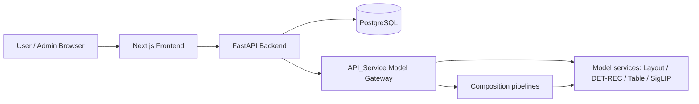
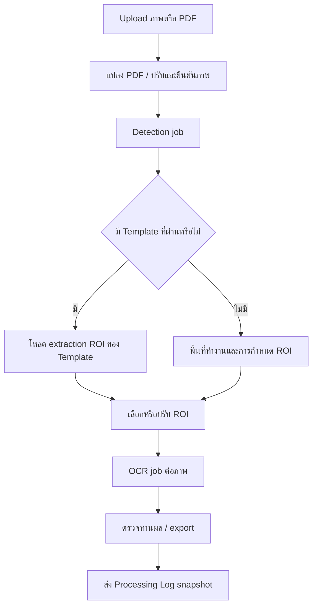

# 01 — ภาพรวมระบบ

ปรับปรุงจาก Source Code วันที่ 10 พฤศจิกายน 2569 (2026-11-10)

## 1. วัตถุประสงค์และขอบเขต

COOP_Project4_New เป็นระบบทำงานกับเอกสาร OCR ผู้ใช้อัปโหลดเอกสาร ยืนยันภาพ ค้นหา Template จัดการพื้นที่อ่านข้อมูล (ROI) ตรวจทานผล และส่งออกข้อมูล ฝั่ง Admin จัดการ Template, คำขอ Template, การตั้งค่า และ Processing Logs

เอกสารชุดนี้ใช้รับช่วงติดตั้ง ดูแล และพัฒนาระบบ อ่าน 01–03 เพื่อเริ่มงาน จากนั้นเลือกคู่มือตามส่วนที่แก้ไข ตัวอย่าง JSON/คำสั่งเป็นตัวอย่างประกอบที่ตรวจรูปแบบกับซอร์ส ไม่ใช่ผลรันบนระบบจริง

## 2. สถาปัตยกรรม

| ส่วน | ความรับผิดชอบ |
| --- | --- |
| Frontend | รับภาพ/PDF, ปรับภาพ, จัดการ ROI, แสดงและตรวจทานผล, สร้างไฟล์ export |
| Backend | API, Matching, Verification, OCR orchestration, jobs, settings และ persistence |
| PostgreSQL | Template/version/page/field, settings, OCR/Publish jobs และ snapshots/log images |
| API_Service | มีซอร์ส Gateway, pipelines และ model inference services; รันเป็นบริการแยกจาก Backend |

Frontend ติดต่อ Backend ผ่าน NEXT_PUBLIC_API_URL Backend ใช้ GATEWAY_URL และ runtime client ติดต่อโมเดล ไม่ได้เปิด Gateway/Leaf servers ให้จาก main.py

ซอร์ส Model API อยู่ใน workspace แล้ว ส่วน weights/cache, GPU/driver และบริการที่ deploy จริงยังเป็น dependency ที่ต้องเตรียม สถานะใช้งานที่ผู้ดูแลยืนยันคือ Table V2 และ Batch ทำงานปกติ ส่วน Model Selection และ Layout ไม่มีปัญหาที่รายงาน ประเด็นที่ต้องดำเนินการต่อใน Model API integration เหลือ SigLIP โดยปรับ Backend ให้รองรับ service ปัจจุบัน ดู [แนวทางดำเนินการต่อ](13_MODEL_API_SERVICE.md#13-ประเด็นที่ต้องดำเนินการต่อ)

## 3. ความสามารถและสถานะ

| ส่วน | สถานะ | สิ่งที่ต้องเข้าใจ |
| --- | --- | --- |
| User upload → detect → ROI → OCR → review/export | Implemented | มี handlers และ API เชื่อมกัน |
| Template CRUD, readiness, prepublish test, Publish | Implemented | readiness กับผลทดสอบการจับคู่เป็นคนละขั้น |
| Verification strategy | Configurable | standard/strict; batch mode ปัจจุบันรับ global |
| Text DET/REC active models | Configurable | เก็บ selection/config ใน app_settings |
| Processing Logs และภาพใน DB | Implemented | Frontend ส่ง snapshot ไม่ใช่ audit ทุก request |
| หน้า Login และ Browser session | Mock | ตรวจ mockAccounts; ไม่เรียก Backend login |
| Template test endpoint แบบเดิม | Stub | /admin/templates/{template_id}/test คืน test_mode_stubbed |
| Layout/alignment helpers รุ่นเดิม | Legacy ในบริบท Matching | current Detection คืนจาก Anchor strategy; alignment skipped |
| Model Gateway/pipelines/leaves | Implemented / Configurable | อยู่ใน API_Service; แนวทางปรับ SigLIP ฝั่ง Backend อยู่คู่มือ 13 |
| Model weights และ GPU/runtime infrastructure | External Dependency / Not Verified | มี loader/config แต่ยังไม่โหลดหรือรันทดสอบจริง |
| Production capacity/accuracy/availability | Not Verified | ไม่มีผลทดสอบใหม่หรือ deployment state ให้ยืนยัน |

## 4. Workflow ที่เชื่อมทุกส่วน

จุดเชื่อมสำคัญคือภาพที่ยืนยันแล้วกับพิกัด ROI ต้องตรงกัน และผล OCR ต้นฉบับต้องแยกจากผลตรวจทาน รายละเอียดอยู่ [Frontend](04_FRONTEND_GUIDE.md), [Detection](08_TEMPLATE_DETECTION.md) และ [OCR](09_OCR_AI_PIPELINE.md)

## 5. ขอบเขตข้อมูลและสถานะงาน

| ข้อมูล | ที่เก็บ |
| --- | --- |
| Template/Fields/Settings | PostgreSQL |
| OCR และ Publish job records | PostgreSQL |
| Detection/prepublish detection job state | Dictionary ใน Backend process |
| Published Template cache / Maintenance event hub | Backend process memory |
| Browser session และ workspace state | localStorage/cookie และ React state ตามหน้าที่ |
| Log image แบบถาวร | processing_log_images ใน PostgreSQL |
| Detection artifacts | filesystem ชั่วคราว; default ลบหลัง Detection จบ |

การเพิ่ม Backend workers หรือ restart มีผลต่อข้อมูลใน process ต้องอ่าน [Jobs และ Logs](10_PROCESSING_JOBS_LOGS.md) ก่อนวางระบบหลาย process

## 6. แผนอ่านเอกสารส่งมอบ

| ไฟล์ | เนื้อหา |
| --- | --- |
| [02](02_PROJECT_STRUCTURE.md) | จุดเข้า โครงสร้าง และเส้นทางแก้งาน |
| [03](03_INSTALLATION_CONFIGURATION.md) | ติดตั้ง ตั้งค่า และเริ่มระบบ |
| [04](04_FRONTEND_GUIDE.md) | User/Admin components, state, ROI, export |
| [05](05_BACKEND_API.md) | API contract, examples และ endpoint catalogue |
| [06](06_DATABASE_DESIGN.md) | ตาราง ความสัมพันธ์ SQL และ schema evolution |
| [07](07_TEMPLATE_MANAGEMENT.md) | Template lifecycle และ Publish |
| [08](08_TEMPLATE_DETECTION.md) | Matching gates, staged verification และผลลัพธ์ |
| [09](09_OCR_AI_PIPELINE.md) | OCR adapters และ Gateway contracts |
| [10](10_PROCESSING_JOBS_LOGS.md) | สถานะงาน snapshots และภาพ |
| [11](11_TESTING_DEPLOYMENT.md) | วิธีทดสอบและข้อกำหนดการติดตั้ง |
| [12](12_TROUBLESHOOTING_HANDOVER.md) | แก้ปัญหา สิ่งที่ต้องส่งต่อ และข้อมูลที่ยังขาด |
| [13](13_MODEL_API_SERVICE.md) | Gateway/model services, setup, inference contracts และงานต่อด้าน SigLIP |

## 7. Source References

| Source | จุดทำงาน |
| --- | --- |
| [main.py](../../project_backend/main.py) | app, startup_warmup, process_document_payload |
| [routes.py](../../project_backend/app/api/routes.py) | router, detect_template_dev_route |
| [page.tsx](../../project_frontend/src/app/page.tsx) | handleBatchConfirm, handleRunOCR และ export handlers |
| [services.py](../../project_backend/app/business/services.py) | AdminTemplateService, VerificationService, ProcessingLogService |
| [runtime client](../../project_backend/app/core/model_runtime_client.py) | ModelRuntimeKind, _post_predict |
| [Model Gateway](../../API_Service/services/gateway/main.py) | _forward, _forward_multiple และ readiness |
| [Model service topology](../../API_Service/core/topology.py) | SERVICE_DESCRIPTORS |
