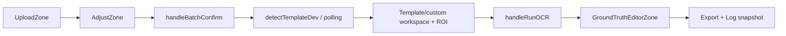

# 04 — Frontend Developer Guide

## 1. Overview และ Route Mapping

Frontend ใช้ Next.js App Router, React และ TypeScript User orchestration อยู่ใน src/app/page.tsx ขณะที่ route wrappers ของ Admin เรียก components ใน src/admin

| Route | Component/จุดเข้า |
| --- | --- |
| / | src/app/page.tsx |
| /login | src/app/login/page.tsx: LoginForm |
| /admin | AdminDashboard |
| /admin/templates | AdminTemplatesPage |
| /admin/templates/[id]/edit | AdminTemplateEditPage |
| /admin/templates/[id]/test | AdminTemplateTestPage |
| /admin/requests และ /admin/requests/[id] | AdminRequestsPage / AdminRequestDetailPage |
| /admin/settings | AdminSettingsPage |
| /admin/logs และ /admin/logs/[id] | AdminProcessingLogsPage / AdminProcessingLogDetailPage |
| /admin/detection-lab | AdminDetectionLabPage |

Admin layout ครอบ children ด้วย AuthGate(requiredRole=admin) และ AdminShell ส่วน proxy.ts ใช้ ocr_role cookie เพื่อ redirect หน้า ไม่ใช่การยืนยันสิทธิ์ของ Backend API

## 2. User Workflow และ State Ownership

| ส่วน | หน้าที่ |
| --- | --- |
| UploadZone | รับไฟล์และส่งภาพให้ page handler |
| shared/pdfImages.ts | โหลด PDF.js, render หน้า scale 2.0 เป็น JPEG data URL |
| AdjustZone | ปรับ/ยืนยันภาพก่อน Detection |
| page.tsx | ถือภาพ, ROI, matched Template, OCR results, processing run และ current step |
| shared/workspace | Canvas, ROI boxes/selection, page navigation และ editor |
| GroundTruthEditorZone | รับผลเพื่อแก้ข้อความ/ตารางตาม contract กับ page |

PDF.js script และ worker โหลดจาก CDN ตาม URL ใน pdfImages.ts หากต้องรองรับเครือข่ายปิดต้องแก้เส้นทางโหลดและทดสอบจริง ปัจจุบันไม่ใช่ bundled npm PDF engine ใน helper นี้

## 3. API Client และ Mapping

adminApi.ts ประกอบ ADMIN_API_BASE_URL จาก NEXT_PUBLIC_API_URL เรียก Backend และ map snake_case ไป types ที่ UI ใช้ เช่น ratio fields และ verification flags ไม่เรียก model services จาก Browser โดยตรง

- detectTemplateDev ส่ง FormData key file ตามลำดับหน้า และ confirmedImages=1 สำหรับภาพยืนยัน
- non-Admin ขอ candidateFormat=pool-v1; createDetectionCandidateResolver ต้องแก้ candidate_ref จาก candidate_pool ก่อนใช้
- fetchTemplateBundle แยก cache ของ context=user กับ Admin และแชร์ in-flight Promise ของ key เดียวกัน
- invalidateAdminListCache ล้าง maps ตามชนิด mutation การเปลี่ยน DB จากนอก API ไม่ทำให้ Browser maps หายเอง
- User Template response มีการตัด image payload จึงไม่ควรสมมติว่า Admin/User response มีภาพครบเท่ากัน

เมื่อเพิ่ม property ใหม่ต้องตรวจ schema/Backend serializer, mapper, adminTypes/types และผู้ใช้ข้อมูล ไม่เพิ่มเฉพาะ interface แล้วถือว่า Backend ส่งมาแล้ว

## 4. พิกัด ROI และการโหลด Template

| ระดับ | หน่วย |
| --- | --- |
| Template API/DB | x/y/width/height ratios; page_number เริ่ม 1 |
| Workspace | display pixels; ความกว้างอ้างอิง 750 ใน User flow; pageIndex เริ่ม 0 |
| OCR request | pixels บนภาพจริง รวม polygon points |

ratioToImageBox ใช้ imageWidth/imageHeight และ imageOffsetX/Y การ persist กลับต้องแยก Canvas offsets ออกจากพิกัดบนภาพ

หลัง detect, handleBatchConfirm โหลด Template bundle แล้ว templateFieldsToWorkspaceRois เลือก extraction Fields และ map ROI ตามขนาดแสดงผล เส้นทางนี้ใช้ ROI ของ Template โดยตรง ไม่ใช้ projected_fields จาก candidate ซึ่ง current Matching ไม่ทำ alignment

main_page extra-page ROI ใช้ข้อมูล auto ROI/fallback ของ User flow ต้องทดสอบการ map หน้าจริง โดยเฉพาะเมื่อเปลี่ยน main_page_number ไม่อนุมานว่า UI รองรับทุกเลขจาก schema ของ Backend เพียงอย่างเดียว

## 5. Async Lifecycle และ Maintenance

Detection polling รอ 1,000 ms ต่อรอบและส่ง AbortSignal ไป request/delay เมื่อ run ใหม่ต้องป้องกันผลเก่า commit เข้า workspace ใหม่

OCR helper runAiProcessJob ใช้ async_mode=true และ poll 500 ms ไม่มี signal/deadline แบบ Detection ใน helper นี้ run guard ของ User handler ป้องกัน late commit บางจุด แต่ไม่ cancel server worker

User อ่านสถานะ Maintenance และรับ SSE ผ่าน /system/maintenance/events พร้อม timer refresh ตาม boundary UI reset state ตามสถานะ แต่ Backend เป็นผู้บังคับ processing gate การ reset หน้าไม่พิสูจน์ว่างาน server หยุดแล้ว

## 6. ตรวจทาน Export และ Log

ผล OCR ต้นฉบับถูก clone แยกจากผลที่แก้ไข การเปลี่ยนโครงสร้างตารางต้องรักษา ocrText/groundTruth, spans และข้อมูลที่ mapper/export ใช้

| Export | Implementation |
| --- | --- |
| JSON | buildExportPayloadWithImages รวมข้อมูล/ภาพตาม options |
| Word | HTML download เป็น .doc MIME application/msword |
| Excel | buildExcelXlsxBlob สร้าง OOXML ZIP พร้อม sheets และ image relationships |
| Image ZIP | crop ภาพจริงแล้วรวมไฟล์ |

queueProcessingLogSave ส่ง snapshot ตามจุดของ workflow ไม่ใช่ queue ถาวร ต้องรักษา processing_run_id และ pageFiles เมื่อแก้การสลับเอกสาร/ออกจากระบบ ดู [10](10_PROCESSING_JOBS_LOGS.md)

## 7. Login และ Development Notes

LoginForm ตรวจ mockAccounts แล้ว writeAuthSession ลง localStorage พร้อม cookie ocr_role ไม่เรียก /auth/login authHeaders ปัจจุบันไม่ได้เติม Bearer tokenเอง จึงไม่ควรใช้ชื่อ fetchWithAuth รับรองว่า request ผ่านระบบ auth จริง

เมื่อแก้ Frontend ให้รักษา upload → detect → ROI → OCR → review/export/log flow, ใช้ Backend เป็นแหล่ง Maintenance และล้าง object URLs เมื่อสร้างภาพผ่าน blob URL ตามกติกาโครงการ

คำสั่งพื้นฐานจาก project_frontend คือ npm run lint และ npm run build ชุด regression ที่ตรงกับงานอยู่ tests/ ดูตัวอย่างการรันใน [11](11_TESTING_DEPLOYMENT.md)

## 8. Source References

| Source | Function/Component |
| --- | --- |
| [User page](../../project_frontend/src/app/page.tsx) | handleUploadSuccess, handleBatchConfirm, handleRunOCR, runAiProcessJob, queueProcessingLogSave |
| [API client](../../project_frontend/src/admin/adminApi.ts) | detectTemplateDev, fetchTemplateBundle, invalidateAdminListCache |
| [PDF helper](../../project_frontend/src/shared/pdfImages.ts) | convertPdfToImages |
| [Candidate resolver](../../project_frontend/src/shared/detectionCandidateResolver.ts) | createDetectionCandidateResolver |
| [ROI geometry](../../project_frontend/src/shared/workspace/roiGeometry.ts) | ratioToImageBox |
| [Session](../../project_frontend/src/auth/session.ts) | mockAccounts, writeAuthSession, authHeaders |
| [Frontend rules](../../project_frontend/AGENTS.md) | กติกาสำหรับผู้พัฒนา |
