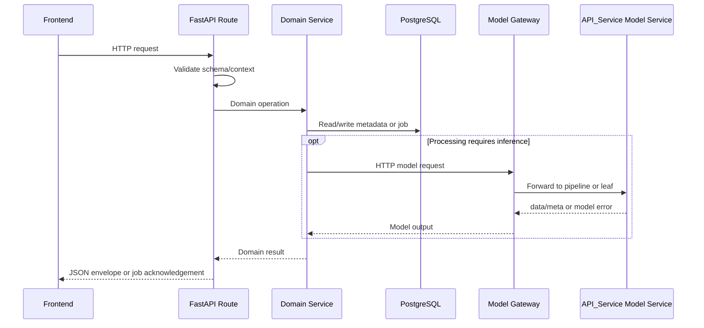

# 05 — Backend API Guide

## 1. App และ Request Lifecycle

main.py สร้าง FastAPI app, CORS และ include router โดยไม่มี prefix กลาง API ด้าน Template/Settings/Logs อยู่ routes.py ส่วน OCR/Layout อยู่ main.py



Model work อาจอยู่ background/serialized worker ตาม endpoint จึงต้องแยก acknowledgement ออกจากผลสำเร็จ

## 2. Request และ Response Conventions

| กลุ่ม | Contract |
| --- | --- |
| Admin APIs ส่วนใหญ่ | ApiResponse: ok, data, error |
| Detection | status=success, data; job acknowledgement HTTP 202 |
| OCR | success=true; async acknowledgement HTTP 200 พร้อม job_id |
| ภาพ Log | Binary Response ตาม MIME; ไม่ใช่ JSON envelope |
| Maintenance events | text/event-stream พร้อม event maintenance_state |

FastAPI validation errors ไม่ได้ถูกแปลงเป็น ApiResponse ทุกกรณี HTTPException ใช้ detail และ error ที่หลุดจาก handler อาจเป็น 500 ตรวจทั้ง HTTP status และ body

Pydantic schema หลายตัวมี aliases เช่น page_number/pageNumber แต่ไม่ควรคาดว่า aliases ใช้กับ raw query/form ด้วย ให้ใช้ชื่อที่ route อ่านจริง

## 3. ตัวอย่าง Health และ Template Request

ตัวอย่าง response ต่อไปนี้เป็นตัวอย่างรูปแบบ ไม่ใช่ผลรันจริง:

GET /health:

```json
{"ok":true,"data":{"status":"ok"},"error":null}
```

POST /admin/templates รับ TemplateCreate ตัวอย่างสร้าง draft:

```json
{
  "name":"ใบคำร้องรุ่นแรก",
  "document_type":"ใบคำร้อง",
  "detection_mode":"all_pages",
  "main_page_number":1
}
```

service คืนข้อมูล Template bundle ผ่าน ApiResponse ให้ใช้ data.id ของ version ที่สร้างสำหรับเพิ่ม Page/Fields ตัวอย่างต่อเนื่องอยู่ [07](07_TEMPLATE_MANAGEMENT.md) ค่า page_count ใน create request ไม่สร้างภาพ/หน้าให้โดยอัตโนมัติ

## 4. ตัวอย่าง Detection แบบ Async

ส่งภาพที่ยืนยันแล้วเป็น multipart ตามลำดับหน้า ตัวอย่าง curl.exe สำหรับ PowerShell โดยต้องมีไฟล์ภาพจริง:

```powershell
curl.exe -X POST "http://localhost:8000/api/templates/detect-dev?confirmedImages=1" -F "file=@page_1.png" -F "file=@page_2.png"
```

ตัวอย่าง acknowledgement HTTP 202:

```json
{
  "status":"success",
  "data":{"job_id":"detectdev_EXAMPLE","status":"processing","confirmed_images":true}
}
```

นำ job_id ที่ตอบจริงไป GET /api/templates/detect-dev/jobs/{job_id} ตัวอย่างเมื่อ worker ล้มเหลว HTTP 200:

```json
{
  "status":"success",
  "data":{"job_id":"detectdev_EXAMPLE","status":"failed","error":"Detection job failed."}
}
```

context=admin เป็น processing context ที่ route อ่าน ไม่ใช่หลักฐานการยืนยันสิทธิ์ role User request ที่ไม่มี confirmedImages=1 ถูกปฏิเสธ confirmed mode ไม่รับ PDF หรือ raw image body ต้องเป็น multipart images

## 5. OCR/Layout และ Processing Logs

OCR ใช้ POST /api/ai/process ด้วย DocumentPayload และ async_mode=true จากนั้น poll GET /api/ai/jobs/{job_id} ตัวอย่าง payload และ pipeline อยู่ [09](09_OCR_AI_PIPELINE.md)

Layout ใช้ POST /api/layout/analyze และ images array; Log ใช้ POST /processing-logs พร้อม processing_run_id ดูรูปแบบใน [10](10_PROCESSING_JOBS_LOGS.md) อย่าส่ง payload ของ endpoint หนึ่งไปอีก endpoint เพราะต่างกันทั้งหน่วย ROI และ schema

GET /admin/processing-logs รับ limit default 100 ช่วง 1–500 GET /notifications รับ limit default 5 สูงสุด 5 สำหรับ User audience

## 6. Error Handling และ Authentication

| กรณี | ผลที่ตรวจพบ |
| --- | --- |
| DTO ไม่ตรง schema | FastAPI validation error โดยทั่วไป 422 |
| Detection body/confirmed mode ไม่ถูกต้อง | 400 พร้อม detail |
| ไม่พบ Detection/OCR job | 404 |
| Template readiness ไม่ผ่าน | 409 พร้อมรายละเอียดจาก service |
| DB health เชื่อมไม่ได้ | 503 พร้อม detail.engine=postgresql |
| OCR synchronous: Paddle/Layout unavailable | 503 |
| OCR synchronous: error อื่น | 500; Table error ไม่มี except เฉพาะใน route นี้ |
| Background processing error | status=failed ในผล poll ซึ่งอาจตอบ HTTP 200 |

Maintenance gate อยู่ภายใน generic try ของ OCR route จึงอาจแปลง HTTPException เป็น 500 ต่างจาก Detection/Layout ที่ gate อยู่ภายนอก อย่าใช้เลข HTTP เพียงอย่างเดียวแยก Maintenance ออกจาก inference error

Authentication ยังไม่สมบูรณ์: /auth/me คืน mock, current_admin ไม่ตรวจ role และหลาย routes ไม่ผูก auth dependency หน้า Login ไม่เรียก Backend auth อีกทั้ง auth_service.py เรียก base64/hashlib โดยไม่มี import ในไฟล์นั้น ทำให้ token helper มีปัญหาตาม static control flow ก่อนใช้งาน auth จริงต้องแก้และทดสอบแยก รายงานนี้ไม่ได้ยิง login/register เพื่อยืนยัน runtime error หรือเขียนผู้ใช้ใหม่

## 7. แนวทางเพิ่มหรือแก้ API

1. แก้ schema และ validation ที่เกี่ยวข้อง
2. เพิ่ม/แก้ route โดยรักษา envelope ที่ผู้เรียกใช้อยู่
3. ให้ service รับผิดชอบ transaction, readiness, pending operation และ cache ของ domain
4. แก้ adminApi/types/result mapper ฝั่ง Frontend พร้อมกัน
5. ทดสอบทั้ง success, invalid input และ processing failure

ชื่อ endpoint ลงท้าย dev ไม่ได้บอกว่าไม่ถูกใช้ เช่น detect-dev อยู่ใน current User flow ส่วน test_template คืน stub ต้องดู implementation ของแต่ละ endpoint

### 7.1 Outbound API ไป API_Service

Backend ส่ง POST JSON image/images ไป GATEWAY_URL พร้อม MODEL_GATEWAY_API_KEY แล้ว _post_predict คลี่ data จาก Model API envelope ให้ adapter ใช้ ส่วน Gateway ส่ง multipart ต่อไป services โดยใช้ INTERNAL_API_TOKEN รายการใน catalogue ด้านล่างเป็น inbound Backend APIs เท่านั้น ไม่รวม Model API endpoints

| Outbound path | Model-side ปลายทาง | ผลตรวจ integration |
| --- | --- | --- |
| text-detections/text-detection-batches | Unified DET leaf ผ่าน Gateway | version/model และ raw_output มีเส้นทาง consumer รองรับ |
| text-recognitions/text-recognition-batches | REC leaf ผ่าน Gateway | อ่านผลแต่ละภาพตามลำดับด้วย batch normalizer |
| document-layouts | Layout composition pipeline | เตรียม regions จาก Layout และ Text Detection ตาม pipeline |
| table-model-results | Integrated Table V2 | อ่านตารางด้วย DET/REC และ structure models ตาม selection; ผู้ดูแลยืนยันใช้งานปกติ |
| image-verifications/image-classification-batches | Verification pipeline/SigLIP leaf | C1: ต้องปรับ Backend ให้รับ output และ scoring ของ Model Service ปัจจุบัน |

การเลือกโมเดลใช้ saved model settings ของ Backend และ selectors ของ Gateway ตาม route ส่วน HTTP errors จาก Model API ถูกแปลงเป็น ModelRuntimeUnavailableError ก่อนเข้า adapter/route ของ Backend Model Selection และ Layout ไม่มีปัญหาที่รายงานในการใช้งานปัจจุบัน รายละเอียด contract และแผนปรับ Backend ด้าน SigLIP อยู่ใน [13_MODEL_API_SERVICE.md](13_MODEL_API_SERVICE.md)

## 8. Endpoint Catalogue

รายการด้านล่างมาจาก route declarations ใน main.py และ routes.py แสดง endpoints ที่เกี่ยวข้องกับขอบเขตส่งมอบ รวม Mock/Stub/dev helpers ที่ยังอยู่ ไม่รวม StaticFiles mount และ /docs, /openapi.json ที่ FastAPI สร้างให้ คอลัมน์ schema ระบุ body model; เครื่องหมาย — หมายถึงไม่มี typed body model ใน signature ไม่ได้แปลว่าไม่มี query/raw body

| Method | Path | Body schema / input |
| --- | --- | --- |
| GET | `/system/maintenance` | - |
| GET | `/system/maintenance/events` | raw Request/form/query |
| GET | `/notifications` | - |
| POST | `/auth/register` | AuthRegisterRequest |
| POST | `/auth/login` | AuthLoginRequest |
| GET | `/auth/me` | - |
| GET | `/health` | - |
| GET | `/health/models` | - |
| GET | `/health/db` | - |
| POST | `/api/templates/detect-dev` | raw Request/form/query |
| GET | `/api/templates/detect-dev/jobs/{job_id}` | raw Request/form/query |
| POST | `/processing-logs` | ProcessingLogUpsertRequest |
| GET | `/admin/processing-logs` | - |
| GET | `/admin/processing-logs/{log_id}` | - |
| GET | `/admin/processing-logs/{log_id}/pages/{page_number}` | - |
| DELETE | `/admin/processing-logs/{log_id}` | - |
| POST | `/template-requests` | TemplateRequestCreate |
| GET | `/template-requests` | - |
| GET | `/template-requests/{request_id}` | - |
| PUT | `/template-requests/{request_id}` | TemplateRequestUpdate |
| DELETE | `/template-requests/{request_id}` | TemplateRequestDelete |
| POST | `/template-requests/{request_id}/submit` | - |
| GET | `/template-requests/{request_id}/pages` | - |
| POST | `/template-requests/{request_id}/requested-fields` | RequestedFieldCreate |
| PUT | `/template-requests/{request_id}/requested-fields/{field_id}` | RequestedFieldUpdate |
| DELETE | `/template-requests/{request_id}/requested-fields/{field_id}` | - |
| GET | `/admin/dashboard` | - |
| POST | `/admin/storage/cleanup-generated` | - |
| GET | `/admin/image-verification-categories` | - |
| POST | `/admin/image-verification-categories` | ImageVerificationCategoryCreate |
| PUT | `/admin/image-verification-categories/{category_value}` | ImageVerificationCategoryUpdate |
| DELETE | `/admin/image-verification-categories/{category_value}` | - |
| GET | `/admin/template-requests` | - |
| GET | `/admin/template-requests/{request_id}` | - |
| DELETE | `/admin/template-requests/{request_id}` | TemplateRequestDelete |
| POST | `/admin/template-requests/{request_id}/start-review` | - |
| POST | `/admin/template-requests/{request_id}/images` | TemplateRequestImageCreate |
| PATCH | `/admin/template-requests/{request_id}/images/{image_id}` | TemplateRequestImageUpdate |
| DELETE | `/admin/template-requests/{request_id}/images/{image_id}` | - |
| POST | `/admin/template-requests/{request_id}/images/{image_id}/approve` | - |
| POST | `/admin/template-requests/{request_id}/images/{image_id}/reject` | - |
| POST | `/admin/template-requests/{request_id}/images/{image_id}/canonical` | - |
| POST | `/admin/template-requests/{request_id}/convert-to-template` | TemplateRequestConvert |
| POST | `/admin/template-requests/{request_id}/suggest-base-version` | TemplateVersionCreate |
| POST | `/admin/template-requests/{request_id}/convert-to-version` | TemplateVersionFromRequestCreate |
| POST | `/admin/template-requests/{request_id}/reject` | RejectRequest |
| POST | `/admin/templates` | TemplateCreate |
| GET | `/admin/templates` | - |
| GET | `/admin/settings/verification-strategy` | - |
| PUT | `/admin/settings/verification-strategy` | VerificationStrategyUpdate |
| GET | `/admin/settings/detection-batch-mode` | - |
| PUT | `/admin/settings/detection-batch-mode` | DetectionBatchModeUpdate |
| GET | `/admin/system/maintenance` | - |
| PUT | `/admin/system/maintenance` | SystemMaintenanceUpdate |
| GET | `/admin/settings/ocr-models` | - |
| PUT | `/admin/settings/ocr-models/active` | OcrActiveModelsUpdate |
| POST | `/admin/settings/ocr-models/{kind}/{model_id}/check` | - |
| POST | `/admin/settings/ocr-models/{kind}` | OcrModelPayload |
| PUT | `/admin/settings/ocr-models/{kind}/{model_id}` | OcrModelPayload |
| DELETE | `/admin/settings/ocr-models/{kind}/{model_id}` | - |
| GET | `/admin/templates/{template_id}` | - |
| PUT | `/admin/templates/{template_id}` | TemplateUpdate |
| DELETE | `/admin/templates/{template_id}` | - |
| GET | `/admin/templates/{template_id}/pages` | - |
| POST | `/admin/templates/{template_id}/pages` | TemplatePageCreate |
| PUT | `/admin/templates/{template_id}/pages/{page_id}` | TemplatePageUpdate |
| DELETE | `/admin/templates/{template_id}/pages/{page_id}` | - |
| POST | `/admin/templates/{template_id}/fields` | TemplateFieldCreate |
| PUT | `/admin/templates/{template_id}/fields/{field_id}` | TemplateFieldUpdate |
| DELETE | `/admin/templates/{template_id}/fields/{field_id}` | - |
| POST | `/admin/templates/{template_id}/ignore-regions` | IgnoreRegionCreate |
| PUT | `/admin/templates/{template_id}/ignore-regions/{region_id}` | IgnoreRegionUpdate |
| DELETE | `/admin/templates/{template_id}/ignore-regions/{region_id}` | - |
| POST | `/admin/templates/{template_id}/publish-jobs` | - |
| POST | `/admin/templates/{template_id}/embedding-jobs` | - |
| GET | `/admin/templates/{template_id}/publish-jobs/latest` | - |
| GET | `/admin/templates/{template_id}/embedding-jobs/latest` | - |
| POST | `/admin/publish-jobs/{job_id}/complete-dev` | - |
| POST | `/admin/embedding-jobs/{job_id}/complete-dev` | - |
| POST | `/admin/publish-jobs/{job_id}/run-dev` | - |
| POST | `/admin/embedding-jobs/{job_id}/run-dev` | - |
| POST | `/admin/publish-jobs/{job_id}/fail-dev` | - |
| POST | `/admin/embedding-jobs/{job_id}/fail-dev` | - |
| POST | `/admin/templates/{template_id}/test` | TemplateTestRequest |
| POST | `/admin/templates/{template_id}/test-extraction` | TemplateVerificationTestRequest |
| POST | `/admin/templates/{template_id}/test-verification` | TemplateVerificationTestRequest |
| POST | `/admin/templates/{template_id}/prepublish-simulation` | - |
| POST | `/admin/templates/{template_id}/prepublish-detection-test` | raw Request/form/query |
| GET | `/admin/templates/{template_id}/prepublish-detection-test/jobs/{job_id}` | - |
| POST | `/admin/templates/{template_id}/confirm-publish` | - |
| POST | `/admin/templates/{template_id}/approve` | - |
| POST | `/admin/templates/{template_id}/reject` | RejectRequest |
| GET | `/` | - |
| POST | `/api/ai/process` | DocumentPayload |
| GET | `/api/ai/jobs/{job_id}` | - |
| POST | `/api/layout/analyze` | LayoutAnalysisPayload |

??? 97 route declarations.

## 9. Source References

| Source | Symbol/บทบาท |
| --- | --- |
| [Routes](../../project_backend/app/api/routes.py) | router, ok, detect_template_dev_route, get_detect_template_dev_job |
| [Schemas](../../project_backend/app/api/schemas.py) | ApiResponse, TemplateCreate, RoiRatio, ProcessingLogUpsertRequest |
| [Main](../../project_backend/main.py) | ROIModel, DocumentPayload, process_document, get_ai_process_job, analyze_document_layout |
| [Services](../../project_backend/app/business/services.py) | Domain implementation และ HTTPException ของ service |
| [Auth service](../../project_backend/app/auth/auth_service.py) | create_access_token, current_user, current_admin |
| [Runtime HTTP client](../../project_backend/app/core/model_runtime_client.py) / [Model Gateway](../../API_Service/services/gateway/main.py) | Outbound selection, envelope และ routing |
