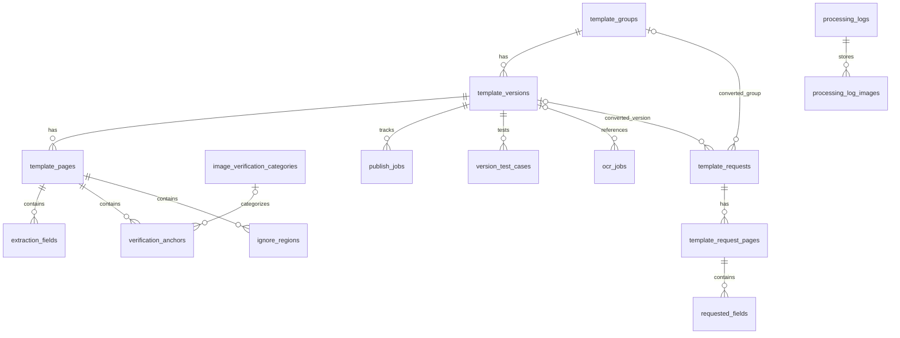

# 06 — Database Design

## 1. Overview และ Schema Authority

Backend ใช้ PostgreSQL ผ่าน psycopg2 และ wrapper ใน app/core/db.py DATABASE_URL รับ postgres:// และ postgresql:// ไม่มี SQLite fallback runtime schema อยู่ใน _POSTGRES_SCHEMA และเริ่มใช้งานผ่าน ensure_database_ready

DDL ชุดนี้ประกาศ 18 ตาราง, 17 indexes และ 3 views รวม ALTER/UPDATE สำหรับ compatibility จึงต้องถือ startup เป็นขั้นตอนที่อาจปรับ schema/ข้อมูล ไม่ใช่ health check แบบ read-only

## 2. ความสัมพันธ์หลัก



diagram แสดง foreign keys ของกลุ่มงานหลัก ไม่ใช่ลำดับ workflow ฟิลด์ created_by/requested_by บางตารางอ้าง users เพิ่มเติมตาม DDL

## 3. ตาราง Template และ ROI

| ตาราง | คอลัมน์สำคัญ | Constraints/หน้าที่ |
| --- | --- | --- |
| template_groups | id, template_code, name, document_type, category, description, created_by | template_code unique; กลุ่มของหลาย versions |
| template_versions | id, template_group_id, version_number, version_name, status, detection_mode, main_page_number, published_at | unique (group,version_number); มี thresholds/weights และ created_from_version_id |
| template_pages | id, template_version_id, page_number, sample_image_url, normalized_image_url, image_width, image_height, image_aspect_ratio, image_geometry_checked, layout_signature_json | unique (version,page_number) |
| extraction_fields | id, template_page_id, field_name, display_label, data_type, extraction_method, roi_*_ratio, roi_points_json, roi_mode, expected_content, required, sort_order | data_type=text/table/image; roi_mode=fix/flexible |
| verification_anchors | id, template_page_id, anchor_name, anchor_type, roi_*_ratio, roi_points_json, expected_text, required, weight, image_category_id, sort_order | anchor_type=text/image; match_type/regex_pattern เป็น legacy archive |
| ignore_regions | id, template_page_id, region_name, roi_*_ratio, reason | พื้นที่ ignore ของ Page |
| image_verification_categories | id, value, label, prompt, match_threshold, margin_threshold, evidence_temperature, enabled | value unique; registry จำกัดค่าที่รองรับ |

roi_*_ratio ในตารางหมายถึง roi_x_ratio, roi_y_ratio, roi_width_ratio, roi_height_ratio ซึ่งเป็น DOUBLE PRECISION แต่ละค่ามี CHECK แยก: x/y 0..1, width/height >0 และ <=1 ผลรวม x+width/y+height ตรวจเพิ่มใน readiness ไม่ใช่ CHECK ชุดนี้

ชื่อ Field/Anchor ไม่ใช่ unique identity ปัจจุบัน DDL drop unique-name constraints รุ่นเก่า ใช้ id ระบุรายการ

## 4. ตาราง Request, Jobs และ Log

| ตาราง | คอลัมน์สำคัญ | ใช้งาน |
| --- | --- | --- |
| template_requests | id, requested_by, request_title, request_mode, status, user_note, admin_note, converted_template_group_id, converted_template_version_id | วงจรคำขอและผลแปลง |
| template_request_pages | id, template_request_id, page_number, sample_image_url, source_file_id, source_file_name, image_source, review_status, is_canonical, layout_signature_json | unique (request,page_number) |
| requested_fields | id, template_request_page_id, field_name, display_label, data_type, extraction_method, roi_*_ratio, roi_points_json, user_note | ROI ที่เสนอในคำขอ |
| version_test_cases | id, template_version_id, test_name, page_number, image_url, expected_match, test_type | ข้อมูล test case ของ version; การมีตารางไม่รับรองว่าทุก UI ใช้ |
| publish_jobs | id, template_version_id, status, step, error_message, metadata_json, requested_at, started_at, completed_at | Publish lifecycle |
| ocr_jobs | id, requested_by, template_version_id, status, request_json, result_json, error_message, timestamps | เก็บภาพ/ROI request และผลของ async OCR |
| processing_logs | id, processing_run_id, document_name, user_email, status, current_step, page_count, source_pages_json, template_detection_json, matched_template_json, roi_snapshot_json, ocr_original_json, ground_truth_json, metadata_json | processing_run_id unique |
| processing_log_images | log_id, page_number, kind, mime_type, image_base64, timestamps | composite PK (log_id,page_number,kind); kind source/processing; page_number>0 |
| notifications | id, audience, event_type, title, message, reason, related_entity_type, related_entity_id, metadata_json | related_entity_id ไม่ใช่ FK ใน DDL นี้ |
| users | id, email, password_hash, role, timestamps | email unique; เก็บ Backend users |
| app_settings | key, value, updated_at | key PK; value TEXT แม้หลายค่าจะ encode JSON |

ตารางที่มี timestamps ตาม DDL ไม่จำเป็นต้องมีทุก timestamp ชื่อเดียวกัน เช่น jobs ใช้ requested_at/started_at/completed_at ให้ตรวจคอลัมน์จริงก่อนเพิ่ม query

## 5. Foreign Keys และผลการลบ

- ลบ Group → cascade Versions → Pages → Fields/Anchors/Ignore และ Publish/Test-case records ที่ผูก Version
- ลบ Request → cascade Request Pages → Requested Fields
- ลบ Processing Log → cascade Log Images
- User references แบบ SET NULL ไม่ลบข้อมูล domain ทั้งหมดตาม User
- OCR job template_version_id และ request converted references ใช้ SET NULL เมื่อ parent ถูกลบ
- ลบ Image Category ทำให้ Anchor.image_category_id เป็น NULL จึงอาจไม่ผ่าน readiness

การ DELETE request ผ่าน service บาง endpoint เปลี่ยนสถานะเป็น rejected ไม่ได้ออก SQL DELETE จึงต้องแยก API semantics ออกจาก FK cascade

## 6. Transaction, Pool และ Schema Changes

connect ใช้ ThreadedConnectionPool ค่า default min=1/max=10 ต่อ process wrapper คืน dictionary-like rows และแปลง placeholder ? เป็น %s context manager commit เมื่อสำเร็จ rollback เมื่อ exception และคืน connection เข้า pool

มี recycle/max-idle check ตอนยืม connection ไม่ใช่ retry query ทุกชนิด การเขียน operation ใหม่ต้องกำหนด transaction boundary ชัดเจน โดยเฉพาะ update หลายตารางและ pending apply

_POSTGRES_READY เป็น process flag ไม่ใช่ migration history table ตัวอย่าง compatibility statements มี geometry columns, polygon JSON, threshold default/update และ drop unique constraints อย่าใช้ Prisma push/reset ทับ runtime schema หากแก้ DDL ให้เตรียมวิธีอัปเกรดข้อมูลเก่าและทดสอบบน DB แยกก่อน

ค่า default ใน DDL อาจต่างจากค่าที่ service ส่งชัดเจน เช่น publish_jobs.step default=validation แต่ create_publish_job ตั้ง anchor_readiness ต้องดู INSERT และ service ด้วย

## 7. Practical SQL สำหรับตรวจข้อมูล

ตัวอย่าง read-only ใช้ id ของ version จริงแทน placeholder:

```sql
SELECT tv.id, tg.name, tv.version_number, tv.status, tv.published_at
FROM template_versions tv
JOIN template_groups tg ON tg.id = tv.template_group_id
ORDER BY tv.updated_at DESC;
```

```sql
SELECT tp.id, tp.page_number,
       COUNT(DISTINCT ef.id) AS extraction_count,
       COUNT(DISTINCT va.id) AS anchor_count
FROM template_pages tp
LEFT JOIN extraction_fields ef ON ef.template_page_id = tp.id
LEFT JOIN verification_anchors va ON va.template_page_id = tp.id
WHERE tp.template_version_id = 'TEMPLATE_VERSION_ID'
GROUP BY tp.id, tp.page_number
ORDER BY tp.page_number;
```

```sql
SELECT id, status, error_message, requested_at, started_at, completed_at
FROM ocr_jobs
ORDER BY requested_at DESC
LIMIT 20;
```

หลีกเลี่ยง SELECT request_json หรือ image_base64 ใน log/terminal เมื่อต้องดูเพียงสถานะ เพราะข้อมูลเหล่านั้นมีภาพเอกสารและอาจมีขนาดใหญ่

## 8. Views และการตรวจปัญหา

Views ที่ประกาศคือ template_versions_view, template_fields_view และ verification_anchors_view ช่วยรวม metadata แต่ service หลายตัวใช้ JOIN โดยตรง ไม่ควรแก้ view แล้วคาดว่าทุก API เปลี่ยนตาม

เมื่อ API update แล้ว UI ไม่เปลี่ยน ให้ตรวจ pending settings และ cache หลังยืนยันแถว DB ไม่แก้ข้อมูลด้วย SQL โดยข้าม cache/readiness flow เป็นวิธีปกติ ดู [12](12_TROUBLESHOOTING_HANDOVER.md)

## 9. Source References

| Source | Symbol/บทบาท |
| --- | --- |
| [DB wrapper และ DDL](../../project_backend/app/core/db.py) | connect, PostgresConnection, ensure_database_ready, _POSTGRES_SCHEMA |
| [Domain services](../../project_backend/app/business/services.py) | INSERT/UPDATE, _template_anchor_readiness, pending operations |
| [Category registry](../../project_backend/app/business/image_verification_category_service.py) | ensure_image_verification_categories_table |
| [JSON helpers](../../project_backend/app/core/json_utils.py) | jsonb_load, jsonb_dump |
| [Jobs](../../project_backend/main.py) | create_ocr_job, run_ocr_job |
