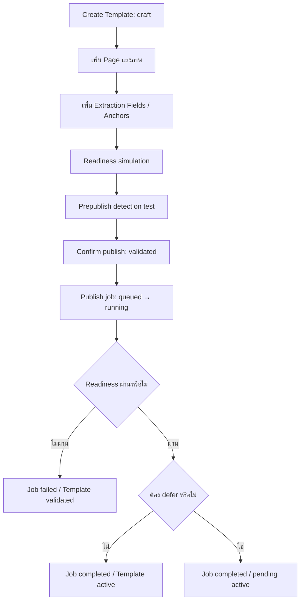

# 07 — Template Management

## 1. Domain Model และคำศัพท์

Template Group คือกลุ่มเอกสาร ส่วน Template Version เก็บรุ่น/สถานะและ Pages ของตนเอง ใน Admin APIs ค่า template_id โดยทั่วไปคือ template_versions.id ไม่ใช่ Group ID

| ข้อมูล | หน้าที่ |
| --- | --- |
| Page | ภาพอ้างอิงและ geometry ของแต่ละหน้า |
| Extraction Field | ROI สำหรับอ่าน text/table/image |
| Verification Anchor | ROI และ expected text/image category สำหรับตรวจว่าเป็น Template นี้ |
| Detection mode | all_pages หรือ main_page |
| Version | รุ่นที่ถูกทดสอบ/Publish; มี version_number ภายใน Group |

Field API ใช้ร่วมกัน แต่ use_for_verification=false เก็บ extraction_fields และ true เก็บ verification_anchors

## 2. Workflow สร้างและ Publish



create_template สร้าง Group และ Version 1 draft ไม่เพิ่ม Pages ตาม page_count ให้อัตโนมัติ Group.name ใช้ document_type ถ้ามี ส่วน version_name ใช้ name ของ payload

## 3. ตัวอย่างสร้าง Page และ Fields

ตัวอย่างเป็น payload ตาม schema ให้แทน TEMPLATE_VERSION_ID/PAGE_ID ด้วย ID ที่ API คืน และแทน BASE64_IMAGE ด้วย bytes ของภาพจริงก่อนทดสอบ readiness

POST /admin/templates/{template_id}/pages — TemplatePageCreate:

```json
{
  "page_number":1,
  "page_name":"หน้าแรก",
  "sample_image_url":"data:image/png;base64,BASE64_IMAGE"
}
```

POST /admin/templates/{template_id}/fields — TemplateFieldCreate สำหรับ extraction:

```json
{
  "template_page_id":"PAGE_ID",
  "page_number":1,
  "field_name":"applicant_name",
  "display_label":"ชื่อผู้ยื่นคำร้อง",
  "data_type":"text",
  "extraction_method":"fixed_roi",
  "roi_mode":"fix",
  "use_for_verification":false,
  "roi":{"page_number":1,"x_ratio":0.1,"y_ratio":0.2,"width_ratio":0.6,"height_ratio":0.08}
}
```

payload สำหรับ Text Anchor ที่ endpoint เดียวกัน:

```json
{
  "template_page_id":"PAGE_ID",
  "page_number":1,
  "field_name":"document_heading",
  "display_label":"หัวเอกสาร",
  "data_type":"text",
  "use_for_verification":true,
  "expected_text":"ใบคำร้อง",
  "required_for_verification":true,
  "roi":{"page_number":1,"x_ratio":0.2,"y_ratio":0.05,"width_ratio":0.6,"height_ratio":0.1}
}
```

Image Anchor ใช้ data_type=image และ image_category ที่ registry รองรับ/เปิดใช้ ดู categories API และ [08](08_TEMPLATE_DETECTION.md) ไม่สร้าง category name ขึ้นเองแล้วถือว่าโมเดลรู้จัก

## 4. Validation และการแก้ Field

| จุดตรวจ | พฤติกรรม |
| --- | --- |
| page ownership | template_page_id ต้องอยู่ใต้ Version ที่แก้ |
| RoiRatio | ตรวจค่ารายตัว x/y 0..1, width/height >0..1 |
| readiness | ตรวจ finite และขอบรวม x+width/y+height เพิ่ม |
| data_type | DB จำกัด extraction เป็น text/table/image และ Anchor เป็น text/image |
| สลับ use_for_verification | immediate update ลบ/สร้างข้ามตาราง จึงได้ ID ใหม่ |

required/weight ยังมีใน schema แต่ staged Matching บังคับทุก Anchor ผ่าน ไม่ใช้ optional flag เพื่อข้าม Anchor ที่ล้มเหลว SQL mapping ของ get_template เติม selectable/default flags บางตัวเอง และ anchor_text/roi_padding ไม่ได้ persist ตรงตาม DTO ในเส้นทางนี้

เปลี่ยนชนิด Field ให้ตรวจ ID ที่ Frontend ถือและ cache หลังบันทึก อย่าใช้ field_name เป็น unique key

## 5. Readiness กับ Prepublish Test

| Operation | สิ่งที่ตรวจ |
| --- | --- |
| prepublish-simulation | ภาพและ stored Anchor configuration; ไม่ยิงโมเดล |
| prepublish-detection-test | เอกสารทดสอบกับ draft ที่เลือกและ active pool; มี inference |
| confirm-publish | ตรวจ readiness และรัน Publish job |

Readiness ต้องมี Pages/ภาพที่โหลดได้ main_page ต้องมีหน้าหลักจริง Anchor ใน scope ต้องมีอย่างน้อยหนึ่ง Text expected_text ไม่ว่าง Image category enabled และ ROI ใช้งานได้ แม้ main_page ก็ตรวจภาพของ stored pages ตาม implementation

Prepublish test ส่งไฟล์เป็น multipart ตอบ 202/ApiResponse แล้ว poll endpoint เฉพาะ template_id/job_id ผล passed=true เมื่อ draft ผ่าน final gate และอันดับ 1 ถ้า active Template อื่นชนะจะได้ warning ผล candidates ไม่ได้ตัดให้เหลือ 5 ใน service

ตัวอย่างเริ่มงาน:

```powershell
curl.exe -X POST "http://localhost:8000/admin/templates/TEMPLATE_VERSION_ID/prepublish-detection-test" -F "file=@sample.png"
```

Confirm publish ไม่ตรวจหลักฐาน prepublish rank ที่บันทึกไว้ก่อนหน้า ทีมจึงต้องรักษาขั้นทดสอบเอกสารก่อนเรียก confirm-publish ไม่ใช้ readiness ผ่านแทนผล Matching

## 6. Publish และ Maintenance

Publish job ใช้ status queued/running/completed/failed step ปัจจุบันคือ anchor_readiness ชื่อ Template status embedding_pending เป็น legacy naming ของช่วงสร้าง job ไม่ใช่การรับรองว่ามี embedding generation ในเส้นทางนี้

หาก enforcement เปิด service อาจเก็บ pending active และคง Template เป็น validated; confirm response เป็น pending_publish/deferred=true หากไม่ defer จะตั้ง active/published_at และ refresh published cache

การแก้ Page/Field บาง operation ของ active Template มี pending path แต่ create/delete Page ไม่ได้ defer เหมือน update Page ทุกกรณี ตรวจ service ของ operation ที่แก้และ [10](10_PROCESSING_JOBS_LOGS.md)

## 7. Template Requests และ Version Reuse

User สร้างคำขอ draft เพิ่มภาพ/ROI แล้ว submit เป็น submitted Admin เริ่ม review เป็น in_review และ approve/reject ภาพก่อน convert การ DELETE request ใน service นี้เปลี่ยนเป็น rejected ไม่ลบ row

convert_request_to_template เลือกภาพที่ approved หรือ pending และมี sample_image_url แล้วสร้าง draft พร้อม extraction Fields ไม่สร้าง verification Anchors จาก requested Fields

create_version_from_request ใช้ Group ของ base และ MAX(version_number)+1 copy requested Fields ก่อน ถ้าไม่ได้ copy Field เลยและ reuse_roi=true จึง copy extraction Fields จาก base ตามเลขหน้า ไม่ copy Anchors ตาม body นี้

suggest_base_version_for_request คืน None/reuse_roi=false เป็นข้อจำกัดปัจจุบัน และ /test แบบเดิมเป็น Stub อย่าใช้แทน prepublish detection ส่วน approve_template ที่ตั้ง active ตรงไม่มี validation/cache flow เท่ากับ confirm_publish_template

## 8. Source References

| Source | Function/Class |
| --- | --- |
| [Services](../../project_backend/app/business/services.py) | AdminTemplateService, TemplateRequestService, TemplatePublishService |
| [Services](../../project_backend/app/business/services.py) | _template_anchor_readiness, _require_template_anchor_readiness |
| [Routes](../../project_backend/app/api/routes.py) | create_template_page, create_template_field, confirm_template_publish |
| [Schemas](../../project_backend/app/api/schemas.py) | TemplatePageCreate, TemplateFieldCreate, RoiRatio |
| [Admin editor](../../project_frontend/src/admin/AdminTemplateEditPage.tsx) | การบันทึก Page/Field และทดสอบ |
| [Admin test](../../project_frontend/src/admin/AdminTemplateTestPage.tsx) | readiness/detection test/Publish UI |
