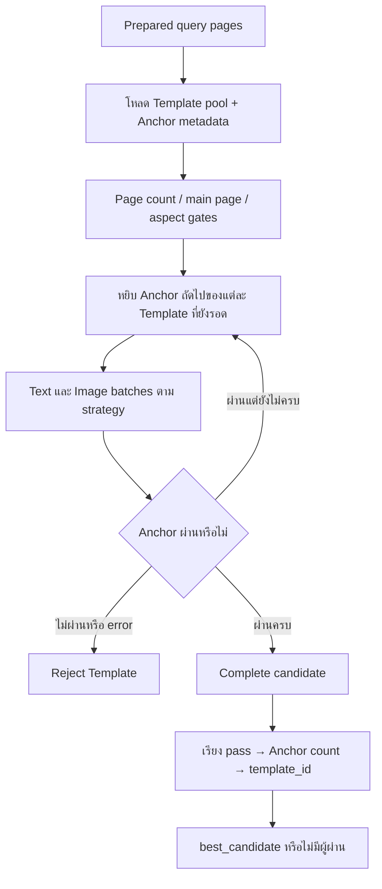

# 08 — Template Detection

## 1. Overview

Detection รับภาพเอกสารเพื่อเลือก Template ที่ผ่าน Verification Anchors ไม่ใช่ขั้น OCR extraction ผลที่ได้ใช้โหลด extraction ROI ใน User workspace ปัจจุบัน entry point detect_template_dev คืนจาก Anchor strategy โดยตรง ไม่ทำ layout alignment/projected ROI แบบ legacy pipeline

## 2. Request และการเตรียมภาพ

User flow ยืนยันภาพใน AdjustZone แล้วส่ง multipart ทุกหน้าไป POST /api/templates/detect-dev?confirmedImages=1 Backend ตรวจ Maintenance ก่อนอ่าน body และสร้าง job ใน process memory

_prepare_query_pages เตรียมภาพแต่ละหน้า สำหรับ confirmed image list ทำ EXIF transpose, จัด alpha บนพื้นขาวและแปลง RGB จากนั้นข้าม normalize/warp ซ้ำตาม flag ภาพยืนยันจึงเป็นฐานพิกัดเดียวกับ User workspace

Admin context ข้าม normalization ด้วย เส้นทางอื่นใน helper ยังรองรับ bytes/PDF แต่ไม่ควรใช้บรรยายว่า User confirmed flow ส่ง PDF ดิบเข้า Matching ดูตัวอย่าง transport ใน [05](05_BACKEND_API.md)

## 3. Matching Workflow



pool ปกติมาจาก active/published templates ใช้ published cache เมื่อพร้อม ถ้าไม่พร้อม/degraded จึง query DB Prepublish เลือก draft ที่ระบุรวมกับ active pool จาก DB ไม่รวม draft อื่น

## 4. Gates ก่อนเรียกโมเดล

| Gate | เงื่อนไข |
| --- | --- |
| all_pages | จำนวนหน้า Template ต้องตรงจำนวน query เมื่อมี page_count |
| main_page | query ต้องมี main_page_number; ไม่บังคับจำนวนหน้ารวมเท่ากัน |
| aspect/orientation | เปรียบเทียบหน้าที่มี ratio ทั้ง query/reference |

aspect difference = max(query,reference)/min(query,reference)-1 ผ่านเมื่อไม่เกิน tolerance+1e-9 และ (query-1)*(reference-1)>=0 ค่า tolerance default 0.08 ตั้งผ่าน TEMPLATE_ASPECT_RATIO_TOLERANCE ซึ่งรับ finite [0,1]

ถ้าไม่มี dimensions ให้เปรียบเทียบ status เป็น unknown_dimensions และ all([]) ผ่าน gate นี้ ไม่ได้แปลว่าวัดแล้วตรง geometry loader อ่าน data URL/local header ไม่ download remote URL

## 5. Staged Verification และ Strategy

หนึ่ง stage หยิบหนึ่ง Anchor ต่อ Template ที่ยังรอด Template ที่ fail หยุดตรวจตัวถัดไป Template ที่ครบหยุด scheduling แต่ระบบยังประเมิน Template อื่นใน pool ต่อ ไม่เลือกตัวแรกที่ผ่านทันที

| ค่า | พฤติกรรมใน stage |
| --- | --- |
| standard | Text/Image batches ทำพร้อมกันด้วย executor สองงาน |
| strict | Text batch แล้ว Image batch ก่อน judge ของ stage |
| detection batch mode | route ปัจจุบันยอมรับ global เท่านั้น |

strict ไม่ได้แปลว่าต้องตรวจ Text ของทุก Template ผ่านทั้งหมดก่อนเริ่ม Image ทุกกรณี หน้าขาด, missing batch result หรือ judge exception ทำให้ Anchor ไม่ผ่าน ไม่มี single-call retry เพื่อเปลี่ยนผล missing batch ใน staged path

ตัวอย่าง PUT /admin/settings/verification-strategy ตาม VerificationStrategyUpdate:

```json
{"verification_strategy":"strict"}
```

## 6. Text และ Image Rules

### Text Anchor

VerificationService._score_match normalize NFKC, ลบ zero-width U+200B/U+200C/U+200D/U+FEFF, lowercase และลบ whitespace แล้วใช้ Levenshtein ผ่านเมื่อ expected/actual ไม่ว่าง และ distance <= len(expected)//4 ค่า len เป็น Python Unicode code points ไม่ใช่จำนวนคำ OCR confidence ไม่เข้ากฎผ่านนี้

ตัวอย่างอธิบายสูตร: expected ยาว 3 ยอม error 0; ยาว 4 ยอม 1 ไม่ใช่ผลวัด OCR หรือ accuracy

### Image Anchor

โค้ด Backend ปัจจุบันยังใช้ SigLIP V2.4 กับ ordered raw logits ของ positives 8 และ negatives 7 categories มี positive categories: emblem, thai_garuda, company_logo, document_stamp, portrait, signature, barcode, qr_code

negative gate คือ negative_top1_logit <= positive_top1_logit+0.8 จากนั้น optional relative confidence/margin gates หากตั้งค่า และ final category ต้องตรง target ที่ enabled

SIGLIP_V24_CONFIDENCE_MIN_RELATIVE_SCORE กับ SIGLIP_V24_MARGIN_MIN_RELATIVE_SCORE ว่างหมายถึงไม่ใช้ gate; เมื่อกำหนดต้อง finite [0,1] ค่าความเชื่อมั่นที่แสดงไม่ใช่ calibrated probability หาก response decision trace ไม่ตรง shared policy จะเกิด contract error

Model Service ปัจจุบันใช้ output/scoring อีก contract หนึ่ง งาน C1 คือปรับ Backend ให้รับ raw_output[].logits_per_image ใน batch และใช้กฎ target-rank-1 แบบเดียวกับ service หรือรับผล decision ของ single verification โดยตรง กฎ V2.4 ข้างต้นอธิบายโค้ด Backend ที่ยังมีอยู่ ไม่ใช่กฎเป้าหมายหลังปรับ และยังไม่ได้แก้ไขจริง ดู [แผน SigLIP](13_MODEL_API_SERVICE.md#13-ประเด็นที่ต้องดำเนินการต่อ)

## 7. ผลลัพธ์และการเลือกผู้ชนะ

ผ่าน final gate เมื่อมี Anchors, checked ครบ, ทุกตัว passed และไม่มี error จัดลำดับ complete pass ก่อน Anchor count มากก่อน และ template_id น้อยก่อน best_candidate ต้องเป็นตัวที่ final_passed

score/final_score ของ complete pass เป็น 1 หรือ 0 ไม่ใช่ความแม่นยำ 100% layout/retrieval scores และ matching weights เป็น compatibility fields ไม่ได้เลือกผู้ชนะในเส้นทางนี้ alignment_status=skipped และ projected_fields=[]

User response ตัด diagnostics/paths/images บางส่วน และอาจใช้ candidate_pool/candidate_ref ต้องผ่าน createDetectionCandidateResolver ก่อน map เข้า UI อย่าเทียบ wire payload กับ Admin debug payload ว่ามี fields เท่ากันทุกตัว

## 8. Error Handling และ Development Notes

- ตรวจ HTTP acknowledgement ก่อน poll; status=failed ของ job อาจอยู่ใน HTTP 200
- ไม่พบ Template ให้ไล่ pool status → page/aspect gate → Anchor diagnostics ไม่เพิ่ม threshold ที่ไม่ได้ใช้ใน current path
- verify_template แบบเดี่ยวมี required/weighted summary และกรณี fields ว่างต่างจาก staged layer การทดสอบ Anchor แยกจึงไม่แทน final Matching
- Query directory ปกติถูกลบใน finally เมื่อ cleanup_generated=true และ SAVE_DEBUG_ARTIFACTS=false ถ้าต้องวิเคราะห์ภาพให้กำหนด debug policy ก่อนรัน
- เปลี่ยนกฎให้ทดสอบหลาย Templates, จำนวน Anchors ไม่เท่ากัน, missing page/result และ tie ordering

## 9. Source References

| Source | Function/Class |
| --- | --- |
| [Detection](../../project_backend/app/processing/detection_service.py) | detect_template_dev, _detect_template_anchor_strategy, _staged_anchor_callbacks |
| [Scheduler](../../project_backend/app/processing/staged_verification.py) | run, candidate_order, batch_key |
| [Aspect](../../project_backend/app/processing/document_aspect.py) | check_template, tolerance, persist_page_geometry |
| [Verification](../../project_backend/app/business/services.py) | VerificationService._score_match, score_image_anchors_batch |
| [SigLIP policy](../../project_backend/app/model_runtime/siglip_policy.py) | decide, consume_decision |
| [SigLIP adapter](../../project_backend/app/model_runtime/siglip_image_verification_adapter.py) | raw outputs/decision contract |
| [Response shaping](../../project_backend/app/api/detection_response.py) | user_detection_response |
| [Candidate resolver](../../project_frontend/src/shared/detectionCandidateResolver.ts) | createDetectionCandidateResolver |
