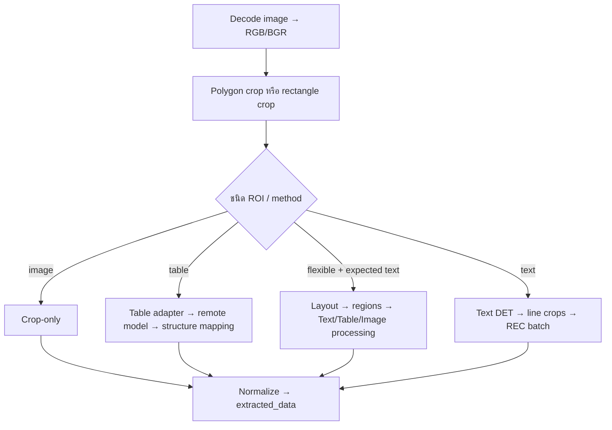

# 09 — OCR และ AI Pipeline

## 1. Overview และขอบเขตโมเดล

Backend รับภาพกับ ROI แล้วเลือก adapter ตามชนิดงาน ก่อนส่งภาพ crop ไป Model Gateway ผลโมเดลถูก normalize และ map เป็น extracted_data ให้ Frontend Model Gateway เป็น External Dependency คู่มือนี้อธิบาย contract ฝั่ง client ไม่รับรอง checkpoint/ฮาร์ดแวร์ของบริการภายนอก

## 2. OCR Request และ Response

POST /api/ai/process ใช้ DocumentPayload มี image, rois และ async_mode ตัวอย่างนี้ตรง schema แต่ BASE64_IMAGE ต้องแทนด้วยภาพจริง และ ROI ต้องอยู่ในหน่วย pixel ของภาพนั้น:

```json
{
  "image":"data:image/png;base64,BASE64_IMAGE",
  "async_mode":true,
  "rois":[
    {
      "roiId":1,
      "fieldName":"applicant_name",
      "x":100,
      "y":200,
      "width":600,
      "height":80,
      "type":"text",
      "extractionMethod":"paddle_thai_ocr",
      "roiMode":"fix"
    }
  ]
}
```

ตัวอย่าง acknowledgement ไม่ใช่ผลรันจริง:

```json
{"success":true,"job_id":"ocr_EXAMPLE","status":"queued","job_create_ms":1.25}
```

poll GET /api/ai/jobs/{job_id} จน completed แล้วอ่าน result.extracted_data หรือ failed แล้วอ่าน error หากไม่ใช้ async_mode route เรียกประมวลผลและรอผลทันที

| Field ของผล ROI | ความหมาย |
| --- | --- |
| roiId, fieldName | ใช้จับคู่พื้นที่ใน UI |
| text, confidence | ข้อความ/คะแนนจาก pipeline; ไม่ใช่ accuracy benchmark |
| type, extraction_method, roi_mode, expected_content | metadata จาก ROI |
| raw_segments, ocr_attempts, ocr_preprocessing | diagnostics ที่ response mapping เลือกส่ง |
| ocr_engine, ocr_model | engine/model ที่ adapter รายงาน |
| table_rows, table_structured, table_sections, table_html, table_debug | ผลตารางเมื่อมี |

อย่าใช้ลำดับ index อย่างเดียวเพราะ crop ว่างอาจถูกข้าม ควรรักษา roiId ในการ map ผล

## 3. Pipeline Selection และ Data Flow



| ลำดับเลือก | เงื่อนไข |
| --- | --- |
| 1. image | type=image หรือ extractionMethod=extract_image |
| 2. table | type=table หรือ method=table_recognition_v2/ocr_table |
| 3. flexible_text | roiMode=flexible และ expectedContent=text |
| 4. text | กรณีที่เหลือ |

process_roi_with_engine แยก type=table/table_recognition_v2 ก่อน ocr_table จึงต้องดูทั้ง type และ method ไม่เลือกจาก method อย่างเดียว typhoon_ocr ถูก normalize เป็น paddle_thai_ocr

ถ้า rois=[] ใช้ full-page text detection แล้วอ่านแต่ละพื้นที่ ไม่ใช่ request ว่างที่ไม่ทำงาน polygon ที่ไม่ใช้ได้ fallback rectangle ส่วน crop ว่างถูกข้าม

## 4. Text DET/REC Contract

ocr_adapter รวม fixed-text crops ส่ง DET batch แบ่ง chunk 60 แล้วเตรียม line crops สำหรับ REC ตัว REC adapter ก็ chunk 60 และ helper ที่อ่านหนึ่งภาพเรียก batch ด้วยหนึ่งรายการ

text_response_contract ตรวจ DET/REC โดยรักษา order/ขอบเขตภาพและจำนวน batch ไม่ pad/drop ผลเอง ตรวจ finite coordinates/scores และปฏิเสธ bool แทนตัวเลข wrapper รองรับ data/result/results/raw_output/predictions/raw_predictions/res ตามเงื่อนไข ไม่ไล่อ่านข้อความจาก metadata โดยพลการ

ตัวอย่าง normalized leaf ที่ผ่านโครงสร้าง contract สำหรับ DET ว่าง:

```json
{"dt_polys":[],"dt_scores":[]}
```

ตัวอย่าง REC leaf (ข้อความ/คะแนนสมมติ):

```json
{"rec_text":"ตัวอย่างข้อความ","rec_score":0.9}
```

DET failure ที่ถูก adapter จับอาจ fallback ไป REC ทั้ง crop จึงต้องดู diagnostics ด้วย ไม่ตีความว่ามี text แล้ว DET สำเร็จ TEXT_RECOGNITION_SCORE_THRESHOLD default 0.0 ใช้กรอง text lines ตาม branch; BACKEND_OCR_INCLUDE_RAW_OUTPUT เปิด raw output ใน REC adapter

## 5. Table และ Flexible ROI

Table recognize_table_v2_local เรียก remote model แล้วสร้าง rows/HTML/structured cells ใน Backend ชื่อ local ไม่ได้หมายถึงโหลด weights ใน process นี้ ตัวจัดผลใช้ cell boxes/recognized items และมี fallback อ่านผลรูปแบบที่รองรับ

Cell mapping ให้ text/ocrText/groundTruth เริ่มจากข้อความเดียวกัน และเก็บ spans/bbox/recognized items ตามผล input Normalization ใช้ cleanup_noise=false เพื่อไม่ลบตัวอักษร/ตัวเลขใน cell แบบ generic การมีโครงสร้างไม่รับรอง confidence; ไม่มี raw scores อาจได้ confidence=0

Flexible text เรียก Layout ภายใน boundary แล้วแยก text/table/image regions ก่อนรวมผล helper มี resolved_blocks แต่ process_document_payload ไม่ได้ copy key นี้เข้า response โดยตรง การเพิ่ม UI ที่พึ่ง key นี้ต้องแก้ response mapping ด้วย

## 6. Layout API สำหรับ Auto ROI

POST /api/layout/analyze ใช้ LayoutAnalysisPayload ตัวอย่างตาม schema:

```json
{
  "images":[{"page_index":0,"image":"data:image/png;base64,BASE64_IMAGE"}],
  "auto_roi_mode":"text_line"
}
```

route เรียก analyze_layout ด้วย layout-only behavior ที่ระบุ use_text_detection=false แล้ว dedupe regions ส่ง page_index/page_number และ ROI ratios กลับ พร้อม type/extraction_method ให้ UI แปลงเข้า workspace การรับ auto_roi_mode ใน DTO ไม่ได้แปลว่า route ใช้ทุกค่า; branch ปัจจุบันระบุ text_line เอง

## 7. Gateway Endpoints และ Model Configuration

ทุก path ในตารางนี้เป็น outbound request ของ Backend ไม่ใช่ endpoint ของ FastAPI app นี้:

| งาน | Default Gateway path |
| --- | --- |
| Layout | /paddle/api/v1/document-layouts |
| Text DET single/batch | /paddle/api/v1/text-detections?version=v6 และ /paddle/api/v1/text-detection-batches?version=v6 |
| Text REC single/batch | /paddle/api/v1/text-recognitions และ /paddle/api/v1/text-recognition-batches |
| Table | /paddle/api/v1/table-model-results?det_version=6&rec_version=5&det_model=baseline&rec_model=thai_ft_v3 |
| SigLIP single/batch | /paddle/api/v1/image-verifications และ /paddle/api/v1/image-classification-batches |

DET/REC paths เลือกจาก active saved model settings มี built-in IDs ocr_det_v6_medium และ thai_ocr_v5_mobile การตั้งค่าจริงอาจต่างจาก defaults ตรวจ GET /admin/settings/ocr-models แล้วใช้ check endpoint ของ model เพื่อ probe ทั้ง single/batch

ตัวอย่าง OcrActiveModelsUpdate ใช้ IDs ที่ built-in config ประกาศ; ก่อนส่งต้องตรวจว่ารายการยังมีอยู่จริง:

```json
{"text_detection_model_id":"ocr_det_v6_medium","text_recognition_model_id":"thai_ocr_v5_mobile"}
```

runtime client ใช้ JSON body image หรือ images เป็น data URLs ใส่ Authorization เมื่อ key ไม่ว่าง timeout ปกติ 120 วินาที และ wrappers ของ batch DET/REC, Table, SigLIP ใช้ 240 วินาที ไม่พบ retry ใน _post_predict

## 8. Error Handling และการพัฒนาต่อ

HTTP/invalid JSON/success=false/model identity mismatch เป็น ModelRuntimeUnavailableError จาก client adapter แปลงเป็น error ตามชนิดงาน ส่วน DET/REC contract mismatch ไม่ถือเป็นผลว่างที่สำเร็จ

Synchronous OCR route จับ Paddle/Layout unavailable เป็น 503 และ generic เป็น 500 Table error ไม่มี except เฉพาะ ส่วน async job จะบันทึก failed ดู [10](10_PROCESSING_JOBS_LOGS.md)

เมื่อเพิ่มโมเดล/แก้ response ให้ตรวจ model identity, batch count, shape, order และ Frontend mapper ด้วย ไม่ทดแทน field ที่หายด้วยข้อความ/คะแนนที่แต่งขึ้น และไม่รายงาน client HTTP timing เป็น GPU inference time

## 9. Source References

| Source | Function/Class |
| --- | --- |
| [main.py](../../project_backend/main.py) | process_document_payload, process_roi_with_engine, process_flexible_text_roi, analyze_document_layout |
| [OCR adapter](../../project_backend/app/processing/ocr_adapter.py) | recognize_text_crops_with_detection, recognize_text_roi |
| [REC adapter](../../project_backend/app/model_runtime/paddle_thai_ocr_adapter.py) | run_paddle_thai_ocr_batch |
| [Table adapter](../../project_backend/app/model_runtime/table_recognition_v2_adapter.py) | recognize_table_v2_local |
| [Text contract](../../project_backend/app/model_runtime/text_response_contract.py) | normalize_single, normalize_batch |
| [Runtime client](../../project_backend/app/core/model_runtime_client.py) | _post_predict, remote wrappers, probe_ocr_model |
| [Model settings](../../project_backend/app/core/ocr_model_config.py) | DEFAULT_OCR_MODEL_SETTINGS, normalize_saved_ocr_settings |
