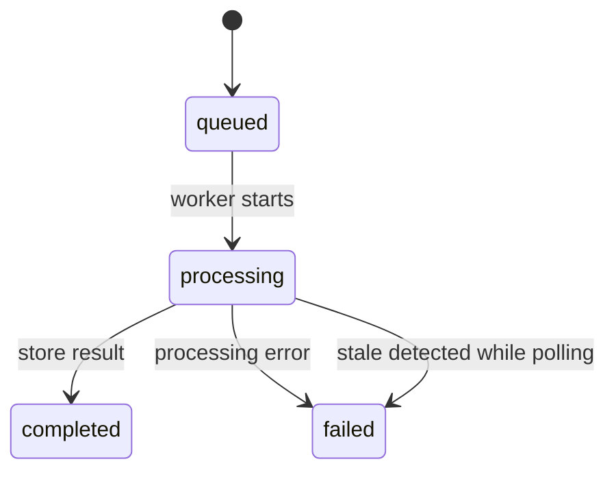

# 10 — Processing Jobs, Logs และ Maintenance

## 1. งานแต่ละชนิดเก็บสถานะที่ใด

| งาน | ที่เก็บ | ผู้รัน/ข้อจำกัด |
| --- | --- | --- |
| Detection | detect_dev_jobs dictionary + Lock | BackgroundTasks; state หายเมื่อ process restart |
| Prepublish detection | prepublish_detection_jobs dictionary + Lock | BackgroundTasks; poll ต้องตรง template_id/job_id |
| OCR | ocr_jobs ใน PostgreSQL | enqueue เฉพาะ ID ไป worker แล้วโหลด request_json เมื่อทำงาน |
| Publish | publish_jobs ใน PostgreSQL | confirm-publish รัน job ผ่าน service ทันทีตามเส้นทางปัจจุบัน |

คำว่า job ไม่ได้หมายถึงมี durable distributed queue ทุกชนิด Detection/prepublish poll ที่เข้าอีก worker อาจไม่พบ ID ส่วน OCR persistence ไม่ได้รับรอง automatic resume หลัง process ตาย

## 2. OCR Job Lifecycle



POST /api/ai/process บันทึก request_json โดยตั้ง async_mode=false ภายในข้อมูลที่เก็บ แล้วส่ง job_id เข้า BackgroundTasks/memory worker ป้องกันการนำ payload ไปสร้าง async job ซ้ำตอน worker ประมวลผล

memory_usage ใช้ ThreadPoolExecutor(max_workers=1) ต่อ process serialized wrapper เรียกซ้อนใน worker เดิมได้เพื่อไม่ deadlock การปิด OCR_MEMORY_DIAGNOSTICS ไม่ได้ปิดการ serialize งาน

run_ocr_job เปลี่ยน processing → โหลด payload → process_document_payload → เก็บ result_json/completed หากล้มเหลวพยายามบันทึก failed และ clear layout cache ใน finally

OCR_JOB_PROCESSING_TIMEOUT_SECONDS default 900 ขั้นต่ำ 60 ตรวจ stale ตอน GET job เฉพาะ status processing ไม่ใช่ timer ที่ cancel thread/HTTP เมื่อครบเวลา queued ไม่เข้าเกณฑ์นี้ และ worker ที่ยังทำงานอาจกลับมาเขียน completed ภายหลัง

## 3. Polling และการเชื่อมกับ Browser

| Client flow | Poll behavior |
| --- | --- |
| Detection | abortable delay 1,000 ms; ส่ง signal ให้ request/delay |
| OCR | delay 500 ms; helper ไม่มี deadline/AbortSignal แบบเดียวกัน |
| Prepublish | API มี progress/progress_events; เก็บ events ท้ายสุด 20 รายการ |

ทั้ง Detection และ OCR poll อาจ HTTP 200 แต่ status=failed ต้องตรวจ body ไม่อ่านเพียง response.ok ปิด Browser หรือเริ่มเอกสารใหม่ไม่ได้เรียก server cancellation API ต้องกัน late result ไป commit state ของ run ใหม่ด้วย

## 4. Processing Log Snapshot

Frontend บันทึก snapshot เมื่อมี processing run และผล OCR ตามจุดใน workflow เช่น OCR completed, เปลี่ยนเอกสาร, ออกจากระบบ หรือกลับไป ROI helper ข้ามกรณีไม่มี active run/results จึงไม่ใช่ audit ของทุก Detection request

| ข้อมูล | จุดประสงค์ |
| --- | --- |
| processing_run_id | unique conflict key สำหรับ upsert run เดิม |
| source_pages / page_files | metadata และภาพที่จะบันทึก |
| template_detection / matched_template | ผลการเลือก Template ขณะนั้น |
| roi_snapshot | พื้นที่ที่ใช้ประมวลผล |
| ocr_original | ผลก่อนตรวจทาน |
| ground_truth | ผลที่ผู้ใช้แก้ไข |
| metadata.snapshotReason | เหตุผลบันทึกและเงื่อนไขรักษาต้นฉบับ |

ตัวอย่าง ProcessingLogUpsertRequest แสดงรูปแบบ ไม่ใช่ผล OCR ที่รันจริง:

```json
{
  "processing_run_id":"handover_example_run",
  "document_name":"sample.png",
  "status":"completed",
  "page_count":1,
  "source_pages":[{"pageNumber":1}],
  "page_files":[{"pageNumber":1,"dataUrl":"data:image/png;base64,BASE64_IMAGE"}],
  "ocr_original":[{"fieldName":"name","text":"ข้อความก่อนแก้"}],
  "ground_truth":[{"fieldName":"name","text":"ข้อความหลังแก้"}],
  "metadata":{"snapshotReason":"ocr_completed"}
}
```

แทน BASE64_IMAGE ด้วยภาพจริงก่อนส่ง POST /processing-logs service ตรวจ run ID ไม่ว่าง และ upsert ตาม run ID รักษา original เดิมใน snapshot ที่ไม่ใช่ ocr_completed ตามเงื่อนไข ไม่ควรเปลี่ยน reason เพื่อเขียนทับโดยไม่เข้าใจ lifecycle

queueProcessingLogSave เป็น fire-and-forget ไม่มี durable retry queue ฝั่ง Browser การออกจากหน้าไม่ได้รับรองว่า snapshot ทุกครั้งถูกส่งถึง DB

## 5. การเก็บและอ่านภาพ

service พยายามอ่านภาพจาก detection query ที่ยังมีอยู่ก่อน แล้ว fallback page_files สำหรับหน้าที่ขาด บันทึก Base64/MIME ลง processing_log_images ภายใน transaction ของ upsert metadata บาง references เป็น logical/legacy paths ไม่ใช่หลักฐานว่ามีไฟล์ถาวรบน disk

Preview ใช้ GET /admin/processing-logs/{log_id}/pages/{page_number}?kind=source หรือ kind=processing อ่าน DB ก่อนและมี legacy path fallback response เป็น image bytes พร้อม MIME

หากใช้ legacy fallback แล้วอ่านไฟล์ได้ page_image_content จะบันทึกภาพลง DB ในการอ่านครั้งนั้นด้วย จึงไม่ควรถือว่าการเปิด preview ของ Log เก่าทุกกรณีเป็น DB read-only

Detection ปกติลบ query artifacts ใน finally เมื่อ cleanup_generated=true และ SAVE_DEBUG_ARTIFACTS=false จึงต้องรักษา pageFiles ของ Frontend การมี queryId หรือ persistedInBackend flag ใน snapshot ไม่ยืนยันว่า bytes ยังอ่านจาก query directory ได้

## 6. Cleanup และ Legacy Image Migration

StorageMaintenanceService ค่า default max_age_hours=24, dry_run=true สแกนตาม mtime และรายงาน candidates สูงสุด 200 แถว แต่ count นับทั้งหมด ไม่ตรวจ DB references ก่อนลบทุกไฟล์

Directories ที่กำหนดคือ project_backend/app/cropped_rois และ project_backend/storage/detection_queries ส่วน main.py OUTPUT_DIR เป็น relative cropped_rois ขึ้นกับ working directory จึงต้องตรวจ path จริงก่อนใช้ cleanup ลดพื้นที่

ตัวอย่าง migration จาก project_backend:

```powershell
python scripts/migrate_processing_log_images.py --log-id LOG_ID
python scripts/migrate_processing_log_images.py --log-id LOG_ID --apply
```

ครั้งแรกเป็น dry-run ของภาพ ครั้งที่สองบันทึก DB และคงต้นฉบับ อย่างไรก็ตาม script เรียก ensure_database_ready จึงอาจทำ bootstrap DB แม้ไม่ได้ใส่ --apply การไม่ระบุ ID ตรวจทุก Log ไม่ใช่คำสั่งที่จัดทำเอกสารนี้รันจริง

## 7. Maintenance และ Pending Operations

GlobalSettingsService ใช้ enforcement พร้อม scheduledStartAt/expectedEndAt เพื่อคำนวณสถานะ แต่การ defer บาง settings ใช้ enforcement boolean แม้ยังไม่อยู่ช่วง active จึงต้องแสดง/ตรวจ pending ควบคู่

| งาน | ข้อควรรู้ |
| --- | --- |
| Active OCR selection / strategy | มี pending path เมื่อ enforcement เปิด |
| Active Template Field/Page updates | มี pending operation ตาม branch |
| create/delete Page หรือ model metadata บาง operation | ไม่ได้ defer เหมือน update ทุกกรณี |
| Pending apply | ทำ DB updates ใน transaction แล้ว refresh cache หลัง commit |
| Due check | อิง start/เวลาปัจจุบัน; ไม่มี background scheduler รับรองว่าจะ apply ตรงเวลาโดยไม่มี request |

Maintenance SSE hub อยู่ใน process ใช้ Condition/version ส่งสถานะแรกและ event/keepalive Frontend มี boundary refresh ของตน ไม่ใช่ distributed event bus บาง settings read error fallback เป็น disabled จึงไม่ควรอ้างว่า gate fail closed ทุกกรณี

## 8. Source References

| Source | Function/Class |
| --- | --- |
| [Main](../../project_backend/main.py) | create_ocr_job, run_ocr_job, get_ocr_job, _mark_stale_ocr_job_failed |
| [Worker](../../project_backend/app/processing/memory_usage.py) | enqueue, serialized, shutdown |
| [Routes](../../project_backend/app/api/routes.py) | _run_detect_dev_job, _run_prepublish_detection_job, log APIs |
| [Services](../../project_backend/app/business/services.py) | ProcessingLogService.upsert, _persist_page_files, page_image_content, StorageMaintenanceService, GlobalSettingsService |
| [Maintenance hub](../../project_backend/app/business/maintenance_events.py) | maintenance_event_hub |
| [User page](../../project_frontend/src/app/page.tsx) | queueProcessingLogSave, runAiProcessJob |
| [Migration](../../project_backend/scripts/migrate_processing_log_images.py) | run |
