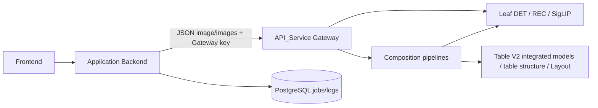

# 13 — Model API Service

ปรับปรุงจาก Source Code วันที่ 10 พฤศจิกายน 2569 (2026-11-10)

## 1. Overview และ System Architecture

API_Service มีซอร์ส FastAPI สำหรับ Gateway, composition pipelines และ model inference services แล้ว จึงไม่ใช่บริการที่ไม่มี implementation ใน workspace อีกต่อไป แต่ยังต้องเปิดเป็น process/container แยกจาก application Backend และเตรียม dependencies, weights/cache และฮาร์ดแวร์ภายนอกตามงาน

| ส่วน | สถานะ | ความรับผิดชอบ |
| --- | --- | --- |
| Gateway | Implemented | รับ JSON/multipart, เลือก upstream, auth/rate/admission limits และ envelope |
| Pipeline services | Implemented | รวม Layout/DET, polygon OCR, table และ image verification |
| Leaf services | Implemented | โหลด PaddleOCR/PyTorch models และ infer |
| Runtime/model selection | Configurable | Environment และ model_variants.json |
| Legacy aliases/format | Legacy | ซ่อนจาก OpenAPI บาง route และปิดได้ด้วย flag |
| Model API integration | ใช้งานตามสถานะที่ผู้ดูแลยืนยัน | Table V2/Batch ทดสอบแล้วปกติ; Model Selection/Layout ไม่มีปัญหาที่รายงาน; เหลือ SigLIP เป็นงานต่อ |
| Weights, GPU/driver, registry access และ live deployment | External Dependency / Not Verified | มี loader/config แต่ไม่ได้โหลดหรือทดสอบจริงในการจัดทำเอกสาร |



Gateway ไม่เรียกโมเดลทุกงานเอง ตัวอย่าง Text DET/REC ไป leaf โดยตรง ส่วน document-layouts ไป pipeline ที่เรียก Layout และ DET อีกชั้น Table V2 เป็น integrated Paddle pipeline ที่มี submodels ของตน ไม่ใช่ HTTP composition แบบ custom table

## 2. Project Structure

```text
API_Service/
├─ app.py                       Compatibility entry: PaddleOCR pipeline
├─ services/*/main.py           FastAPI apps แยก process
├─ inference/                   Model selection/load/predict
├─ pipelines/                   Layout, OCR, table และ verification orchestration
├─ clients/model_service_client.py  Pipeline HTTP boundary
├─ core/                        App factory, parsing, auth, queue, telemetry/cache
├─ shared/                      Contracts, serialization, variants และ upstream HTTP
├─ model_variants.json          DET/REC catalog และ local paths
├─ requirements/                Base/API/Paddle/SigLIP/dev และ constraints
├─ scripts/                     Windows/Linux setup และ process manager
├─ deploy/nginx/nginx.conf      ตัวอย่าง HTTPS edge configuration
├─ tests/                       Mock/contract/infrastructure tests
└─ weights/                    พื้นที่วาง weights; .gitkeep ไม่ใช่โมเดล
```

เส้นทาง import เช่น core/shared/services อิง API_Service เป็น working directory หรือ PYTHONPATH ห้ามนำ virtualenv ของ Backend มารวมโดยไม่ตรวจ versions เพราะ API_Service ใช้ FastAPI/Paddle dependencies คนละชุด

## 3. Model Service Entry Points

พอร์ตเป็น default ของ bare-metal launch scripts ไม่ใช่พอร์ตที่ยืนยันว่ารันอยู่จริง รายละเอียดต่อไปนี้อิงการเปิด services แยก process ผ่าน Windows/Linux launchers

| Service ใน launcher | Uvicorn module | Default port | ประเภท |
| --- | --- | ---: | --- |
| gateway | services.gateway.main:app | 8080 | Router/API env |
| layout | services.layout.main:app | 8001 | Paddle leaf |
| detection | services.text_det.main:app | 8002 | Unified DET v5/v6 leaf |
| rec-th | services.text_rec.main:app | 8004 | REC leaf + fair queue |
| ocr-custom | services.ocr_pipeline_custom.main:app | 8005 | HTTP DET → crop → REC |
| ocr-paddle | services.ocr_pipeline_paddle.main:app | 8006 | Integrated PaddleOCR |
| table-wired / table-wireless | services.table.main:app | 8007 / 8008 | Table structure leaf; ต่างด้วย env |
| siglip | services.siglip.main:app | 8009 | PyTorch leaf |
| layout-pipeline | services.layout_pipeline.main:app | 8010 | Layout + DET composition |
| table-pipeline | services.table_pipeline.main:app | 8011 | Custom table composition |
| image-verification | services.image_verification_pipeline.main:app | 8012 | binary-v3 verification |
| table-v2 | services.table_v2.main:app | 8013 | TableRecognitionPipelineV2 |


app.py import app จาก services.ocr_pipeline_paddle.main ไม่ใช่ Gateway ต้องเลือก services.gateway.main:app เมื่อจะเปิด Gateway

## 4. Model Initialization และ Loading

Model objects โหลดแบบ lazy ผ่าน cache loader เมื่อมี inference หรือ readiness ที่เรียก loader ไม่ใช่ health endpoint ทุกตัวจะโหลดโมเดล

| งาน | Constructor / การเลือก |
| --- | --- |
| Layout | paddleocr.LayoutDetection; default PP-DocLayoutV3 |
| DET | paddleocr.TextDetection; resolve_model_variant เลือก version/model |
| REC | paddleocr.TextRecognition; รองรับ global rec_input_shape ใน catalog |
| Table structure | paddleocr.TableStructureRecognition; SLANeXt_wired/wireless |
| Table V2 | paddleocr.TableRecognitionPipelineV2; รวม structure + DET/REC ภายใน |
| Paddle OCR | paddleocr.PaddleOCR; เลือกคู่ DET/REC หรือ legacy environment defaults |
| SigLIP | SiglipProcessor/SiglipModel.from_pretrained แล้ว eval/to(device), torch.inference_mode |

singleflight_lru_cache ใช้ RLock กัน loader miss ซ้ำและ lru_cache เก็บ object ต่อ process: Layout/Table structure/SigLIP max 1, DET/REC max 8, Table V2 default 2 และ PaddleOCR default 2 การเปลี่ยน variant จึงอาจเพิ่ม weights ใน GPU memory การ eviction ไม่ใช่หลักประกันว่า GPU allocator คืน VRAM ทันที

model_variants.json รองรับ version v5/v6 และ variant ที่ประกาศจริง เช่น baseline และ thai_ft_* baseline ที่ local artifacts ใช้ไม่ได้อาจกลับไป official model name; requires_local_weights=true ไม่มี directory/files จะ 422 MODEL_VARIANT_UNAVAILABLE ก่อน infer การตรวจว่ามีไฟล์ไม่รับรองว่าเป็น weights ที่ถูกต้อง

catalog ปัจจุบันมี absolute paths ใต้ /workspace/API_service/weights การติดตั้งแต่ละ environment ให้กำหนด paths ของ artifacts ตาม catalog และ launcher ที่ใช้ ไม่ถือว่า weights ถูกบรรจุมากับ source repository

MODEL_DEVICE default gpu:0 Paddle options ปิด MKLDNN ส่วน SigLIP แปลง gpu/cuda เป็น cuda:index และ error หาก torch ไม่พบ CUDA ไม่มี automatic GPU→CPU fallback ใน branch นี้

Readiness ของ DET/REC/Table ตรวจ default selection ไม่ได้รับรองทุก fine-tuned variant ที่อาจส่งภายหลัง

## 5. Model Gateway Architecture

Frontend → Backend ใช้ NEXT_PUBLIC_API_URL; Backend → Gateway ใช้ GATEWAY_URL และ MODEL_GATEWAY_API_KEY; Gateway/Pipelines → services ใช้ ServiceURLs และ INTERNAL_API_TOKEN ชุด token ภายในต้องตรงกันในทุก process ที่เกี่ยวข้อง

Gateway parse JSON Base64 เป็น verified temp file แล้วส่ง multipart image/images ไป upstream ผ่าน post_images พร้อม X-Request-ID รูปแบบ response จาก upstream ต้องมี data จากนั้น Gateway ห่อ data/meta ใหม่ ไม่ส่ง meta ของ leaf กลับทั้งหมด

ServiceURLs ที่ใช้บ่อย:

| ตัวแปร | Default เมื่อเปิด module โดยตรง |
| --- | --- |
| TEXT_DETECTION_URL | http://localhost:8002; ค่า nonempty นี้มาก่อน DET_SERVICE_URL ใน composition ที่เกี่ยวข้อง |
| REC_SERVICE_URL | http://localhost:8004 |
| LAYOUT_SERVICE_URL / LAYOUT_PIPELINE_URL | http://localhost:8001 / http://localhost:8010 |
| OCR_CUSTOM_URL / OCR_PADDLE_URL | http://localhost:8005 / http://localhost:8006 |
| TABLE_PIPELINE_URL / TABLE_MODEL_URL | http://localhost:8011 / http://localhost:8013 |
| SIGLIP_URL / SIGLIP_SERVICE_URL | http://localhost:8009 |
| IMAGE_VERIFICATION_URL | http://localhost:8012 |
| TABLE_WIRED_SERVICE_URL / TABLE_WIRELESS_SERVICE_URL | http://localhost:8007 / http://localhost:8008 |
| OCR_SERVICE_URL | http://localhost:8005; ใช้ custom table |

GET services รายงาน inventory/capabilities ที่ตั้งค่า ไม่ probe upstream ส่วน readiness probe enabled services และตัดสินจาก required list GATEWAY_ENABLED_SERVICES/GATEWAY_REQUIRED_SERVICES มาก่อนชื่อเดิม *_PIPELINES รวมถึงกรณีตั้งเป็นสตริงว่าง

Enabled/required lists ใช้ discovery/readiness ไม่ได้เป็น route authorization allowlist ใน _forward ทุก endpoint หากมีบาง service พร้อมและไม่มี required failure Gateway อาจตอบ readiness=degraded HTTP 200 แม้ endpoint ที่ Backend ต้องใช้ยังไม่พร้อม

## 6. API Endpoint Documentation

path ด้านล่างเป็นของ API_Service ไม่ใช่ Backend ในคู่มือ 05 ทุก model request เป็น POST ยกเว้น Operations/Discovery ที่ระบุ GET

| Gateway endpoint ใต้ /paddle/api/v1 | Upstream | การเลือก/หน้าที่ |
| --- | --- | --- |
| document-layouts / document-layout-batches | layout-pipeline | Layout+DET workflow; auto_roi_mode ใน body |
| layout-prediction-batches | layout leaf | Raw Layout batch |
| text-detections / text-detection-batches | Unified detection | version=5/v5/6/v6, model=variant; unversioned ขอ legacy-layout format |
| text-recognitions / text-recognition-batches | REC leaf | version/model หรือ default ของ service |
| ocr-results | ocr-custom หรือ ocr-paddle | engine=custom เป็น default; engine=paddle เลือก integrated |
| ocr-result-batches | ocr-paddle | รองรับ engine=paddle เท่านั้น |
| table-results | table-pipeline | table_mode auto/wired/wireless และ include_ocr |
| table-model-results | table-v2 | Integrated Table V2; version/profile และ det_version/rec_version, det_model/rec_model |
| image-classifications / image-classification-batches | SigLIP leaf | Raw logits ตาม categories/prompts |
| image-verifications | image-verification pipeline | Target category decision ด้วย binary-v3 |
| GET services | Gateway | Configured capabilities; ไม่โหลดโมเดล |
| GET readiness | Gateway | Probe readiness upstream; อาจโหลดโมเดล |
| GET health | ทุก app ผ่าน app factory | Process metadata; ไม่โหลดโมเดล |

Gateway ไม่มี single /layout-predictions route แต่ leaf Layout มี ทั้ง leaf Layout และ table structure มี single/batch routes ของตน; /table-structures และ /table-structure-batches ไม่ได้ expose ผ่าน Gateway table routes อื่นโดยอัตโนมัติ

/health เป็น hidden alias ในทุก app บาง leaf มี /predict และ /v1/textdetection หรือ /v1/textrecognition เป็น Legacy ตาม decorators LEGACY_ENDPOINTS_ENABLED default true ใน development, false ใน production อย่าใช้ alias เป็น contract ใหม่

## 7. Request/Response Contracts

### 7.1 Image input

parse_image_request รับ application/json หรือ multipart/form-data ไม่รับ raw image bytes/PDF ตรง ๆ แบบ parser บางตัวของ Backend

| รูปแบบ | Single | Batch |
| --- | --- | --- |
| JSON | image หรือ image_base64 เป็น Base64/Data URL | images เป็นรายการ Base64/Data URL |
| Multipart | image file หรือ image_base64 | images files ตามลำดับ; parser ยอมรับ image file key ด้วย |
| Model selection | query หรือ body fields ตาม route resolver | query มีลำดับก่อนสำหรับ selector ที่ route รองรับ |

ตัวอย่าง JSON ของ Text DET batch แทน BASE64_IMAGE_* ด้วยภาพจริงก่อนใช้งาน; ตัวอย่างนี้ไม่ได้รัน inference:

```json
{
  "images":["data:image/png;base64,BASE64_IMAGE_1","data:image/png;base64,BASE64_IMAGE_2"],
  "version":"v6",
  "model":"baseline"
}
```

### 7.2 Envelope

Success ใช้ data/meta ไม่มี success=true บังคับ; Backend _post_predict รองรับ data envelope นี้:

```json
{
  "data":{"status":"ok","model":"pipeline-router-v1","device":"gpu:0"},
  "meta":{"request_id":"req_example","api_version":"v1","service":"model-api-gateway","duration_ms":0.0,"model":"pipeline-router-v1"}
}
```

เป็นตัวอย่างรูปแบบ health response ค่าเวลาไม่ใช่ผลวัดจริง Error ใช้ error.code/message/details/request_id/docs เช่น:

```json
{
  "error":{"code":"IMAGE_REQUIRED","message":"The image field is required.","details":[{"field":"image","issue":"required"}],"request_id":"req_example","docs":"http://localhost:8080/docs"}
}
```

### 7.3 Leaf output และ Batch ordering

Leaf default ใช้ contract_version=leaf-inference-v1, kind และ raw_output; response_format=compact เปลี่ยนเป็น normalized output เฉพาะชนิดที่ helper รองรับ ตัวอย่าง REC single data ส่วนภายใน envelope:

```json
{
  "contract_version":"leaf-inference-v1",
  "kind":"text_recognition",
  "raw_output":[{"rec_text":"ข้อความตัวอย่าง","rec_score":0.9}],
  "model_selection":{"kind":"recognition","version":"v5","variant":"baseline","model_name":"th_PP-OCRv5_mobile_rec","local_weights":false}
}
```

ข้อความ/คะแนนเป็น fixture เพื่ออธิบาย schema ไม่ใช่ผลโมเดล DET ใช้ dt_polys/dt_scores; REC ใช้ rec_text/rec_score Backend normalize_single/normalize_batch อ่าน raw_output ได้ตามตัวอย่างที่มี shape ถูกต้อง

SigLIP leaf data ต่างจาก Backend contract ที่คาด:

```json
{
  "contract_version":"leaf-inference-v1",
  "kind":"siglip",
  "raw_output":[{"logits_per_image":[1.0,-1.0]}],
  "categories":["prompt A","prompt B"],
  "device":"cpu"
}
```

ตัวอย่างนี้มีสอง prompts เพื่อแสดง shape เท่านั้น ไม่ใช่ vector 15 categories ที่โค้ด Backend V2.4 เดิมคาดไว้ ดูแนวทางปรับ Backend ในหัวข้อ 13 ก่อนนำไปใช้ตัดสิน Image Anchor

Batch รักษาลำดับ input list ผ่าน chunk/flatten ส่วน DET/REC adapter จัดจำนวน raw_output ด้วย expected_count ซึ่งมีการ pad/truncate ตาม implementation Backend อ่านแต่ละ leaf ผ่าน normalizer ของตน ผู้ดูแลยืนยันว่า Batch ใช้งานปกติ การเพิ่มโมเดลใหม่ต้องรักษาจำนวน ลำดับ และ field types ตาม contract เดิม

## 8. Model Inference Workflow

### Layout Detection

Document Layout pipeline decode ภาพ → เรียก Layout leaf → เรียก DET leaf ตามลำดับ → แยก text/table/image และกรองความสัมพันธ์ → ปรับ padding/neighbor overlap → sort ตาม y/x → regions พร้อม bbox/bbox_ratio, text_lines และ raw output โหมด text-line/layout/hybrid มี implementation แต่ยังเรียกทั้ง Layout และ DET ก่อนเลือกผลทุกโหมด

### Text และ OCR

DET/REC leaf เรียก Paddle predict และแนบ model_selection ส่วน custom OCR เรียก DET → perspective crop ของ quadrilateral → หมุน crop สูงตามสัดส่วน → ส่ง REC เป็น chunks → จับคู่ผลตามลำดับ → legacy text/segments/lines contract พร้อมลบ crop ชั่วคราวใน finally

Integrated PaddleOCR เป็นอีกเส้นทางที่โหลด DET+REC ภายใน process เอง ไม่แชร์ model object กับ leaf แยก เมื่อไม่ได้ส่ง selection ใช้ environment รุ่นเดิม; เมื่อมี selection จึง resolve pair จาก catalog

### Table Recognition

| เส้นทาง | งานที่ทำ |
| --- | --- |
| table-model-results | TableRecognitionPipelineV2 เปิด OCR/cell matching, ปิด orientation/unwarp/layout detection; ส่ง raw_output + model_selection กลับให้ Backend reconstruct เพิ่ม |
| table-results | Custom pipeline วิเคราะห์เส้น grid เลือก wired/wireless ก่อน เรียก structure และ OCR พร้อมกัน แล้วจัดข้อความลง cells |
| Custom fallback | ถ้าคุณภาพไม่ผ่านใน auto mode อาจแยก semi-table regions เป็น batch และเรียก alternate structure model; เก็บ upstream failures ใน debug เมื่อยังประกอบผลได้ |

Custom table quality เป็น heuristic จาก shape/fill/consistency/OCR ไม่ใช่ calibrated accuracy ใช้ OCR ร่วมในครั้งแรกแล้วนำผลมาใช้ต่อ ไม่ได้ยิง OCR ใหม่ทุก candidate โดยไม่มีเงื่อนไข

### Image Verification

Raw SigLIP leaf แปลงภาพ RGB, processor text/images, model logits_per_image แล้ว serialize raw logits Pipeline image-verifications ส่ง prompts ไป leaf แล้วตัดสิน target rank 1 แบบ binary-v3 และส่ง verifications ของ targets กลับ ไม่มี negative competition/decision fingerprint แบบ Backend V2.4 ใน implementation นี้

## 9. Batch Processing, Concurrency และ Resource Usage

| ระดับควบคุม | Default ในโค้ด | ความหมาย |
| --- | --- | --- |
| MAX_BATCH_IMAGES | 64 | จำกัดภาพต่อ request ไม่ได้แบ่ง request ให้เอง |
| DET_BATCH_SIZE / REC_BATCH_SIZE | 16 / 16 | internal Paddle predict batch; invalid parse ใช้ 8 ตาม branch |
| LAYOUT_BATCH_SIZE / SIGLIP_BATCH_SIZE | 1 / 4 | internal model batching |
| TABLE_BATCH_SIZE | 4 | table structure leaf; ไม่ใช่ Table V2 batch endpoint |
| OCR_RECOGNITION_BATCH_SIZE | min(64,MAX_BATCH_IMAGES) | custom OCR composition ส่ง REC chunks |
| MAX_CONCURRENT_REQUESTS | direct public API 2, internal 1 | POST admission semaphore ต่อ app; launcher Gateway default 4 |
| INFERENCE_QUEUE_TIMEOUT_SECONDS | 5 | รอ POST admission ก่อน 503 SERVICE_BUSY |
| REC_FAIR_CHUNK_SIZE | 20 | round-robin turn; ไม่ใช่ GPU batch size |
| REC_QUEUE_MAX_JOBS / REC_QUEUE_MAX_IMAGES / REC_QUEUE_MAX_MB | 16 / 256 / 256 | ขอบเขตคิวต่อ REC process; bytes ของไฟล์ input ไม่ใช่ decoded GPU tensors |
| REC_JOB_TIMEOUT_SECONDS / REC_MAX_CONCURRENT_REQUESTS | 180 / 16 | REC job wait และ HTTP admission |

REC ใช้ FairInferenceQueue กับ ThreadPoolExecutor หนึ่ง worker แบ่งงานเป็น turns และ flatten ผลตามลำดับ ไม่สลับผลของผู้ใช้ Native inference ที่กำลังทำไม่ถูก interrupt เมื่อ caller timeout/cancel; queue เก็บ ownership ของไฟล์ไว้จน native call กลับก่อน cleanup

Leaf หลายตัวเรียก synchronous inference ใน async endpoint admission limit จึงไม่ใช่หลักประกันว่า event loop/nonblocking GPU concurrency ทุกชนิดเหมือน REC ห้ามเพิ่ม workers โดยคิดว่าใช้ weights ชุดเดียว: cache, limiter และ queues อยู่ต่อ process และหลาย process อาจโหลด weights ซ้ำ

### Timeout และ error propagation

Backend model client timeout ปกติ 120 วินาที; batch DET/REC, Table และ SigLIP 240 วินาที API_Service post_images ใช้ requests timeout 240 วินาทีต่อ upstream call และ readiness probe default 10 วินาที ความลึกหลาย hop อาจทำให้ client หมดเวลาก่อน upstream เสร็จ ไม่ใช่ global end-to-end cancellation deadline

| กรณี | Model API error |
| --- | --- |
| Invalid input/image | 400/415/422 ตาม parsing branch |
| Request/image/batch limits | 413 PAYLOAD_TOO_LARGE, BATCH_TOO_LARGE หรือ IMAGE_DIMENSIONS_TOO_LARGE |
| Auth / sliding-window rate | 401 AUTHENTICATION_REQUIRED / 429 RATE_LIMIT_EXCEEDED |
| Admission/REC capacity | 503 SERVICE_BUSY; REC wait timeout 504 INFERENCE_TIMEOUT |
| requests timeout/connect | 504 UPSTREAM_TIMEOUT / 503 UPSTREAM_UNAVAILABLE |
| Upstream non-JSON/no data | 502 UPSTREAM_INVALID_RESPONSE / UPSTREAM_CONTRACT_MISMATCH |
| Upstream error HTTP | 4xx คง status, upstream 5xx แปลง 502 UPSTREAM_MODEL_ERROR |
| Missing configured weights / loader error | MODEL_VARIANT_UNAVAILABLE, MODEL_WEIGHTS_UNAVAILABLE หรือ MODEL_NOT_READY ตามจุดที่ล้ม |
| CUDA/GPU error ใน run_image_inference | 503 GPU_UNAVAILABLE ตามข้อความ exception |

Backend แปลง HTTP error ของ Gateway เป็น ModelRuntimeUnavailableError แล้ว adapter/route จัดสถานะต่อ อาจจบเป็น failed job บน HTTP 200 ของ poll ดู [05](05_BACKEND_API.md) และ [10](10_PROCESSING_JOBS_LOGS.md)

### Logging และ Memory

- X-Request-ID ถูกส่งต่อ Gateway→pipeline→leaf; invalid ID จะสร้างใหม่ แต่ Backend _gateway_headers ยังไม่ส่ง model_call_id เป็น X-Request-ID โดยอัตโนมัติ จึงไม่ใช่ ID เดียวกับ processing_run_id
- RequestTelemetry วัด receive bytes, response bytes, duration/stages และ resources() ระดับ process; ไม่วัด per-request GPU allocation/VRAM
- Linux launcher ตั้ง logs/{service}.log, {service}.debug.log และ {service}.audit.jsonl; debug หมุน 20 MiB + 3 backups, audit 20 MiB + 10 backups
- Windows manager redirect เป็น {service}.windows.log/.windows.error.log; ไม่มีการตั้ง debug/audit file แบบ Linux อัตโนมัติใน manager
- Audit events ใช้ metadata/auth slot/status ไม่ส่ง token value หรือ document body แต่ access/debug logs อาจมี query string, model paths และ exception details ต้องดู retention/permissions และไม่ใส่ secrets ใน query
- parse_image_request สร้าง temp files และ endpoint cleanup ใน finally; REC ย้าย ownership ให้ queue ไม่มี DB job store หรือ object storage ใน model service นี้

## 10. Configuration และ Environment

| หมวด | ตัวแปรและ behavior |
| --- | --- |
| Authentication | MODEL_GATEWAY_API_KEY สำหรับ Gateway; INTERNAL_API_TOKEN สำหรับ internal services; *_PREVIOUS รองรับ rotation |
| Production | APP_ENV=prod/production บังคับ token non-placeholder >=32 characters; Gateway ตรวจว่าตั้ง internal token ด้วย |
| Documentation | API_DOCS_ENABLED เปิดได้เฉพาะ non-production; production ปิด /docs,/redoc,/openapi.json |
| Network | URLs ตามหัวข้อ 5; CORS_ORIGINS เป็น comma-separated origins; Frontend ปกติไม่เรียก Gateway ตรง |
| Request limits | MAX_REQUEST_MB=28, MAX_UPLOAD_MB=20, MAX_BATCH_UPLOAD_MB=64, MAX_IMAGE_PIXELS=40000000, MAX_IMAGE_DIMENSION=12000 |
| Rate limiting | RATE_LIMIT_REQUESTS=120 ต่อ RATE_LIMIT_WINDOW_SECONDS=60, MAX_RATE_LIMIT_KEYS=10000; process-local และ client/IP key |
| Proxy trust | TRUST_PROXY_HEADERS ใช้ x-forwarded-for เมื่อเปิด ต้องสอดคล้อง reverse proxy |
| Device/weights | MODEL_DEVICE, LAYOUT_MODEL_DIR, TABLE_MODEL_DIR, SIGLIP_MODEL_DIR, DET_MODEL_*/REC_MODEL_* และ MODEL_VARIANTS_CONFIG |
| Model variants | version/model ของ DET/REC; rec_input_shape ใน JSON catalog |
| Table V2 | TABLE_V2_OCR_VERSION, TABLE_V2_MODEL_CACHE_SIZE, TABLE_V2_*_MODEL_NAME/DIR ตาม loader |
| Logging | APP_LOG_LEVEL, API_ACCESS_LOG, MODEL_DEBUG_LOG_FILE, MODEL_AUDIT_LOG_FILE, DEBUG_ERRORS |
| Launchers | MODEL_ENV_FILE, *_PORT, STARTUP_WAIT_SECONDS, READINESS_TIMEOUT_SECONDS และ Linux MODEL_RUN_DIR/MODEL_LOG_DIR/MODEL_CACHE_DIR/MODEL_TMP_DIR |

Python apps ไม่โหลด .env.runtime เอง launcher model-stack เป็นผู้โหลด: PowerShell parser ทับ process env จากไฟล์; Bash source เป็น shell code และ export ตัวแปร บาง env อ่านตอน create_app/ServiceURLs/import จึงต้อง restart process ที่เกี่ยวข้องเมื่อเปลี่ยนค่า

Base64 เพิ่มขนาดข้อมูล: MAX_BATCH_UPLOAD_MB=64 ไม่ได้รับรองว่า JSON body 64 MB ผ่าน MAX_REQUEST_MB=28 หรือ Nginx client_max_body_size 28m middleware เช็ก Content-Length ส่วน parser ยังมีขอบเขต per-image/batch ต่างหาก

## 11. Installation และ Deployment

คำสั่งส่วนนี้สำหรับผู้รับช่วงรันใน environment ที่อนุญาต ไม่ได้รันระหว่างจัดทำเอกสาร และการ setup/readiness อาจติดตั้ง dependencies/ดาวน์โหลดหรือโหลด weights ได้

### Dependencies และ runtime ที่ประกาศ

| Environment | แหล่ง dependency |
| --- | --- |
| API/Pipelines | requirements-api.txt → requirements/api.txt/base.txt; มี OpenCV/NumPy และ Streamlit ตามไฟล์ปัจจุบัน |
| Paddle leaves/integrated pipelines | requirements-paddle.txt; PaddleOCR 3.7.0, paddlepaddle-gpu 3.3.0 และ cu129 extra index |
| SigLIP | requirements-siglip.txt; torch 2.8.0, torchvision 0.23.0, transformers 4.48.0 และ cu129 index |
| Dev | requirements-dev.txt; pytest/httpx เพิ่มบน API environment |

constraints.txt กำหนด FastAPI 0.115.6/Uvicorn 0.34.0/NumPy 1.26.4 และ dependencies อื่น ต่างจาก application Backend Windows setup ใช้ Python 3.12; Linux setup ยอม 3.10–3.12 ให้ใช้ driver/GPU และ environment ที่ทีมกำหนดสำหรับการส่งมอบ

### Windows

จาก API_Service:

```powershell
scripts\setup-local.cmd all
```

script สร้าง .venv-api312/.venv-paddle312/.venv-siglip312 แยก Paddle กับ PyTorch ตั้งค่าไฟล์ .env.runtime จาก example เฉพาะเมื่อยังไม่มี และแทน placeholder tokens ด้วยค่าที่ทีมจัดการก่อน production:

```powershell
if (!(Test-Path .env.runtime)) {
    Copy-Item .env.production.example .env.runtime
}
```

เมื่อ dependencies/config/weights พร้อมตาม environment แล้ว:

```powershell
scripts\model-stack.cmd start core-stack
scripts\model-stack.cmd start table-v2
scripts\model-stack.cmd status all
scripts\model-stack.cmd logs gateway 100
```

core-stack ไม่รวม table-v2 แต่ Backend เรียก table-model-results จึงแสดง start table-v2 เพิ่ม กำหนด enabled/required capabilities ของ Gateway และ memory budget ให้ตรง services ที่เปิด Windows stop ใช้ taskkill /T /F จึงไม่ใช่ graceful GPU drain

### Linux

จาก API_Service เตรียม .env.runtime อิง .env.linux.example ด้วย secrets ที่ทีมอนุญาต, LF line endings และ permissions ที่ script ตรวจ:

```bash
bash scripts/setup-linux.sh all
bash scripts/model-stack.sh check
bash scripts/model-stack.sh start core-stack
bash scripts/model-stack.sh start table-v2
bash scripts/model-stack.sh status all
bash scripts/model-stack.sh logs gateway 100 --log-level debug
```

Linux default APP_ENV=production และตรวจ token/driver/weights directory ก่อน start manager ใช้ nohup/PID files, private hosts default 127.0.0.1, isolated caches/temp และ --workers 1 ส่วน stop ส่ง TERM แล้ว KILL เมื่อเกิน SHUTDOWN_WAIT_SECONDS

Start manager รอ /health จึงยืนยันเพียง process live ไม่ใช่ model readiness คำสั่งต่อไปนี้เป็นขั้นที่อาจโหลดโมเดลจริง ทำเฉพาะเมื่ออนุญาต warm-up:

```bash
bash scripts/model-stack.sh readiness all
```

### HTTPS edge

Nginx example มี TLS certificate placeholders, request/rate/connection limits, Gateway upstream 127.0.0.1:8080 และ proxy_read_timeout 300s ต้องแทน host/cert paths และตรวจ trust headers ให้ตรง ไม่มีการติดตั้ง Nginx/certificates หรือเปิด port ในงานเอกสารนี้

## 12. Testing และ Troubleshooting

เลือก tests ที่ใช้ mocks และ contract ตามซอร์ส ไม่ยิง readiness/inference เพื่อแค่ทดสอบว่า API process มีชีวิต ตัวอย่างคำสั่งสำหรับ dev environment ที่ติดตั้งไว้แล้ว จาก API_Service:

```powershell
.\.venv-api312\Scripts\python.exe -m pytest tests/test_inference_adapters.py tests/test_upstream_security.py tests/test_public_api_contract.py tests/test_service_topology.py
```

setup api อย่างเดียวไม่ได้เพิ่ม pytest ให้ ต้องมี dev dependencies ใน environment ที่ใช้ทดสอบก่อน Linux ใช้ interpreter ใน .venv-api/bin/python ตาม environment ของตน ตรวจ test imports/fixtures ก่อนขยายชุด tests ทั้งหมด เพราะไม่ได้รับรองว่าทุก test ทำงานได้โดยไม่มี model packages

| อาการ | ตรวจ |
| --- | --- |
| 401 / startup token error | Gateway key กับ Backend ตรงกันหรือไม่; internal token ต่างหาก; production ไม่รับ placeholder |
| MODEL_VARIANT_UNAVAILABLE | Catalog version/variant, absolute path/case, mount และ requires_local_weights |
| 503/502 upstream | ตรวจ TEXT_DETECTION_URL/REC/LAYOUT URLs จาก process/container ที่เรียกจริง |
| SERVICES discovery มี route แต่เรียกไม่ได้ | เป็น inventory ไม่ใช่ readiness; required list อาจยังไม่ครอบคลุม |
| GPU_UNAVAILABLE / DLL error | Device/driver และใช้ virtualenv ที่ตรง Paddle/SigLIP; ไม่เพิ่ม fallback โดยไม่มีการทดสอบ |
| SERVICE_BUSY / 429 / INFERENCE_TIMEOUT | Admission, per-client rate, REC queue limits และงานที่ยังรันอยู่ |
| SigLIP raw_logits_required | C1: ปรับ output mapping/scoring ฝั่ง Backend ตามหัวข้อ 13 โดยคง Model Service เดิม |

สถานะการใช้งานในเอกสารนี้อิงข้อมูลที่ผู้ดูแลระบบยืนยันประกอบกับ implementation การปรับเอกสารไม่ได้รัน tests ข้างต้น ไม่ import Paddle/Torch service apps ไม่ติดตั้ง package และไม่เรียก inference


## 13. ประเด็นที่ต้องดำเนินการต่อ

### C1 — ปรับ SigLIP ฝั่ง Backend ให้รองรับ Model Service ปัจจุบัน

**สถานะ: ยังไม่ได้ดำเนินการแก้โค้ด** งานต่อคือปรับ Backend adapter และการใช้ scoring ให้ตรง output ของ Model Service ที่ใช้งานอยู่ โดยไม่เปลี่ยน Gateway, SigLIP leaf หรือ verification pipeline ฝั่ง API_Service

### 13.1 Output และ Scoring ที่ต้องรองรับ

| เส้นทางปัจจุบัน | Output ของ Model Service | การปรับที่ต้องทำใน Backend |
| --- | --- | --- |
| POST /paddle/api/v1/image-verifications | ผล decision ได้แก่ passed, status, failure_reason, predicted_category, target_rank, evidence_score, scoring_version รวม verifications และ requested_categories | ใช้ decision ของ service โดยตรง จับคู่ตาม image_category/target; ไม่บังคับว่าต้องมี logits และไม่คำนวณ V2.4 ซ้ำ |
| POST /paddle/api/v1/image-classification-batches | results ตามภาพ แต่ละ item มี raw_output[0].logits_per_image, categories ซึ่งเป็นลำดับ prompts และ device | อ่าน vector จากตำแหน่งจริง จับคู่กับ category objects ที่ส่งไป และแปลงเป็นผล verification ด้วยกฎเดียวกับ verify_classification ของ service |

ปัจจุบัน verify_image_category และ verify_image_categories_batch ของ Backend อ่าน logits/raw.logits แล้วเรียก _result_from_logits ซึ่งใช้ V2.4 ดังนั้นการเพิ่ม key reader อย่างเดียวไม่เพียงพอ ต้องปรับทั้ง output mapping และ decision path

Service verify_classification ใช้ **target_rank == 1** เป็นเงื่อนไขผ่าน และรายงาน scoring_version=**siglip-image-category-binary-v3** ค่า match_threshold/margin_threshold ในผลเป็นข้อมูลประกอบ ไม่ใช่ gates ของกฎนี้ ส่วน V2.4 negative-tolerance/optional gates ใน Backend ไม่ใช่ scoring contract เป้าหมายของงานนี้

### 13.2 แนวทางปรับ Backend โดยไม่แก้ Model Service

1. **รับ single decision:** หลัง _post_predict คลี่ data ให้เลือกผลของ target จาก verifications เมื่อมีหลายรายการ หรือใช้ผลหลักที่ image_category ตรงกัน ตรวจ passed/status/error ก่อน map เข้าผลลัพธ์ของ Backend
2. **อ่าน batch raw output:** ใช้ results ตามลำดับภาพ ตรวจจำนวนผลและจำนวน logits เทียบ categories/prompts ตรวจ finite numeric values และจัดการ missing/invalid output เป็น error ห้ามแทน vector หรือคะแนนที่หายด้วยค่าที่แต่งขึ้น
3. **ใช้ category mapping เดียวกับ request:** เก็บ value/label/prompt ของ categories ที่ส่งไป จับคู่กับ prompts ที่ service คืน ไม่สมมติว่า vector ต้องมี 15 รายการเสมอ และไม่เปลี่ยนชื่อหรือ prompt เพื่อทำให้ผลผ่าน
4. **ทำ scoring ฝั่ง batch ให้ตรง service:** จัดอันดับ raw logits ตามรายการ categories ที่ใช้ request; target ผ่านเมื่ออันดับ 1 เท่านั้น ใช้ tie ordering, target selection และการรวมหลาย targets แบบเดียวกับ verify_classification/verify_image ใน API_Service ตัวเลข sigmoid/relative scores ใช้แสดงข้อมูลตามสูตรของ service ไม่เพิ่ม acceptance gate ใหม่
5. **รักษา contract ภายใน Backend:** map ผลกลับรูปแบบที่ VerificationService/staged matching และ Frontend ใช้อยู่ ให้ single กับ batch มีความหมายของ passed/score/failure_reason เหมือนกัน เก็บ model/scoring metadata ที่มีจริง และไม่รายงาน V2.4 ว่าเป็นกฎที่ใช้หลังปรับ
6. **แยกโค้ดเดิมให้ชัด:** V2.4 helpers/policy ที่ยังอยู่ต้องไม่ถูกนำมาตัดสินผล service ปัจจุบันซ้ำใน active path หากเก็บเพื่อ compatibility ให้ระบุขอบเขตและ tests แยกโดยไม่แก้ API_Service

| Field สำหรับ Backend/UI | หลักการ map ที่ต้องใช้ |
| --- | --- |
| passed, status, failure_reason | Single ใช้ผล service; batch ใช้กฎเดียวกับ service และส่ง error ที่ตรวจพบอย่างชัดเจน |
| score / evidence_score | 1.0 เมื่อ target ผ่าน, 0.0 เมื่อไม่ผ่าน ตาม binary-v3; ไม่ใช้แทนความแม่นยำ |
| image_category, predicted_category, target_rank | จับคู่ target/category value และอันดับจาก categories ที่ใช้จริง |
| labels / rankings / ui_percentages | รักษาลำดับ ความหมาย raw/relative scores และสูตรการแสดงผลของ service |
| verification_threshold / margin_threshold | เก็บเป็น configuration metadata ไม่เพิ่มเงื่อนไข reject ที่ service ไม่ได้ใช้ |
| scoring_version / version | ใช้เวอร์ชัน scoring ของ service ปัจจุบัน ไม่ตั้งเป็น V2.4 |
| model/device metadata | เก็บเฉพาะค่าที่มีหลักฐานใน response หรือ metadata ที่ Backend รักษาไว้ ไม่แต่งชื่อรุ่นหรือ device |

### 13.3 ขอบเขตไฟล์ Backend ที่ต้องอ่านและปรับ

| Source | จุดเกี่ยวข้อง |
| --- | --- |
| [siglip_image_verification_adapter.py](../../project_backend/app/model_runtime/siglip_image_verification_adapter.py) | verify_image_category, verify_image_categories_batch, _result_from_logits และ SiglipImageVerificationResult |
| [model_runtime_client.py](../../project_backend/app/core/model_runtime_client.py) | _post_predict, remote_verify_image_logits, remote_verify_image_logits_batch; ตรวจ envelope/metadata ที่ส่งถึง adapter |
| [services.py](../../project_backend/app/business/services.py) | VerificationService._score_image_anchor, _image_match_from_siglip_result และ score_image_anchors_batch |
| [staged_verification.py](../../project_backend/app/processing/staged_verification.py) | checked fields, passed/error และผลเลือก Template ที่ใช้ผล adapter |

ใช้ [verify_classification](../../API_Service/pipelines/verification/scoring.py), [verify_image](../../API_Service/pipelines/verification/orchestrator.py) และ [adapt_siglip](../../API_Service/shared/inference_adapters.py) เป็นสัญญาอ้างอิงจาก Model Service ปัจจุบัน **ไม่แก้ไฟล์เหล่านี้ในงานปรับ Backend**

### 13.4 เกณฑ์ตรวจรับหลังพัฒนา

- Single decision ที่ไม่มี logits ต้องอ่านได้โดยไม่เกิด raw_logits_required
- Batch raw_output[].logits_per_image ต้องจับคู่ภาพ/target ได้ถูกต้อง และไม่ทำ inference ซ้ำเพื่อแก้ mapping
- Single และ batch ให้ผล passed/score/predicted_category ตรงกันเมื่อใช้ categories และผล classifier เดียวกัน รวมหลาย targets และกรณี logits เสมอกัน
- ตรวจ target ไม่อยู่ใน categories, categories disabled, vector/count ผิด, non-finite values และ upstream error โดยรักษา failure/error handling
- ตรวจว่า threshold metadata ไม่กลายเป็น gate ใหม่ และ active path ไม่เรียก V2.4 ตัดสินซ้ำ
- รันทดสอบ Image Anchors ใน Template verification, prepublish และ User Detection แล้วตรวจผล UI/Processing Logs ที่เกี่ยวข้อง
- บันทึกผล tests และ environment ที่ใช้จริงก่อนเปลี่ยนสถานะ C1 เป็นเสร็จ ไม่ใช้การแก้เอกสารแทนหลักฐานว่าแก้ Backend แล้ว

## 14. Source Code References

| กลุ่ม | Source และ symbols |
| --- | --- |
| Gateway | [services/gateway/main.py](../../API_Service/services/gateway/main.py): _forward, _forward_multiple, _request_table_v2_selection, readiness |
| App/security | [core/app_factory.py](../../API_Service/core/app_factory.py): create_app; [auth.py](../../API_Service/core/auth.py): _configured_tokens; [errors.py](../../API_Service/core/errors.py): run_image_inference |
| Input/contracts | [request_parsing.py](../../API_Service/core/request_parsing.py): parse_image_request; [contracts.py](../../API_Service/shared/contracts.py): success_response; [adapters](../../API_Service/shared/inference_adapters.py): adapt_* |
| Settings/catalog | [core/settings.py](../../API_Service/core/settings.py), [service_settings.py](../../API_Service/core/service_settings.py), [model_variants.py](../../API_Service/shared/model_variants.py): resolve_model_variant/resolve_ocr_model_pair |
| Model loading | [Layout](../../API_Service/inference/layout_detection.py), [DET](../../API_Service/inference/text_detection.py), [REC](../../API_Service/inference/text_recognition.py), [PaddleOCR](../../API_Service/inference/paddle_ocr.py), [Table V2](../../API_Service/inference/table_recognition_v2.py), [Table structure](../../API_Service/inference/table_structure.py), [SigLIP](../../API_Service/inference/siglip.py) |
| Composition | [Layout](../../API_Service/pipelines/layout/orchestrator.py), [OCR](../../API_Service/pipelines/ocr/orchestrator.py), [Table](../../API_Service/pipelines/table/orchestrator.py), [Verification](../../API_Service/pipelines/verification/orchestrator.py) |
| Transport/queue | [upstream.py](../../API_Service/shared/upstream.py): post_images; [client](../../API_Service/clients/model_service_client.py): HTTPModelClient; [fair_queue.py](../../API_Service/core/fair_queue.py): FairInferenceQueue |
| Logs/resources | [telemetry.py](../../API_Service/core/telemetry.py): RequestTelemetry/resources; [audit.py](../../API_Service/core/audit.py): emit; [cache.py](../../API_Service/core/cache.py): singleflight_lru_cache |
| Dependency versions | [constraints.txt](../../API_Service/requirements/constraints.txt), [api.txt](../../API_Service/requirements/api.txt), [paddle.txt](../../API_Service/requirements/paddle.txt), [siglip.txt](../../API_Service/requirements/siglip.txt) |
| Launch/deploy | [Windows setup](../../API_Service/scripts/setup-local.cmd), [Linux setup](../../API_Service/scripts/setup-linux.sh), [Windows manager](../../API_Service/scripts/model-stack.ps1), [Linux manager](../../API_Service/scripts/model-stack.sh), [Nginx](../../API_Service/deploy/nginx/nginx.conf) |
